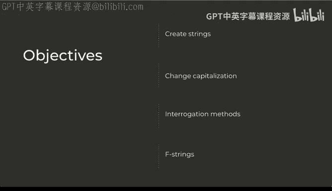
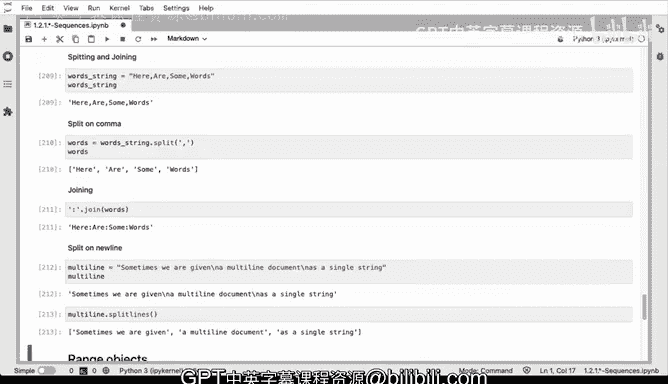

#  019：Python中的字符串 🧵

在本节课中，我们将要学习Python中字符串的基础知识。我们将了解如何创建字符串，如何使用字符串方法来改变大小写、检查内容，以及如何动态地将值插入到字符串中。



---

## 创建字符串

上一节我们介绍了课程概述，本节中我们来看看如何创建字符串。

字符串是表示文本的序列。它由任何类型的Unicode字符组成，并用引号包裹。

字符串可以用单引号或双引号表示。如果单引号和双引号字符串的内容相同，它们被认为是等价的。

```python
'Hello' == "Hello"  # 结果为 True
```

这种特性很有价值，因为它意味着如果你想在字符串内容中包含引号，只需确保使用另一种引号来包裹字符串即可。

```python
# 在字符串中包含双引号
text = 'He said, "Hello!"'
# 在字符串中包含单引号
text2 = "It's a beautiful day."
```

我们还可以使用三引号创建多行字符串。

```python
multi_line_string = """This is
a multi-line
string."""
print(multi_line_string)
```

---

## 特殊字符与原始字符串

字符串中的某些特殊字符会被特殊解释。例如，`\t` 被解释为制表符，`\n` 被解释为换行符。

```python
print("Hello\tWorld")  # 输出: Hello    World
print("Hello\nWorld")  # 输出: Hello
                       #        World
```

当你处理像Windows路径这样的字符串，希望反斜杠保持原样时，这可能会带来麻烦。

```python
path = "C:\Users\Name\Documents"
print(path)  # 输出可能混乱，因为 \U, \N 等被解释
```

为了避免这种情况，可以在字符串前加上 `r`，使其成为原始字符串。在原始字符串中，所有字符都被纯粹地解释为它们本身。

```python
raw_path = r"C:\Users\Name\Documents"
print(raw_path)  # 输出: C:\Users\Name\Documents
```

---

## 字符串方法：改变大小写

以下是用于改变字符串大小写的常用方法。

*   `capitalize()`: 将字符串的第一个字母大写。
*   `lower()`: 将整个字符串转换为小写。
*   `upper()`: 将整个字符串转换为大写。

```python
my_string = "Hello World"
print(my_string.capitalize())  # 输出: Hello world
print(my_string.lower())       # 输出: hello world
print(my_string.upper())       # 输出: HELLO WORLD
```

---

## 字符串检查方法

上一节我们介绍了如何改变字符串，本节中我们来看看如何检查字符串的内容。

字符串也支持序列检查方法。`index()` 方法返回子字符串的起始索引（从0开始）。

```python
my_string = "Hello World"
print(my_string.index("World"))  # 输出: 6
```

需要注意的是，如果搜索的项不存在于字符串中，`index()` 方法会抛出错误。`find()` 方法是 `index()` 的替代方案，如果未找到项，它会返回 `-1`，而不会抛出错误。

```python
print(my_string.find("Universe"))  # 输出: -1
```

字符串还有 `startswith()` 和 `endswith()` 方法，用于检查前缀和后缀。

```python
print(my_string.startswith("Hello"))  # 输出: True
print(my_string.endswith("World"))    # 输出: True
```

我们还可以更专业地检查字符串内容。

*   `isalpha()`: 检查字符串是否只包含字母字符。
*   `isalnum()`: 检查字符串是否只包含字母和数字字符。
*   `islower()` / `isupper()`: 检查字符串是否全为小写或大写。
*   `isnumeric()`: 检查字符串是否只包含数字字符。这在尝试将字符串转换为数字之前非常有用。

```python
print("Hello".isalpha())      # 输出: True
print("Hello123".isalnum())   # 输出: True
print("123".isnumeric())      # 输出: True
```

---

## 格式化字符串（F-strings）

格式化字符串是Python 3.6引入的一种特殊字符串。它以大写或小写的 `f` 为前缀，允许你在运行时插入值。

```python
name = "Alice"
age = 30
greeting = f"My name is {name} and I am {age} years old."
print(greeting)  # 输出: My name is Alice and I am 30 years old.
```

花括号 `{}` 被称为替换字段。替换字段的内容可以是任何表达式，该表达式的结果将被插入到字符串中。

```python
# 使用数学表达式
result = f"Five times six is {5 * 6}."
print(result)  # 输出: Five times six is 30.

# 使用序列索引
players = ["Alice", "Bob", "Charlie"]
team = f"Team: {players[0]}, {players[1]}, and {players[2]}."
print(team)  # 输出: Team: Alice, Bob, and Charlie.
```

---

## 格式化选项

替换字段允许你对插入的项进行格式化。格式化通常在冒号 `:` 之后指定。

```python
number = 42
# 填充空格，使其总宽度为5个字符
print(f"The number is: {number:5d}")  # 输出: The number is:    42

# 使用变量指定填充宽度
width = 10
print(f"The number is: {number:{width}d}")  # 输出: The number is:         42

# 为数字添加千位分隔符
big_number = 1234567
print(f"Big number: {big_number:,}")  # 输出: Big number: 1,234,567
```

---

## 处理空白字符

字符串有许多内置方法用于处理空白字符。这在处理用户输入（如网页表单）时很常见。

```python
user_input = "   Hello World   "
print(user_input.strip())    # 输出: "Hello World" (移除首尾空白)
print(user_input.lstrip())   # 输出: "Hello World   " (移除左侧空白)
print(user_input.rstrip())   # 输出: "   Hello World" (移除右侧空白)
```

---

## 拆分与连接字符串

另一个常见的字符串操作是拆分和连接。

`split()` 方法根据指定的分隔符将字符串拆分为子字符串列表。

```python
csv_string = "apple,banana,orange"
fruit_list = csv_string.split(",")
print(fruit_list)  # 输出: ['apple', 'banana', 'orange']
```

`join()` 方法使用一个字符串作为连接符，将一个字符串序列连接成一个字符串。

```python
new_string = " and ".join(fruit_list)
print(new_string)  # 输出: apple and banana and orange
```

对于按换行符拆分这种常见情况，有一个专门的方法 `splitlines()`。

```python
multi_line = "Line 1\nLine 2\nLine 3"
lines = multi_line.splitlines()
print(lines)  # 输出: ['Line 1', 'Line 2', 'Line 3']
```

---

## 总结



本节课中我们一起学习了Python字符串的核心操作。你学会了如何使用单引号和双引号创建字符串，如何使用字符串方法来改变大小写和检查内容，以及如何使用F-strings在运行时动态插入值。我们还介绍了如何处理空白字符、拆分和连接字符串。现在你应该尝试练习使用字符串，以获得更好的理解。