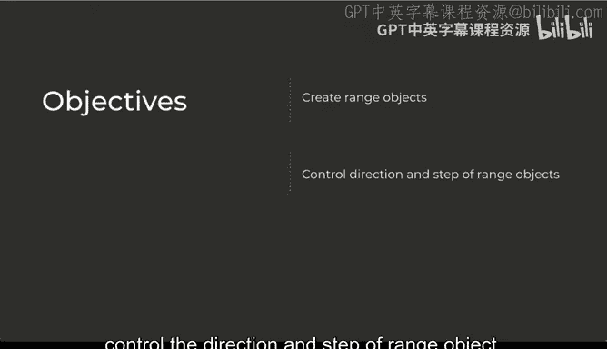
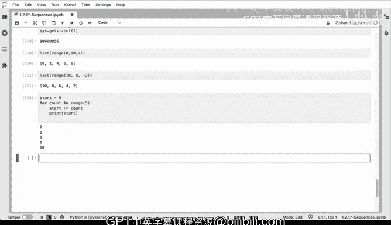

#  020：创建Python的range对象 📊

在本节课中，我们将学习如何创建Python中的`range`对象，并了解如何控制其方向和步长。

---



## 概述

`range`对象用于表示一个整数序列。它非常高效，是Python中处理循环和序列计数的核心工具之一。本节我们将学习其创建方法、参数含义以及内存效率优势。

---

## 什么是range对象？

`range`对象代表一个整数范围。例如，一个从0到10的`range`对象。

默认情况下，创建一个`range`对象只需要一个参数，即计数停止的值。它会从0开始计数。

我们也可以指定起始点。

如果将`range`对象转换为列表，它会从第一个数开始计数，直到最后一个数。

---

## range对象的内存效率

我们可以使用`sys`模块来获取Python中对象的大小。

以下代码创建了一个包含数字0、1、2的`range`对象`r`，并获取其大小：
```python
import sys
r = range(3)
size = sys.getsizeof(r)
```

现在，我们创建一个范围大得多的第二个`range`对象，并注意其大小与第一个相同。

这是`range`对象的重要特性之一：它可以表示一个非常长的数字序列，而不会占用大量内存。

为了对比，我们将相同的`range`转换为列表，然后获取列表的大小：
```python
list_from_range = list(r)
list_size = sys.getsizeof(list_from_range)
```
可以看到，列表占用的内存要大得多。这正是引入`range`对象的原因之一。

---

## 控制步长与方向

我们可以为`range`对象添加第三个参数，即**步长**。这类似于切片操作中的步长，它决定了计数的间隔。

例如，以下代码从0开始，以步长2计数，得到小于10的偶数：
```python
even_numbers = range(0, 10, 2)
# 转换为列表查看: [0, 2, 4, 6, 8]
```

我们也可以使用负步长来倒序计数，就像在切片操作中一样。

---

## range对象的常见用途：循环

`range`对象最常见的用途是在**循环**中，用于控制循环执行的次数。

以下是一个示例，我们有一个变量`start`，并遍历范围0到4（结束于5）。我们使用范围中的每个值作为计数，将其与`start`相加并打印结果：
```python
start = 5
for count in range(5):  # 生成 0, 1, 2, 3, 4
    result = start + count
    print(result)
```

---

## 总结



本节课我们一起学习了如何创建和使用Python的`range`对象。我们了解了其表示整数序列的基本功能，通过`sys.getsizeof()`验证了其高效的内存特性，并掌握了如何使用起始值、结束值和步长参数来控制序列。最后，我们看到了它在`for`循环中的典型应用。现在，你应该尝试练习使用`range`对象来巩固理解。