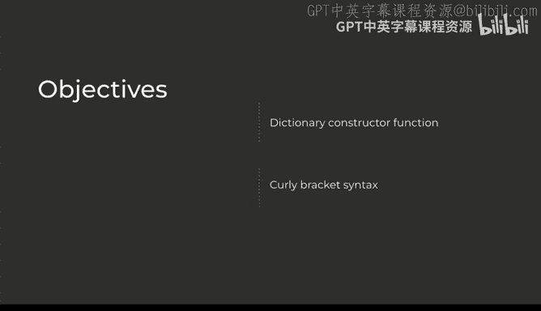
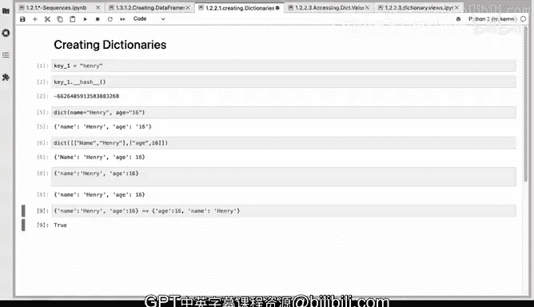

#  021：创建Python字典 📚

在本节课中，我们将要学习如何创建Python字典。我们将介绍两种主要方法：使用`dict()`构造函数和使用花括号`{}`语法。同时，我们会探讨字典的核心概念，包括键值对映射和哈希函数。

---

## 什么是字典？ 🔑

上一节我们介绍了课程概述，本节中我们来看看字典的基本定义。

字典是一种数据结构，它将键映射到值。字典使用一种高效的机制，通过这些键来查找数据，这种机制依赖于所谓的哈希函数。

Python中所有不可变的数据类型都有哈希函数。例如，我们创建一个值为字符串的变量，可以调用它的哈希函数，该函数会返回一个可预测的值，这个值被用于字典查找。

我们之前已经讨论过可变与不可变数据类型的概念。这意味着，可变的数据类型（如Python列表）不能用作字典键，也没有哈希函数；而不可变的类型（如元组或字符串）可以用作键。

---

## 使用 `dict()` 构造函数创建字典 🛠️

了解了字典的基本概念后，本节我们来看看第一种创建字典的方法：使用`dict()`构造函数。

如果我们不带参数调用它，它会创建一个空字典。字典用花括号表示。

我们也可以给它提供参数，这些参数将是键值对。现在我们可以看到这个字典有键`name`和`age`，以及值`Henry`和`16`。

以下是使用`dict()`构造函数的具体方式：

*   不带参数创建空字典：`my_dict = dict()`
*   带键值对参数创建字典：`my_dict = dict(name=‘Henry‘, age=16)`

我们还可以使用`dict()`构造函数，将一个列表的列表作为参数传入。在这种情况下，每个子列表应该包含一个键和一个值。我们可以看到它生成了相同的字典，只是我将`16`的数据类型从字符串改为了整数。

以下是使用列表的列表创建字典的示例：

*   `my_dict = dict([[‘name‘, ‘Henry‘], [‘age‘, 16]])`

---

## 使用花括号 `{}` 语法创建字典 ✏️

上一节我们介绍了使用构造函数创建字典，本节中我们来看看另一种更常用的方法：直接使用花括号`{}`语法。

在这种情况下，我们按照字典的表示方式直接书写，它会返回一个字典对象。

字典中的键值对是按照它们输入字典的顺序创建的，但这个顺序并不用于判断两个字典是否相等。例如，如果我们创建一个字典，其键值对顺序不同，但键和值相同，然后使用`==`操作符进行测试，我们可以看到这两个字典被认为是相等的，尽管它们的顺序不同。

以下是使用花括号语法创建字典的示例：

*   直接创建字典：`my_dict = {‘name‘: ‘Henry‘, ‘age‘: 16}`
*   顺序不同的等值字典：`my_dict2 = {‘age‘: 16, ‘name‘: ‘Henry‘}`， 此时 `my_dict == my_dict2` 的结果为 `True`。

---

## 总结 📝

本节课中我们一起学习了如何创建Python字典。我们掌握了两种主要方法：使用`dict()`构造函数和使用花括号`{}`语法。我们理解了字典是键值对的映射，其高效的查找依赖于键的哈希函数，因此键必须是不可变类型。我们还了解到字典的键值对顺序不影响字典的相等性比较。

现在你应该尝试自己创建一些字典了。