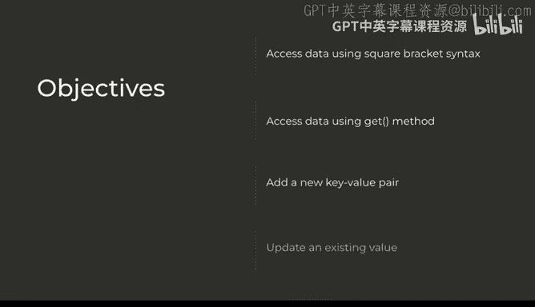
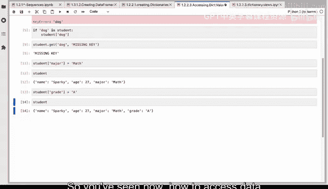

#  022：访问Python字典数据 📚

在本节课中，我们将要学习如何从Python字典中访问和操作数据。具体来说，我们将掌握两种访问字典值的方法，以及如何向字典中添加新的键值对或更新已有的键值对。

---

## 访问字典数据的两种方法 🔑

有两种主要方法可以从字典中访问值。

以下是访问字典值的两种方式：

1.  **方括号语法**：通过将键名放在方括号内来直接访问值。
2.  **`get`方法**：使用字典的`.get()`方法来安全地访问值，即使键不存在也不会引发错误。



---

## 使用方括号语法访问数据

上一节我们介绍了访问字典的两种基本方法，本节中我们来看看第一种方法：方括号语法。这种语法与我们之前通过索引访问序列（如列表）中的数据非常相似。

让我们看一个例子。这里我们有一个名为`student`的字典，其键为`name`、`age`和`major`。

```python
student = {'name': 'Alice', 'age': 21, 'major': 'Computer Science'}
```

如果我们想获取`age`键对应的值，我们将键名（即`age`）放在字典名称后面的方括号中。

```python
age = student['age']
print(age)  # 输出：21
```

现在，如果我们尝试访问一个字典中不存在的键，Python会抛出一个`KeyError`错误。

```python
# 这行代码会引发 KeyError
# grade = student['grade']
```

我们可以通过使用`if`语句来避免这种情况，在尝试访问之前先检查键是否存在于字典中。

```python
if 'grade' in student:
    grade_value = student['grade']
else:
    print("键 'grade' 不存在于字典中。")
```

这样，因为键不在字典中，所以永远不会执行方括号语法的访问。

---

## 使用 `get` 方法安全访问数据

上一节我们看到了使用方括号语法可能引发错误的情况。本节中，我们来看看更安全的替代方法：`get`方法。这种情况非常常见，因此Python提供了一个特殊的方法——`get`方法。

使用`get`方法时，如果我们提供一个错误的键，它将返回`None`（或者我们指定的默认值），而不是引发错误。

```python
# 键存在，返回对应值
major = student.get('major')
print(major)  # 输出：Computer Science

# 键不存在，返回 None
grade = student.get('grade')
print(grade)  # 输出：None
```

`get`方法还允许我们提供一个默认值作为第二个参数，当键不正确时返回这个默认值。

```python
# 提供默认值
grade = student.get('grade', 'missing key')
print(grade)  # 输出：missing key
```

在这里，我提供了字符串`‘missing key’`作为回退值。如果键缺失，你可以在这里放置任何类型的其他值。

---

## 更新字典中的现有数据

上一节我们学习了如何安全地获取数据。本节中，我们来看看如何修改字典中已有的数据。如果我们想更新一个现有键对应的值，我们同样使用方括号语法。

假设我们想更改这位学生的专业。

```python
# 更新 ‘major’ 键的值
student['major'] = 'Data Science'
print(student)  # 输出：{'name': 'Alice', 'age': 21, 'major': 'Data Science'}
```

我们通过方括号语法指定键，然后为其分配一个新值。现在查看字典，可以看到`major`键对应的值确实已被更新。

---

## 向字典添加新的键值对

如果我们想向字典中添加一个新的键值对，也可以使用方括号索引。

在这种情况下，如果我们使用一个当前字典中不存在的键，然后为其赋值，我们可以看到这个新的键值对已被添加到字典中。

```python
# 添加新的键值对
student['grade'] = 'A'
print(student)  # 输出：{'name': 'Alice', 'age': 21, 'major': 'Data Science', 'grade': 'A'}
```

---



## 总结 📝


本节课中我们一起学习了如何操作Python字典。我们掌握了两种访问字典值的方法：直接的**方括号语法**和更安全的**`get`方法**。我们还学习了如何使用方括号语法来**更新**现有键的值，以及如何**添加**全新的键值对到字典中。你应该自己尝试使用这些方法，以加深理解。