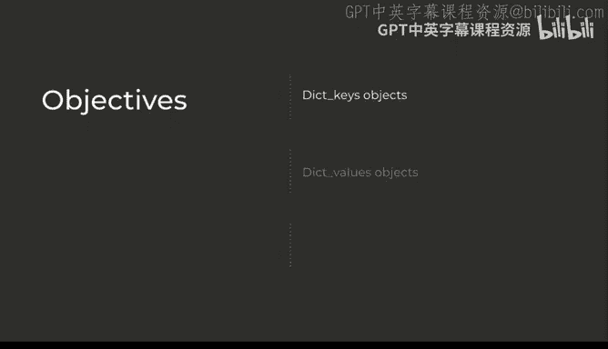
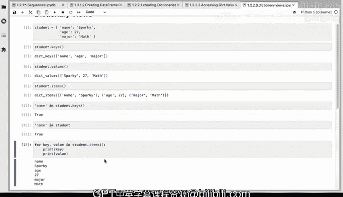

#  023：Python字典视图 📚

在本节课中，我们将要学习Python字典的视图对象。具体来说，我们将了解`dict_keys`、`dict_values`和`dict_items`这三种特殊的视图对象，以及如何使用它们来高效地访问和操作字典中的数据。

---

## 什么是字典视图？ 👀



上一节我们介绍了字典的基本操作，本节中我们来看看字典的视图对象。字典提供了三个方法，它们会返回特殊的“字典视图”对象。这些方法分别是`keys()`、`values()`和`items()`。每个方法返回的对象都提供了观察字典内容的不同视角。

例如，我们有一个名为`student`的字典：

```python
student = {'name': 'Alice', 'age': 25, 'course': 'Data Engineering'}
```

我们可以使用`keys()`方法来返回一个`dict_keys`对象，它包含了字典中所有键的信息。

```python
keys_view = student.keys()
```

`values()`方法返回一个`dict_values`对象，它代表了字典中的所有值。

```python
values_view = student.values()
```

`items()`方法返回一个`dict_items`对象，它代表了字典中所有的键值对。

```python
items_view = student.items()
```

---

## 字典视图的常见操作 ⚙️

了解了视图对象是什么之后，我们来看看可以对它们进行哪些操作。一个常见的操作是测试成员关系，即检查一个键是否存在于字典的键视图中。

实际上，对于`keys()`方法，即使不显式调用它，我们也可以直接测试一个键是否在字典中。以下两种方式是等效的：

```python
# 方式一：使用 in 关键字直接测试字典
'name' in student
# 方式二：通过 keys() 视图测试
'name' in student.keys()
```

这两种方法都测试了键`'name'`是否存在于字典`student`中。

---

## 在循环中使用字典视图 🔄

使用这些字典视图最常见的方式是在循环中。例如，我们可以遍历字典的所有键并打印出来：

以下是遍历字典键的示例：

```python
for key in student.keys():
    print(key)
```

或者，我们也可以遍历字典的`items()`，即所有的键值对。通常，在遍历`items()`时，我们会将每个键值对解包，以便在循环的代码块中分别使用键和值。

以下是遍历字典键值对并解包的示例：

```python
for key, value in student.items():
    print(f"Key: {key}, Value: {value}")
```

从上面的代码可以看到，它打印出了字典中每一对键和值。

---

## 总结 📝



本节课中我们一起学习了Python字典的视图对象。我们了解到，通过`keys()`、`values()`和`items()`方法可以获得字典的不同视图。我们学习了如何用它们来测试成员关系，以及如何在`for`循环中高效地遍历字典的键、值或键值对。你应该尝试在循环中使用这些特殊的方法来更好地处理字典数据。