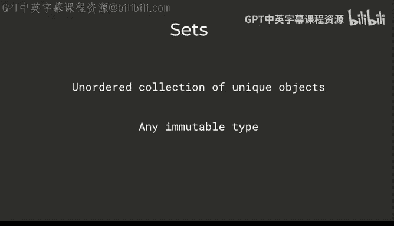
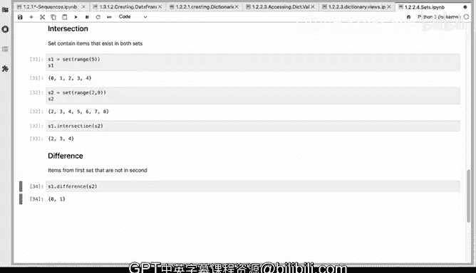

#  024：Python集合与集合运算 🧮

在本节课中，我们将学习Python中的集合。集合是一种无序且元素唯一的数据结构。我们将学习如何创建集合、向集合添加元素、从集合中移除元素，以及如何使用集合特有的运算操作。

## 概述

集合是数学中常见的概念，在Python中，集合是一个无序的、元素唯一的容器。它可以包含任何不可变（可哈希）的数据类型，但不能包含可变对象。本节将详细介绍集合的创建、基本操作和集合运算。

## 创建集合



我们可以使用 `set()` 构造函数来创建一个集合。该函数可以接受一个序列作为参数，并返回一个包含该序列中所有唯一元素的集合。

```python
# 创建一个空集合
empty_set = set()
print(empty_set)  # 输出: set()

# 使用序列创建集合
my_list = [1, 2, 2, 3, 4]
my_set = set(my_list)
print(my_set)  # 输出: {1, 2, 3, 4}
```

集合的表示形式是用逗号分隔的元素，并用花括号 `{}` 括起来。它与字典的区别在于没有键值对，只有单独的元素。

我们也可以直接使用花括号语法来创建集合。

```python
# 直接创建集合
direct_set = {1, 2, 3, 3, 4}
print(direct_set)  # 输出: {1, 2, 3, 4}
```

即使我们在创建时添加了重复的元素，集合也只会保留唯一的元素。

## 向集合添加元素

上一节我们介绍了如何创建集合，本节中我们来看看如何向集合中添加元素。由于集合是无序的，我们不能像列表那样通过索引来添加元素。相反，我们使用 `add()` 方法。

```python
# 创建一个集合
s = {'a', 'b', 'c'}
print(s)  # 输出: {'a', 'b', 'c'}

# 向集合添加元素
s.add('d')
print(s)  # 输出: {'a', 'b', 'c', 'd'}
```

使用 `add()` 方法可以将一个新元素添加到集合中。如果该元素已存在，集合不会发生任何变化，因为集合的元素是唯一的。

## 从集合中移除元素

我们可以从集合中移除元素。有两种主要方法：`pop()` 和 `remove()`。

`pop()` 方法会随机移除并返回集合中的一个元素。由于集合是无序的，你不能依赖它移除“最后一个”元素。

```python
# 使用 pop() 方法
s = {'a', 'b', 'c', 'd'}
removed_item = s.pop()
print(f"被移除的元素是: {removed_item}")
print(f"移除后的集合: {s}")
```

`remove()` 方法用于移除集合中指定的元素。如果元素不存在，它会引发一个错误。

```python
# 使用 remove() 方法
s = {'a', 'b', 'c', 'd'}
s.remove('b')
print(s)  # 输出: {'a', 'c', 'd'}
```

## 集合运算

集合支持多种数学集合运算，例如判断交集、并集、差集等。以下是几个核心的集合运算方法。

### 判断是否不相交

如果两个集合没有任何共同的元素，则称它们为“不相交”集合。我们可以使用 `isdisjoint()` 方法来判断。

```python
set1 = {0, 1, 2}
set2 = set('Herman')  # 从字符串创建集合，得到唯一字符
print(set2)  # 输出: {'H', 'e', 'r', 'm', 'a', 'n'}

# 判断是否不相交
result = set1.isdisjoint(set2)
print(result)  # 输出: True
```

如果两个集合有共同的元素，`isdisjoint()` 将返回 `False`。

```python
set1 = {0, 1, 2}
set2 = {1, 3}
result = set1.isdisjoint(set2)
print(result)  # 输出: False
```

### 子集与超集

一个集合是另一个集合的**子集**，如果它的所有元素都包含在另一个集合中。使用 `issubset()` 方法进行判断。

```python
set_a = {2, 3, 4, 5}
set_b = {0, 1, 2, 3, 4, 5, 6, 7, 8, 9}

# 判断 set_a 是否是 set_b 的子集
result = set_a.issubset(set_b)
print(result)  # 输出: True
```

**超集**是子集的反向关系。如果集合A包含集合B的所有元素，那么A就是B的超集。使用 `issuperset()` 方法判断。

```python
# 判断 set_b 是否是 set_a 的超集
result = set_b.issuperset(set_a)
print(result)  # 输出: True
```

### 并集、交集与差集

以下是三个最常用的集合运算：

*   **并集**：返回包含两个集合所有元素的新集合。使用 `union()` 方法或 `|` 运算符。
    ```python
    set1 = {'a', 'b', 'c'}
    set2 = {1, 2, 3}
    union_set = set1.union(set2)
    print(union_set)  # 输出: {1, 2, 3, 'a', 'b', 'c'}
    ```

*   **交集**：返回两个集合中共有元素的新集合。使用 `intersection()` 方法或 `&` 运算符。
    ```python
    set1 = {0, 1, 2, 3, 4}
    set2 = {2, 3, 4, 5, 6, 7, 8}
    intersect_set = set1.intersection(set2)
    print(intersect_set)  # 输出: {2, 3, 4}
    ```

*   **差集**：返回存在于第一个集合但不在第二个集合中的元素的新集合。使用 `difference()` 方法或 `-` 运算符。
    ```python
    set1 = {0, 1, 2, 3, 4}
    set2 = {2, 3, 4, 5, 6, 7, 8}
    diff_set = set1.difference(set2)
    print(diff_set)  # 输出: {0, 1}
    ```

## 总结



本节课中我们一起学习了Python集合。我们了解了集合是一个无序且元素唯一的容器。我们学习了如何使用 `set()` 构造函数或花括号 `{}` 来创建集合。掌握了使用 `add()` 方法添加元素，以及使用 `pop()` 和 `remove()` 方法移除元素。最后，我们探讨了集合的核心运算，包括判断不相交、子集与超集关系，以及计算并集、交集和差集。现在你应该尝试自己使用集合来解决一些问题。