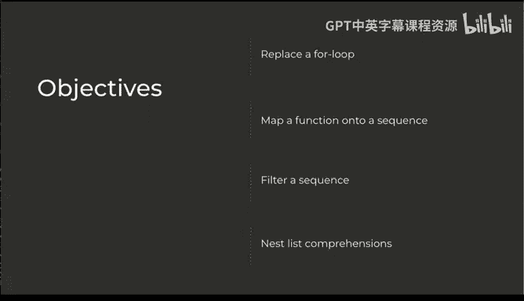
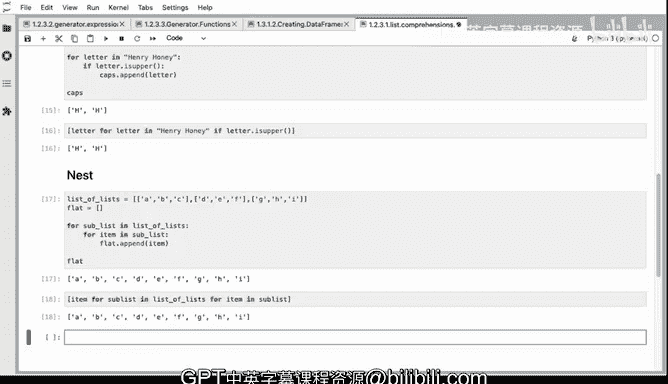

#  025：Python列表推导式 📝

在本节课中，我们将要学习Python中的列表推导式。这是一种简洁、高效的语法结构，用于创建列表，可以替代某些类型的`for`循环。我们将学习如何使用列表推导式来映射函数、过滤序列元素，甚至创建嵌套的列表推导式。



---

## 列表推导式基础

上一节我们介绍了课程概述，本节中我们来看看列表推导式的基本概念。列表推导式是一种语法结构，用于执行与一部分`for`循环相同的功能。

具体来说，列表推导式适用于那些遍历一个序列，对序列中的每个元素执行某些操作，然后将结果作为新列表的一部分返回的循环。

以下是一个标准的`for`循环示例：
```python
output = []
for i in range(10):
    output.append(i**2)
print(output)  # 输出: [0, 1, 4, 9, 16, 25, 36, 49, 64, 81]
```
这个循环遍历一个`range`对象（0到9），对每个数字进行平方运算，并将结果添加到名为`output`的列表中。

现在，我们来看看如何用列表推导式替换这个`for`循环。

列表推导式用方括号`[]`括起来。其结构如下：
1.  首先放入要添加到输出列表中的元素表达式。
2.  然后模拟`for`循环第一行的语法，即迭代部分。

因此，上面的`for`循环可以改写为：
```python
output = [i**2 for i in range(10)]
print(output)  # 输出: [0, 1, 4, 9, 16, 25, 36, 49, 64, 81]
```
我们可以将列表推导式的结果赋值给一个变量，就像处理`for`循环的输出一样。可以看到，我们得到了相同的列表。因此，列表推导式是一种更简洁的语法方式，用于表示返回列表的`for`循环。

---

## 使用列表推导式映射函数

上一节我们学习了基础列表推导式，本节中我们来看看如何使用它来映射函数。映射函数是指将一个函数应用到序列的每个元素上。

以下是一个使用`for`循环映射函数的例子：
```python
import random
scores = []
for i in range(5):
    scores.append(random.randint(1, 10))
print(scores)  # 输出示例: [3, 7, 1, 9, 4]
```
在这个例子中，序列是`range`对象，函数是`random`模块中的`randint`函数。循环遍历序列，对每个元素调用函数，并将结果添加到列表中。

以下是使用列表推导式实现相同功能的代码：
```python
import random
scores = [random.randint(1, 10) for i in range(5)]
print(scores)  # 输出示例: [8, 2, 5, 10, 6]
```
我们使用方括号定义列表推导式。首先放入我们希望添加到新列表中的函数调用结果，然后定义遍历序列的变量。虽然由于随机数生成，结果可能不同，但逻辑是相同的。列表推导式将原本需要多行代码完成的任务压缩到了一行。

---

## 使用列表推导式过滤元素

除了映射，列表推导式另一个强大的功能是过滤序列中的元素。这意味着我们可以根据条件选择性地将元素添加到新列表中。

以下是一个使用`for`循环和条件语句进行过滤的例子：
```python
string = "HeLlO WoRlD"
output = []
for letter in string:
    if letter.isupper():
        output.append(letter)
print(output)  # 输出: ['H', 'L', 'O', 'W', 'R', 'D']
```
这个循环遍历字符串中的每个字母，如果字母是大写的（`letter.isupper()`返回`True`），则将其添加到输出列表中。

现在，我们使用列表推导式来替换它。列表推导式同样允许我们添加条件语句。

以下是实现相同过滤功能的列表推导式：
```python
string = "HeLlO WoRlD"
output = [letter for letter in string if letter.isupper()]
print(output)  # 输出: ['H', 'L', 'O', 'W', 'R', 'D']
```
我们再次使用方括号。首先放入要添加到输出中的变量（`letter`），然后是序列（`string`）。新的部分是在列表推导式的末尾添加了一个`if`条件。它的作用是：只将序列中满足条件（即是大写字母）的`letter`添加到输出列表中。可以看到，结果与上面的`for`循环一致。

---

## 嵌套列表推导式

最后，我们来看看更高级的用法：嵌套列表推导式。这常用于处理嵌套结构的数据，例如“展平”一个列表的列表（即将所有子列表的元素合并到一个列表中）。

假设我们有以下嵌套列表：
```python
nested_list = [[1, 2, 3], [4, 5, 6], [7, 8, 9]]
```
我们希望将其展平为`[1, 2, 3, 4, 5, 6, 7, 8, 9]`。

使用嵌套的`for`循环可以这样做：
```python
flattened = []
for sublist in nested_list:
    for item in sublist:
        flattened.append(item)
print(flattened)  # 输出: [1, 2, 3, 4, 5, 6, 7, 8, 9]
```
我们遍历外层列表得到每个子列表，然后遍历每个子列表中的项目，并将其添加到一个输出列表中。

我们可以通过嵌套两个列表推导式来实现相同的效果：
```python
flattened = [item for sublist in nested_list for item in sublist]
print(flattened)  # 输出: [1, 2, 3, 4, 5, 6, 7, 8, 9]
```
外层推导式仍然用方括号括起来。其结构解读如下：
*   `item`：我们希望返回到输出列表中的最终元素。
*   `for sublist in nested_list`：外层循环，遍历`nested_list`中的每个`sublist`。
*   `for item in sublist`：内层循环，对于每个`sublist`，遍历其中的每个`item`。

这样就得到了一个展平后的列表。

> **最佳实践提示**：虽然列表推导式功能强大，但通常最佳实践是将其用于简单的循环，这种单行格式更易于阅读。应避免创建过于复杂的列表推导式，以免你或他人难以理解和解析。保持列表推导式的简洁性，但请大胆尝试使用它们。

---

## 总结 🎯

本节课中我们一起学习了Python列表推导式。我们了解到列表推导式是一种用于创建列表的简洁语法，可以替代特定的`for`循环。我们具体学习了：
1.  **基础列表推导式**：用于替代简单的遍历和操作循环。
2.  **映射函数**：使用列表推导式将函数应用到序列的每个元素上。
3.  **过滤元素**：在列表推导式中加入`if`条件，选择性包含元素。
4.  **嵌套列表推导式**：用于处理嵌套数据结构，如展平列表的列表。



记住，列表推导式的核心优势在于使代码更简洁、更易读，但应避免过度复杂化。