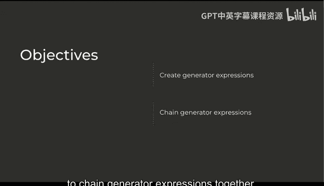
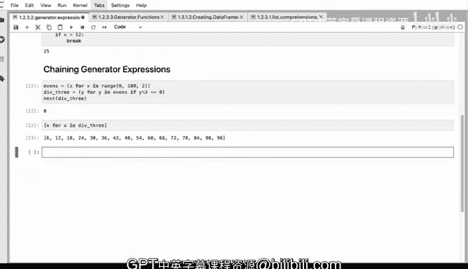

#  026：Python生成器表达式 🧬

在本节课中，我们将要学习如何创建生成器表达式，以及如何将多个生成器表达式链接在一起使用。

---



## 概述

我们已经了解了使用 `range` 对象相比数字列表能显著减少内存占用。生成器表达式是列表推导式的一种内存高效替代方案，其工作原理与 `range` 对象类似，只在需要时才计算值。

## 从列表推导式到生成器表达式

上一节我们介绍了列表推导式，本节中我们来看看如何将其转换为更节省内存的生成器表达式。

首先，这是一个我们之前见过的列表推导式。它遍历一个 `range` 对象，并对每个数字进行平方。我们导入了 `sys` 模块来获取结果对象的大小。

```python
import sys

# 列表推导式
list_comp = [x**2 for x in range(1000000)]
print(sys.getsizeof(list_comp))  # 输出对象占用的内存大小
```

为了将其替换为生成器表达式，我们基本上使用相同的内部逻辑，但将方括号 `[]` 改为圆括号 `()`。

```python
# 生成器表达式
gen_exp = (x**2 for x in range(1000000))
print(sys.getsizeof(gen_exp))  # 输出对象占用的内存大小
```

我们可以看到，生成的结果对象在内存占用上要小得多。这是因为生成器表达式（或称生成器）与 `range` 对象类似，只在被请求时才计算值。

## 访问生成器表达式的值

如果我们查看这个生成器表达式，会发现它只显示为一个对象，看不到其中的任何值。

要访问生成器表达式中的值，我们可以使用 `next()` 函数。

```python
gen = (x**2 for x in range(5))
print(next(gen))  # 输出第一个值：0
print(next(gen))  # 输出第二个值：1
```

通常，我们使用生成器表达式的方式是在循环中。

```python
gen = (x**2 for x in range(1000000))
for value in gen:
    print(value)
    break  # 此处使用break，因为生成器表达式会生成大量值
```

当我们迭代生成器表达式时，其行为类似于迭代一个序列，会依次返回每个后续值。

## 链接生成器表达式

生成器表达式的另一个强大功能是可以将它们链接在一起。

以下是两个生成器表达式链接的例子：

```python
# 第一个生成器：获取0到99之间的所有偶数
evens = (x for x in range(100) if x % 2 == 0)

# 第二个生成器：迭代第一个生成器，筛选出能被3整除的数
filtered = (x for x in evens if x % 3 == 0)

print(next(filtered))  # 输出：0
```

如果我们想查看这个生成器对象会返回的所有值，可以使用列表推导式将其转换为列表。

```python
result_list = [x for x in filtered]
print(result_list)
```

## 总结



本节课中我们一起学习了生成器表达式。生成器表达式在语法上与列表推导式非常相似，但具有更小的内存占用，因为它们采用惰性求值的方式。你应该尝试创建一些自己的生成器表达式，并体会其在处理大数据集时的优势。