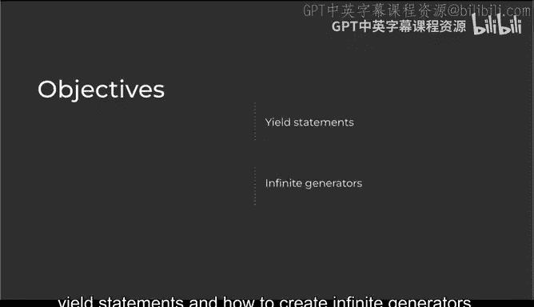
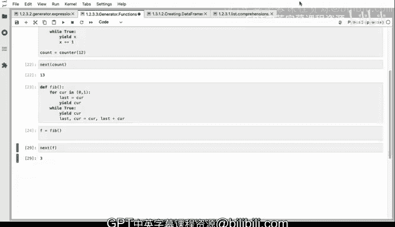

#  027：Python生成器函数 🧬

在本节课中，我们将要学习如何使用 `yield` 语句，以及如何创建无限生成器。生成器是一种特殊的迭代器，它允许你按需生成值，而不是一次性在内存中创建所有值，这对于处理大数据集或无限序列非常有用。



---

上一节我们介绍了生成器的基本概念，本节中我们来看看如何编写更复杂的生成器函数。

首先，让我们看一个简单的函数示例。这个函数名为 `return_number`，目前它包含一个 `for` 循环。但在循环内部，它有一个 `return` 语句，这意味着它会在第一次循环迭代时就停止并返回值。

```python
def return_number():
    for i in range(3):
        return i
```

如果我们运行这个函数，它确实会在第一次遇到 `return` 语句时停止。

现在，如果我们把这个 `return` 语句改为 `yield` 语句，情况会发生变化。

```python
def yield_number():
    for i in range(3):
        yield i
```

此时，`yield_number` 不再直接返回值，而是返回一个生成器对象。我们可以像之前操作生成器一样，对这个对象调用 `next()` 函数。

```python
gen = yield_number()
print(next(gen))  # 输出: 0
print(next(gen))  # 输出: 1
print(next(gen))  # 输出: 2
```

有趣的是，每次我们从生成器对象中获取一个值时，生成器都会记住我们在 `for` 循环中的位置，即它保存了函数的执行状态。这就是 `yield` 语句的作用：它返回一个值，但不会重置函数的状态。

利用这个特性，我们可以创建比生成器表达式更复杂的生成器。

---

接下来，让我们创建一个可以计数的生成器。

以下是该生成器的代码：它初始化一个值为 0，并包含一个永不退出的无限 `for` 循环。在每次迭代中，它 `yield` 当前数字，然后将其递增。

```python
def count_up():
    x = 0
    while True:
        yield x
        x += 1
```

让我们尝试对它调用 `next()`。

```python
counter = count_up()
print(next(counter))  # 输出: 0
print(next(counter))  # 输出: 1
# 可以无限继续下去
```

由于这个循环永远不会退出，这被称为**无限生成器**。我们可以从这个生成器中获得无限的计数序列，除了语言本身的数字大小限制外，它永远不会停止。

---

为了让生成器更有趣，我们还可以在初始化时给它传递参数。

以下是一个改进的计数器生成器：它接受一个起始值作为参数，而不是每次都从 0 开始。

```python
def count_up_from(start):
    x = start
    while True:
        yield x
        x += 1
```

现在，当我们从这个生成器开始计数时，可以从指定的数字开始。

```python
counter = count_up_from(12)
print(next(counter))  # 输出: 12
print(next(counter))  # 输出: 13
```

---

让我们再做一个生成器示例。这次，创建一个生成斐波那契数列的生成器。

斐波那契数列从 0 和 1 开始，之后的每个数字都是前两个数字之和（即 0, 1, 1, 2, 3, 5, 8...）。

以下是该生成器的实现：它首先处理前两个数字（0 和 1），然后进入一个无限循环，不断计算并生成下一个斐波那契数。

```python
def fibonacci():
    last, current = 0, 1
    yield last
    yield current
    while True:
        last, current = current, last + current
        yield current
```

让我们测试一下：

```python
fib = fibonacci()
print(next(fib))  # 输出: 0
print(next(fib))  # 输出: 1
print(next(fib))  # 输出: 1
print(next(fib))  # 输出: 2
print(next(fib))  # 输出: 3
```

通过这种方式，你可以创建相当复杂的无限生成器。与列表推导式不同，它们没有固定的截止点，并且可以在保持极小内存占用的同时，实现非常强大的功能。

---

本节课中我们一起学习了如何使用 `yield` 语句来编写生成器函数，包括创建简单的生成器、无限计数器以及生成斐波那契数列的复杂生成器。生成器是处理流式数据或大型序列的强大工具，因为它们支持惰性求值，可以高效地管理内存。



现在，你应该尝试使用 `yield` 语句来编写自己的生成器表达式了。