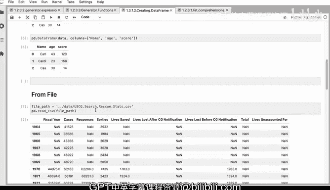

#  029：创建Pandas数据框 📊


在本节课中，我们将要学习如何创建Pandas数据框。数据框是Python数据科学生态系统中最重要的数据结构之一，它以二维表格的形式存储数据。我们将探讨四种创建数据框的方法：创建空数据框、从字典创建、从列表的列表创建，以及从文件数据创建。

## 什么是Pandas数据框？ 🤔

上一节我们介绍了本课的学习目标，本节中我们来看看Pandas数据框的基本概念。

Pandas数据框是Python数据科学生态系统中使用最广泛的数据结构之一。它们以二维表格结构保存数据。该结构由列和行组成，两者都可以被标记。Pandas数据框中的数据可以是混合类型，但每一列都定义为单一类型。数据可以通过列、行或两者组合来访问。你可以将Pandas数据框视为用代码编写的电子表格。

## 导入Pandas库 📦

在开始创建数据框之前，我们需要导入Pandas库。按照惯例，我们通常使用`pd`作为Pandas的别名。

```python
import pandas as pd
```

## 从字典创建数据框 📖

现在，让我们看看如何从字典创建Pandas数据框。字典的键将成为数据框的列名。

以下是创建数据框的步骤：


1.  定义一个字典，其中键是列名，值是列数据。
2.  使用`pd.DataFrame()`构造函数，并将字典作为参数传入。

```python
# 定义一个字典
data = {
    'Name': ['Alice', 'Bob', 'Charlie'],
    'Age': [25, 30, 35],
    'City': ['New York', 'Los Angeles', 'Chicago']
}

# 从字典创建数据框
df_from_dict = pd.DataFrame(data)
print(df_from_dict)
```

执行上述代码将输出一个类似表格的结构，这就是Pandas数据框在Jupyter Notebook中的表示形式。

## 从列表的列表创建数据框 📋

接下来，我们学习如何从列表的列表创建数据框。在这种方法中，每个子列表代表数据框中的一行数据。

以下是需要注意的要点：

*   每个子列表对应数据框中的一行。
*   如果没有指定列名，列将只有索引编号。

```python
# 定义一个列表的列表
data = [
    ['Alice', 25, 'New York'],
    ['Bob', 30, 'Los Angeles'],
    ['Charlie', 35, 'Chicago']
]

# 从列表的列表创建数据框（无列名）
df_from_list = pd.DataFrame(data)
print(df_from_list)

# 从列表的列表创建数据框（指定列名）
df_from_list_with_columns = pd.DataFrame(data, columns=['Name', 'Age', 'City'])
print(df_from_list_with_columns)
```

## 从文件数据创建数据框 📁

从列表和字典创建数据框是基础方法，但最常见的方式是从文件加载数据。这通常是你从其他地方获取或数据管道传递过来的文件。

Pandas提供了专门的函数来读取不同格式的数据。以下是读取CSV文件的示例：

```python
# 假设有一个名为‘data.csv’的文件
file_path = 'data.csv'

# 使用read_csv方法从文件创建数据框
df_from_file = pd.read_csv(file_path)
print(df_from_file.head()) # 查看前几行数据
```

以下是Pandas支持的部分文件读取函数：

*   `pd.read_csv()`: 用于读取逗号分隔值文件，这是最常见的格式之一。
*   `pd.read_json()`: 用于读取JSON格式文件。
*   `pd.read_excel()`: 用于读取Excel文件。
*   `pd.read_sql()`: 用于从SQL数据库读取数据。

你应该根据数据文件的格式选择合适的读取函数。

## 创建空数据框 ⬜

最后，我们也可以创建一个完全空的数据框，这在需要后续动态添加数据时很有用。

```python
# 创建一个空数据框
empty_df = pd.DataFrame()
print(empty_df)
```

## 总结 🎯



本节课中我们一起学习了创建Pandas数据框的多种方法。我们首先了解了数据框作为二维表格结构的基本概念。然后，我们逐步实践了四种创建方式：创建空数据框、从字典创建（键成为列名）、从列表的列表创建（每个子列表为一行），以及最常用的从文件（如CSV）加载数据。掌握这些方法是使用Pandas进行数据操作和分析的重要第一步。现在，你可以尝试使用不同的数据源来创建自己的数据框了。