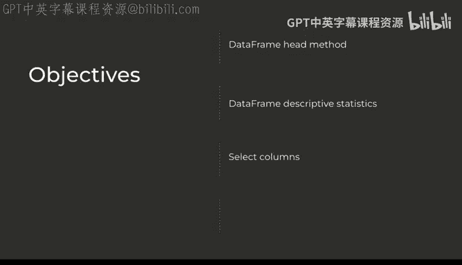
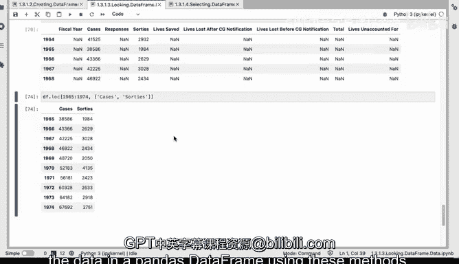

#  030：探查Pandas数据框中的数据 📊

在本节课中，我们将学习如何探查Pandas数据框中的数据。我们将介绍几种查看数据的方法，包括查看数据的前几行和后几行、获取描述性统计信息，以及如何选择特定的列和行。掌握这些基本操作是进行数据分析和处理的第一步。

上一节我们介绍了数据框的基本概念，本节中我们来看看如何具体查看和选择数据框中的数据。

## 查看数据框的前几行和后几行 👀

加载一个新的数据框或新数据后，首先要做的就是查看数据的前几行，以了解数据的结构和内容。

以下是查看数据的方法：

*   **`df.head()`**：默认显示数据框的前5行。可以传入一个整数参数来指定显示的行数，例如 `df.head(10)`。
*   **`df.tail()`**：默认显示数据框的后5行。同样可以传入参数来指定显示的行数，例如 `df.tail(3)`。

## 获取数据的描述性统计信息 📈

查看了几行数据后，下一步是了解数据的整体形状和分布。

获取描述性统计信息是一个好方法，这可以通过 `describe` 方法实现。

`df.describe()` 方法会为所有数值型列计算并显示计数、均值、标准差、最小值、最大值以及25%、50%、75%分位数。

我们也可以直接调用单个统计方法，例如 `df.min()` 获取最小值，或 `df.std()` 获取标准差。

## 选择数据框中的列 🔍

选择特定的列是数据操作中的常见需求。首先，我们可以通过数据框的 `columns` 属性查看所有列名。

以下是选择列的几种方法：

*   **方括号语法（最常用）**：`df[‘column_name‘]`。这与从字典中获取值的方式类似。选择单个列会返回一个Series对象。要选择多个列，需要将列名放入一个列表中：`df[[‘col1‘, ‘col2‘]]`，这将返回一个包含所选列的新数据框。
*   **点语法**：如果列名中没有空格或特殊字符，可以直接使用点语法选择列，例如 `df.column_name`。方括号语法和点语法都非常方便，你会经常看到它们被使用。

## 使用 `iloc` 和 `loc` 选择行和列 🎯

对于处理大量数据或需要更精确选择的情况，`iloc` 和 `loc` 操作符是更优化的方法。

以下是它们的使用方式：

*   **`iloc` 操作符**：基于整数位置索引进行选择。
    *   选择单行：`df.iloc[2]` （选择第三行，索引从0开始）。
    *   选择行范围：`df.iloc[3:30]` （选择第4行到第30行）。
    *   选择特定行和列：`df.iloc[2, 2]` （选择第三行、第三列）。也可以使用范围：`df.iloc[3:30, 1:4]`。
*   **`loc` 操作符**：基于行和列的标签名称进行选择。
    *   选择单行：`df.loc[1990]` （假设行标签是年份）。
    *   选择行范围：`df.loc[1990:2000]`。
    *   选择特定行和列：`df.loc[1990, ‘column_name‘]`。也可以选择多列：`df.loc[1990:2000, [‘col1‘, ‘col2‘]]`。

使用这些方法，你可以选择数据框的一个子集，只查看你感兴趣的行和列。

## 总结 ✨

本节课中我们一起学习了探查Pandas数据框的基本方法。我们首先使用 `head` 和 `tail` 方法查看了数据的首尾部分，然后通过 `describe` 方法获取了数据的描述性统计信息。接着，我们探讨了如何选择特定的列，包括使用方便的方括号语法、点语法，以及更强大的 `iloc` 和 `loc` 操作符来选择行和列的组合。现在，你应该尝试使用这些方法来调查你数据框中的数据了。