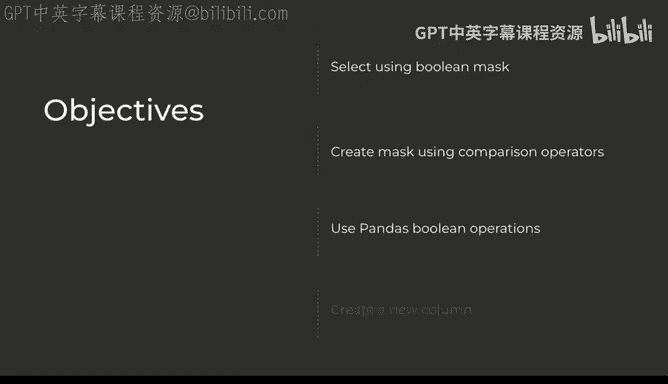
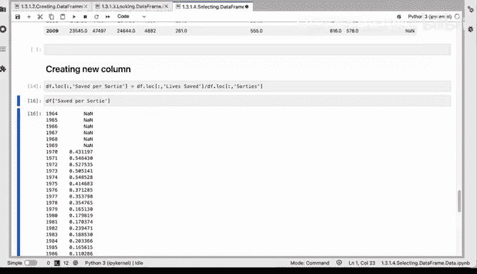

#  031：选取Pandas数据框中的数据 📊

在本节课中，我们将学习在Pandas数据框中选取和筛选数据的多种方法。我们将重点介绍如何使用布尔掩码（Boolean Mask）来精确地选择数据行，以及如何通过比较运算符和逻辑运算符来创建这些掩码。此外，我们还将学习如何基于现有列创建新的数据列。

---



## 数据框的初始设置

首先，我们像之前一样，从一个CSV文件设置我们的Pandas数据框。

```python
import pandas as pd
df = pd.read_csv('your_data.csv')
df.head(2)
```

我们调用了`head`方法来查看前两行数据，以便了解数据的结构。

---

## 使用布尔掩码选择数据

上一节我们设置了数据框，本节中我们来看看如何使用布尔值列表来筛选数据。

布尔掩码是一个与数据框行数等长的布尔值（True/False）列表。我们可以手动创建这样一个列表。

例如，我创建了一个列表，其中所有值都是`False`，除了第3到第6行（索引从0开始）为`True`。

```python
mask = [False, False, False, True, True, True, True] + [False] * (len(df) - 7)
```

以下是使用此掩码的两种方法：

1.  **使用方括号语法**：我们可以将这个布尔列表作为参数传递给数据框的方括号语法。
    ```python
    filtered_df = df[mask]
    ```
2.  **使用`.loc`索引器**：我们也可以使用`.loc`索引器达到同样的效果。
    ```python
    filtered_df = df.loc[mask]
    ```

这两种方法都只会返回那些在掩码中对应位置为`True`的行。这种方法被称为**布尔掩码**，它是我们接下来要探讨的筛选方法的核心。

---

## 使用比较运算符创建掩码

手动指定每个行的布尔值虽然可行，但在分析数据时并不实用。更实用的方法是使用比较运算符来动态生成掩码。

例如，我们可以比较两列的值来创建掩码。假设我们想找出“CG通知后损失的生命”大于“CG通知前损失的生命”的所有行。

```python
mask = df['lives_lost_after_CG_notification'] > df['lives_lost_before_CG_notification']
```

这个操作会生成一个布尔序列，对于满足条件的行标记为`True`，否则为`False`。然后，我们可以像之前一样使用这个掩码来筛选数据框。

```python
result_df = df[mask]
```

这样，`result_df`将只包含满足我们设定条件的行。

比较运算符不仅可以在列之间使用，也可以与固定值进行比较。

例如，创建一个掩码，筛选出“CG通知后损失的生命”小于600的所有行：

```python
mask = df['lives_lost_after_CG_notification'] < 600
filtered_df = df[mask]
```

---

## 使用Pandas布尔运算符组合条件

有时我们需要基于多个条件进行筛选。Pandas使用Python的逻辑运算符（并进行了重载）来组合多个布尔掩码。

主要的三个运算符是：**与（&）**、**或（|）**、**非（~）**。

假设我们查看数据框的统计摘要后，想创建一个掩码来筛选同时满足以下两个条件的行：
1.  `cases`列的值小于60000。
2.  `sorties`列的值大于4500。

以下是创建此复合掩码的方法：

```python
mask = (df['cases'] < 60000) & (df['sorties'] > 4500)
result_df = df[mask]
```

在这个例子中：
*   `(df[‘cases’] < 60000)` 创建了第一个条件掩码。
*   `(df[‘sorties’] > 4500)` 创建了第二个条件掩码。
*   使用 **`&`** 运算符将两个掩码组合，要求两个条件同时为`True`。
*   最终，`result_df`只包含同时满足这两个条件的行。

---

## 在数据框中创建新列

除了筛选数据，我们还可以基于现有列进行计算，并将结果添加为数据框的新列。

创建新列使用了与我们查看单个列时相同的选择语法。我们只需指定一个新列名，并为其赋值一个由现有列计算而来的序列。

例如，我们想计算每次出动平均拯救的生命数，可以用“拯救的生命数”除以“出动次数”：

```python
df['saved_per_sortie'] = df['lives_saved'] / df['sorties']
```

执行这行代码后，我们的数据框`df`中就会新增一个名为`‘saved_per_sortie’`的列。该列的数据就是我们指定的两个现有列进行除法运算的结果。

---

## 总结

本节课中我们一起学习了在Pandas数据框中选取和操作数据的核心技巧。



我们首先介绍了**布尔掩码**的概念，它是筛选数据的基石。接着，我们学习了如何使用**比较运算符**（如`>`， `<`）来动态生成针对列值条件的掩码。然后，我们探讨了如何使用Pandas的**布尔运算符**（`&`， `|`）来组合多个条件，实现更复杂的筛选逻辑。最后，我们还掌握了如何通过对现有列进行运算来**创建新的数据列**。


掌握这些数据选取和转换的方法，是进行有效数据清洗、分析和工程化的重要一步。现在，你应该尝试在自己的数据框上应用这些技术进行数据选取了。