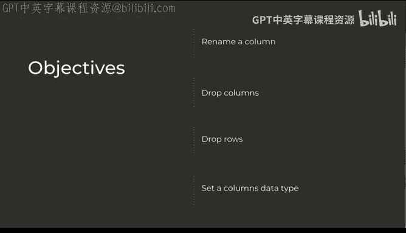
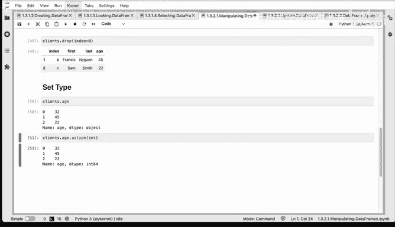

#  032：操作Pandas数据框 🐼

在本节课中，我们将学习如何操作Pandas数据框。你将掌握重命名列、删除列与行，以及设置列数据类型的核心方法。



---

上一节我们介绍了Pandas数据框的基础知识，本节中我们来看看如何对已创建的数据框进行具体操作。

首先，我们创建一个基于客户数据的数据框，命名为`clients`。这个数据框包含三列和三行。

以下是创建数据框的示例代码：
```python
import pandas as pd

data = {
    'first': ['Alice', 'Bob', 'Charlie'],
    'last': ['Smith', 'Jones', 'Brown'],
    'age': ['25', '30', '35']
}
clients = pd.DataFrame(data)
```

---

### 重命名列

数据框有一个`rename`方法，可用于重命名列。该方法有一个`columns`参数，该参数接收一个字典，用于将当前列名映射到我们希望使用的新列名。

例如，我们将`first`列重命名为`first_name`：
```python
clients_renamed = clients.rename(columns={'first': 'first_name'})
```

我们也可以使用`rename`方法为行设置标签。默认情况下，创建数据框时若不指定行标签，Pandas会分配数字标签。通过指定`index`参数并传入一个字典，我们可以将当前行标签映射到新标签。

例如，将行标签从`0, 1, 2`更改为`A, B, C`：
```python
clients_relabeled = clients.rename(index={0: 'A', 1: 'B', 2: 'C'})
```

在上述两种情况下，`rename`方法返回的是一个新的数据框，原始数据框`clients`保持不变。若希望直接修改原始数据框，可以使用`inplace=True`参数。

例如，原地重命名列：
```python
clients.rename(columns={'first': 'first_name'}, inplace=True)
```

若希望将行标签重置回数字序列，可以使用`reset_index`方法，同样配合`inplace=True`参数：
```python
clients.reset_index(inplace=True)
```

---

### 删除列与行

数据框的`drop`方法可用于删除列或行。`columns`参数可以接收单个列名或列名列表。

以下是删除`first`列的示例：
```python
clients_without_first = clients.drop(columns='first')
```

我们也可以通过指定行索引来删除特定行。

例如，删除索引为`0`的第一行：
```python
clients_without_row = clients.drop(index=0)
```

---

### 设置列的数据类型

数据框的每一列都有单一的数据类型。从数据创建数据框时，若不指定数据类型，Pandas会尽力推断。例如，我们创建`age`列时使用了字符串，Pandas会将其类型识别为`object`。

若希望将某列作为整数处理，可以使用`astype`方法，并指定目标数据类型。

以下是更改`age`列数据类型的示例：
```python
clients['age'] = clients['age'].astype(int)
```

---

### 总结



本节课中，我们一起学习了操作Pandas数据框的几个核心技巧：使用`rename`方法重命名列和行标签，使用`drop`方法删除列与行，以及使用`astype`方法设置列的数据类型。这些是数据处理中的基础且重要的操作，建议你多加练习以熟练掌握。