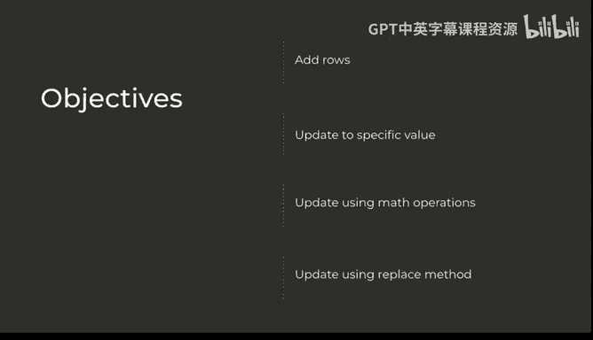
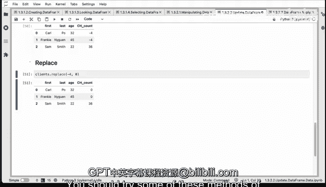

#  033：更新Pandas数据框数据 📝


在本节课中，我们将要学习如何更新Pandas数据框中的数据。具体来说，我们将掌握四种核心操作：添加新行、更新特定值、使用数学运算更新以及使用替换方法更新数据。

---

## 概述



数据框中的数据并非一成不变。在实际工作中，我们经常需要根据新信息或计算来修改现有数据。本节课程将详细介绍在Pandas中执行这些更新操作的各种方法。

---

## 添加新行

上一节我们介绍了数据框的基本结构，本节中我们来看看如何向现有数据框添加新的数据行。

首先，我们创建一个包含客户数据的示例数据框。当有新数据需要加入时，我们可以通过添加新行来实现。

以下是添加新行的步骤：

1.  准备一个字典，其键与现有数据框的列名相同，值为要插入的新数据列表。
2.  使用该字典创建一个新的数据框。
3.  使用 `append` 方法将新数据框追加到原数据框。

```python
# 示例：创建新数据并追加
new_data = {'Name': ['Eve'], 'Age': [28], 'City': ['Boston']}
new_clients_df = pd.DataFrame(new_data)
updated_df = clients_df.append(new_clients_df, ignore_index=True)
```

请注意，`append` 方法默认会返回一个新的数据框。如果直接追加，索引可能会出现重复（例如两个索引0），此时可以考虑使用 `reset_index` 方法来重置索引。

---

## 更新特定值

了解了如何添加行之后，我们来看看如何修改数据框中某个特定位置的值。

我们可以使用与字典或列表类似的括号语法来定位并修改单个单元格的值。

例如，要将索引为1的行、第一列（‘Name’列）的值改为‘Frankie’，可以这样操作：

```python
# 使用 .loc 更新单个值
df.loc[1, 'Name'] = 'Frankie'
```

此操作会直接（就地）修改原数据框中的值。我们也可以同时更新一个范围内的多个单元格。使用 `.loc` 时，范围指定是包含首尾的。

```python
# 更新一个范围的值
df.loc[0:1, 'Age'] = 30
```

---

## 使用数学运算更新

除了直接赋值，我们还可以通过数学运算来批量更新数据，例如为整列数据加1。

以下是为‘Count’列所有值加1的代码：

```python
# 返回一个新的数据框，原数据框不变
new_df = df['Count'] + 1
```

但请注意，上面的操作会返回一个新的Series，原数据框并未改变。如果希望直接在原数据框上进行运算，需要使用原地赋值操作符，如 `+=`、`-=` 等。

```python
# 使用原地操作符，直接修改原数据框
df['Count'] -= 3
```

---

## 使用替换方法

最后，我们学习一种更通用的更新方法：`replace`。当需要将数据框中所有出现的某个特定值替换为另一个值时，这个方法非常有用。

`replace` 方法接受两个主要参数：要被替换的值和替换后的新值。

例如，将数据框中所有的 `-4` 替换为 `0`：

```python
# 替换整个数据框中的特定值
df.replace(-4, 0, inplace=True)
```

该方法会搜索整个数据框，将所有匹配的值进行替换。`inplace=True` 参数确保更改直接应用于原数据框。

---

## 总结

本节课中我们一起学习了更新Pandas数据框数据的四种主要方法：
1.  使用 `append` 方法**添加新行**。
2.  使用 `.loc` 或括号语法**更新特定单元格或范围**的值。
3.  使用数学运算（如 `+=`）**批量更新列数据**。
4.  使用 `replace` 方法**全局替换特定值**。



掌握这些方法，你就能灵活地管理和修正数据框中的内容，为后续的数据分析和处理打下坚实基础。请尝试在自己的数据上练习这些操作以加深理解。