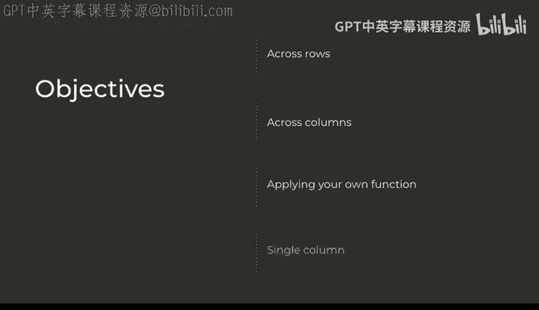
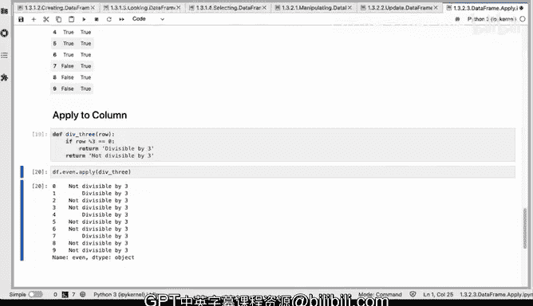

#  034：在Pandas数据框中应用函数 🐼

在本节课中，我们将要学习如何对Pandas数据框应用函数。你将掌握如何跨行、跨列应用函数，如何编写自定义函数，以及如何对单个列应用函数。

---

## 创建示例数据框



首先，我们创建一个数据框。我们的数据框有两列：`even`（偶数）和`odd`（奇数）。

`even`列包含从20开始，每次递减2的数字。
`odd`列包含从1开始，递增到21的奇数。

我们将使用一个名为`sum`的内置函数作为示例。`sum`函数接受任何包含数值数据的可迭代对象作为参数，并对其中的项进行求和。例如，对0到9的数字求和，结果是45。

接下来，我们将`sum`函数应用到我们的数据框上。

---

## 应用函数到整个数据框

每个数据框都有一个`apply`方法。该方法接受一个函数作为参数，并将该函数应用到数据框的每一行或每一列。

以下是使用`apply`及其默认参数，以及`sum`作为要应用的函数的示例：

```python
df.apply(sum)
```

使用默认参数时，`apply`会将函数应用到**每一列**的所有值上。因此，它会分别对`even`列和`odd`列的所有值求和，并返回结果。

`apply`方法接受一个可选的`axis`参数。让我们再次查看数据框。

如果将`axis`设置为1，函数将应用到**每一行**。

```python
df.apply(sum, axis=1)
```

我们可以看到，它计算了每一行中所有列值的总和。在这个例子中，每一行的和恰好都是21。

---

## 使用自定义函数

我们不仅可以使用内置函数或第三方函数，还可以定义自己的函数。

首先，定义一个应用于列数据的函数：

```python
def column_function(col):
    if sum(col) > 100:
        return "大于100"
    else:
        return "不大于100"
```

这个函数接受一个列作为参数。它对列调用`sum`函数，并测试总和是否大于100。根据结果返回相应的字符串。

如果我们把这个函数应用到数据框：

```python
df.apply(column_function)
```

我们可以看到，函数被分别应用到每一列，并根据各列的值返回结果。

我们也可以定义处理行的函数。对于行函数，其参数是行本身，行包含每一列的值。

```python
def row_function(row):
    if row['even'] % 3 == 0:
        return "偶数可被3整除"
    elif row['odd'] % 3 == 0:
        return "奇数可被3整除"
    else:
        return "均不可被3整除"
```

在这个函数中，我们检查`even`值是否能被3整除，同时也检查`odd`值。

将这个函数应用到数据框，并指定`axis=1`，使其应用于行（即跨列）：

```python
df.apply(row_function, axis=1)
```

---

## 返回可迭代结果的函数

我们还可以定义返回可迭代结果（如列表）的函数。

```python
def list_return_function(row):
    return [row['even'] * 2, row['odd'] * 3]
```

这个函数对一行数据操作，根据行中每列的值，返回一个包含两个值的列表。

如果我们将其应用到数据框：

```python
df.apply(list_return_function, axis=1)
```

它会返回一个对象，其中每个行的值都是一个列表。

有时，我们希望设计这样的函数：它从返回的可迭代对象中取出值，并将其展开，使每个值都有自己的列。我们可以使用`result_type='expand'`参数来实现。

```python
df.apply(list_return_function, axis=1, result_type='expand')
```

结果是得到一个具有两列的新数据框，每一列对应我们函数返回的一个值。

---

## 对单个列应用函数

除了对整个数据框应用函数，我们还可以对单个列应用函数。当我们只想基于单个列的值进行操作，而不是对整列求和或跨行操作时，这非常有用。

这里我们定义了一个函数：

```python
def single_column_function(value):
    if value > 10:
        return "大"
    else:
        return "小"
```

这个函数接受一个名为`value`的参数，并将其视为单个值（而不是一个可以索引并获取不同列的对象），然后根据条件返回不同的值。

我们以与完整数据框类似的方式应用它，但指定了要应用到的单个列：

```python
df['even'].apply(single_column_function)
```

可以看到，函数被应用到了单个列，并为该列中的每个值返回了结果。

---

## 总结

本节课中，我们一起学习了在Pandas数据框中应用函数的核心方法。

我们介绍了如何跨行（`axis=1`）和跨列（默认`axis=0`）应用函数，如何编写自定义函数来处理行或列数据，以及如何将函数专门应用于单个列。



无论是跨整个数据框（行或列）还是对单个列应用函数，都是处理和转换数据、将其塑造成新值的重要方式。你应该自己尝试这些操作，以加深理解。