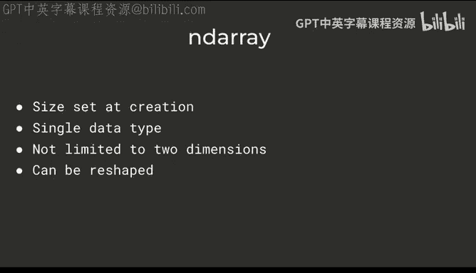
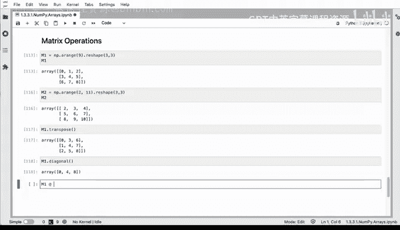
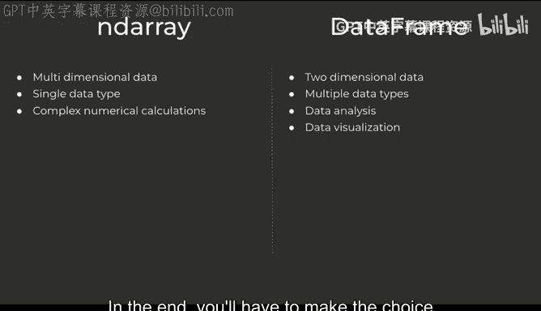
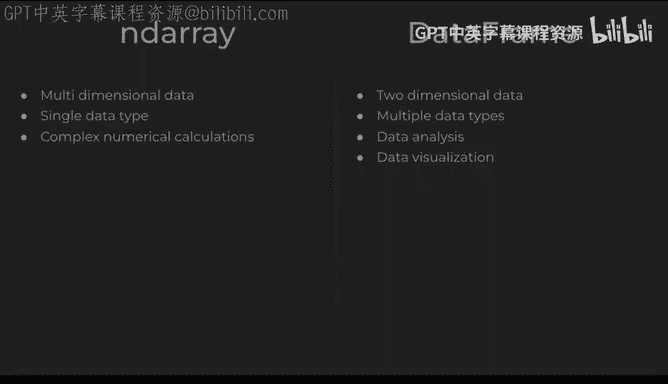
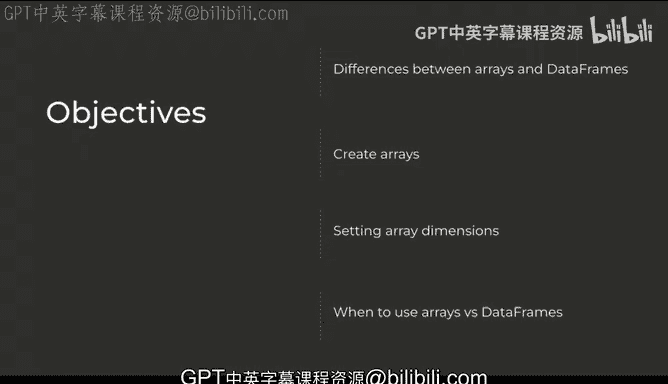

#  035：创建NumPy数组 🧮

在本节课中，我们将介绍NumPy数组。你将学习NumPy数组与Pandas数据框之间的区别，了解如何创建NumPy数组，如何控制数组的维度，以及何时应选择NumPy数组而非Pandas数据框。

## 概述

NumPy是一个为科学计算设计的包。它围绕一个**ND数组对象**构建，我们通常简称为数组。它为这些多维数组对象提供了高度优化的计算工具，并且围绕这个数组对象已经发展出了一个科学和数学库的生态系统。

许多机器学习库期望数组对象作为输入。即使不直接期望，它们也会在后台将输入转换为数组对象，并返回数组对象作为结果。

## NumPy数组的特点

上一节我们介绍了NumPy的基本概念，本节中我们来看看NumPy数组对象的一些关键特性，这些特性使其区别于Python序列和Pandas数据框。

*   当你创建一个ND数组对象时，其大小是固定的。不创建新对象就无法调整其大小。
*   ND数组对象包含单一数据类型，这与Pandas数据框不同。
*   它们不限于二维。它们可以被重塑，返回一个新的数组对象，这是我们控制其维度的方式。

## 创建NumPy数组

了解了数组的基本特性后，我们来看看如何在Jupyter笔记本中创建NumPy数组。按照惯例，NumPy通常以别名`np`导入。

我们可以通过多种方式创建数组。一种方式是向`np.array`函数或构造函数传入一个序列参数。

以下是创建数组的几种方法：

*   使用列表创建：`np.array([1, 2, 3])`
*   使用嵌套列表（列表的列表）创建二维数组：`np.array([[1, 2, 3], [4, 5, 6]])`
*   使用`np.ones`方法创建全1数组：`np.ones((3, 3))`
*   使用`np.zeros`方法创建全0数组：`np.zeros((2, 4))`
*   使用`np.arange`方法创建序列数组，类似于Python的`range`对象：`np.arange(10)`

请注意，无论我们如何创建数组，NumPy在显示时都会使其看起来像是通过列表传入的数据。

## 数组的维度与形状

我们已经学会了创建数组，现在让我们深入了解数组的维度。NumPy对象具有维度的概念。

我们可以查看数组的维度（`ndim`）、形状（`shape`）和总大小（`size`）。例如，一个由`np.arange(21)`创建的一维数组，其维度为1，形状为`(21,)`，大小为21。

一个由嵌套列表创建的二维数组（例如3x3），其维度为2，形状为`(3, 3)`，大小为9。

## 重塑数组

我们可以使用`reshape`方法来返回一个具有新形状的数组。例如，将一个包含12个元素的一维数组重塑为3x4的二维数组：`arr.reshape(3, 4)`。

调用`reshape`时，参数必须是能乘出数组中正确项目总数的数字。例如，尝试将12个项目的数组重塑为2x3的数组会引发错误，因为2乘以3不等于12。

要创建更高维度的数组，只需为每个新维度提供更多参数。例如，使用参数`(2, 2, 3)`可以创建一个形状为2x2x3的三维数组。

## 数据类型

如前所述，NumPy数组与Pandas数据框的一个区别是它们只能包含单一数据类型。

创建数组时，我们可以查看其数据类型（`dtype`）和占用的内存大小（`nbytes`）。我们也可以在创建时通过`dtype`参数指定特定的数据类型，例如`np.array([1, 2, 3], dtype=np.int8)`。这对于处理大量数据且已知数值范围有限的情况非常重要，因为可以选择更小的数据类型来节省内存。

需要注意的是，一旦数据类型被设定，NumPy不允许添加不同类型的数据项，并且其处理方式有时可能具有误导性。例如，向一个`int8`类型的数组中添加一个浮点数，NumPy会截断小数点后的部分。因此，在设置数组数据类型时，需要清楚将要放入的数据的预期类型。

## 广播

广播是NumPy数组维度操作的另一个重要方面。它允许在不同形状的数组之间进行算术运算。

例如，我们可以将一个3x3的数组与另一个3x3的数组相加，也可以与一个单一数值相加，结果数组的维度仍为3x3。我们甚至可以将一个3x1的数组与一个3x3的数组相加，结果仍然是3x3的数组。这就是广播。

广播的规则是：运算结果数组的每个维度大小，是输入数组在该维度上的最大值。让我们看一个更复杂的例子：一个形状为`(2, 1, 5)`的三维数组与一个形状为`(2, 7, 1)`的三维数组相加，结果数组的形状将是`(2, 7, 5)`，即每个维度都取了两者中的最大值。

## 矩阵运算

NumPy为数组提供了大量高效的数学运算，其中一部分是矩阵运算。

以下是部分矩阵运算示例：

*   **转置**：使用`.T`属性或`np.transpose`函数，例如 `m1.T`。
*   **对角线**：使用`np.diag`函数获取矩阵对角线元素，例如 `np.diag(m1)`。
*   **矩阵乘法**：使用`@`运算符或`np.dot`函数，例如 `m1 @ m2`。

## 何时使用NumPy数组 vs Pandas数据框

在学习了数组的创建和操作后，一个重要的问题是：何时应该使用NumPy数组对象，何时应该使用Pandas数据框？

*   如果你处理的是**高维数据**或**任何非二维的、单一数据类型**的数据，并且目标是进行**复杂的数值计算**，那么应该使用**NumPy数组**。
*   另一方面，如果你处理的是**二维数据**，尤其是包含**多种数据类型**，并且希望进行**数据分析或数据可视化**，那么**Pandas数据框**是更合适的选择。

最终，你需要根据所要解决的问题和手头的数据来做出选择。

## 总结

本节课中，我们一起学习了NumPy数组与Pandas数据框的区别，掌握了如何创建数组并了解了一些数组方法，学会了如何操作数组的维度，并讨论了何时使用数组、何时使用数据框。现在，你应该尝试创建和操作一些NumPy数组来巩固所学知识。