#  036：Spark与PySpark数据框 🔥

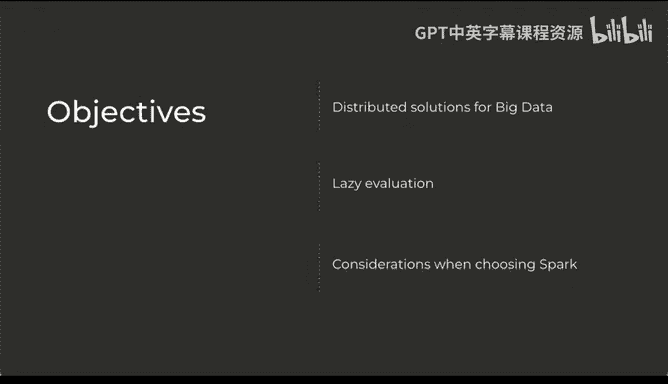

在本节课中，我们将要学习Spark与PySpark数据框。我们将探讨处理大数据的分布式解决方案，理解惰性求值与急切求值的区别，并分析在选择Spark/PySpark与pandas时需要考虑的因素。

## 单机方案：Pandas 🐼

上一节我们介绍了课程概述，本节中我们来看看传统的数据处理库Pandas。

Pandas被设计为在单台机器上运行。这意味着其性能受限于该机器的内存。为了让Pandas高效运行，其数据需要能够放入该内存中。

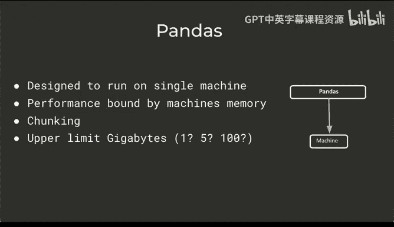

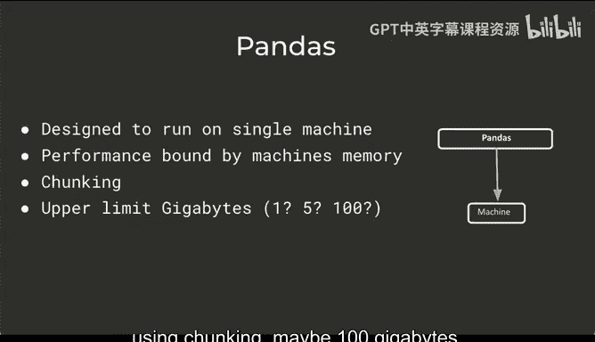

Pandas提供了一种称为“分块”的功能，即加载数据子集进行处理，然后再加载另一块数据。但这种方法的处理和性能并不理想。

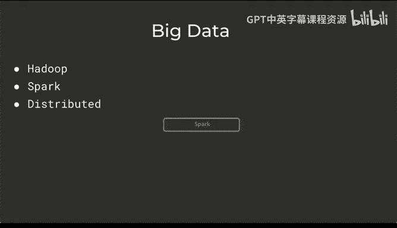

那么，使用Pandas处理的数据可以有多大？这实际上取决于你的机器。你需要根据所使用的硬件来判断何种规模是高效的。但作为一个经验法则，在不使用分块的情况下，上限通常在**1到5GB**左右；使用分块时，可能达到**100GB**。

## 大数据与分布式方案 🚀

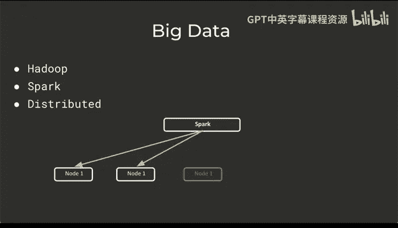

那么，如果你有TB或PB级别的数据呢？这时你就遇到了所谓的“大数据”，应该考虑其他解决方案。

以下是两种被广泛采用的大数据解决方案：
*   **Hadoop**
*   **Spark**

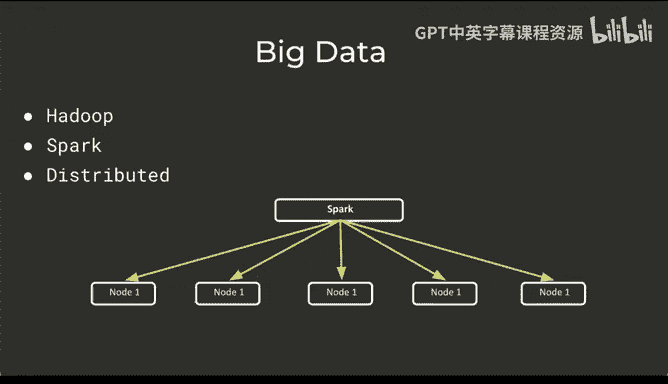

这两种方案都使用分布式计算。这意味着它们不是使用单个节点或单一线程，而是使用多个节点。这些节点可以是不同的计算机、虚拟机或子进程。无论如何，它们都允许你进行水平扩展，即通过添加更多机器来提高性能，而不必非得添加更庞大、更昂贵的机器。

*   **Hadoop**通过在计算过程中写入中间文件来实现这一点，因此对内存要求不高。
*   **Spark**是一个较新的解决方案，性能更高，它在内存中工作，但使用的是所有这些节点的内存总和。因此，它可用的内存通常比Pandas大得多。

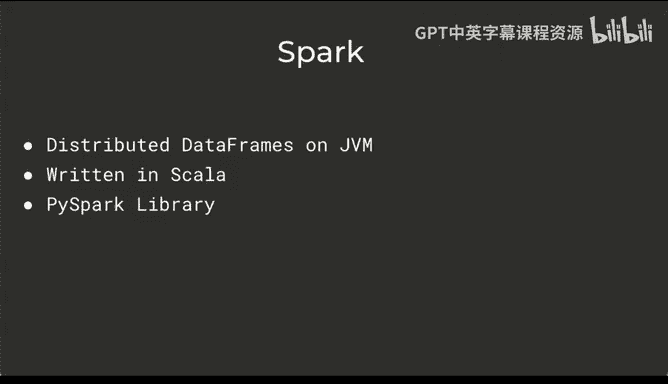

## Spark核心：分布式数据框 ⚙️

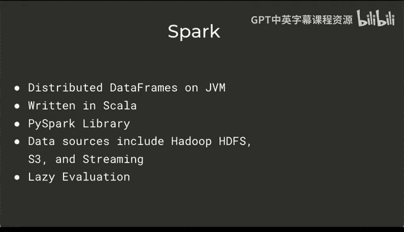

接下来，让我们更深入地了解Spark。

Spark的核心使用数据框，并且如我们所说，这些是分布式数据框。它们使用Java虚拟机编写。Spark本身是用Scala编写的，但提供了许多库，包括**PySpark库**，它允许你在Python环境中使用Spark数据框和转换操作。

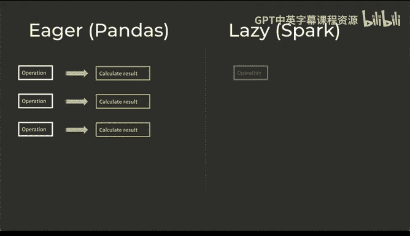

Spark可以处理来自广泛数据源的数据，包括：
*   分布式数据源Hadoop HDFS
*   S3上的文件
*   流数据

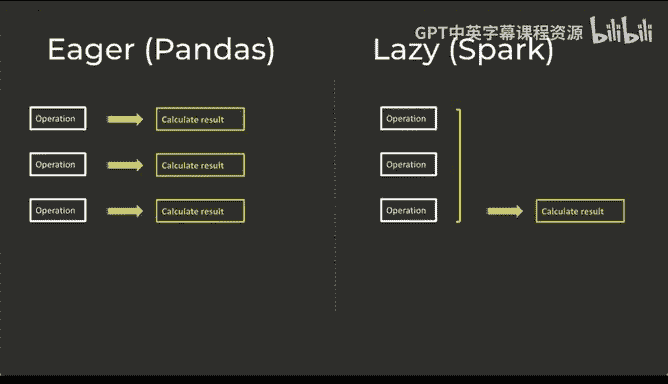

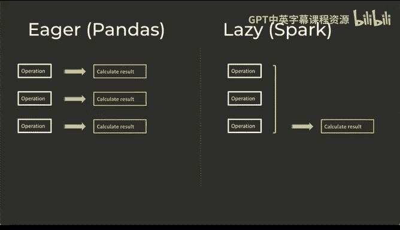

Spark使用一种称为**惰性求值**的策略。

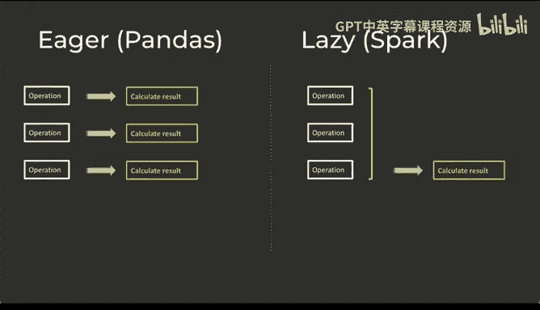

## 惰性求值 vs. 急切求值 ⚡

现在，我们来谈谈惰性求值。

Pandas使用的是**急切求值**。这意味着在Pandas代码中，每一个操作都会在其下一个操作运行之前计算出结果。急切求值在交互式工作时非常有用，并且调试起来更直观。

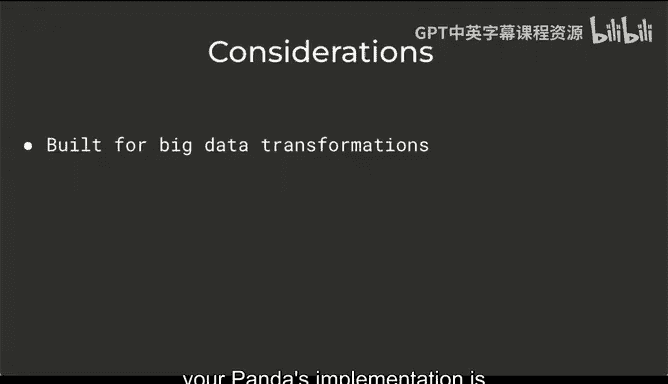

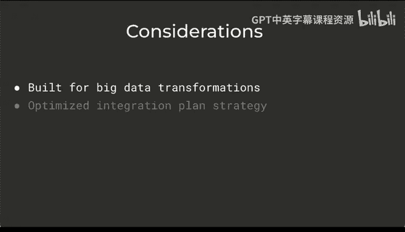

另一方面，Spark充分利用了**惰性求值**。在惰性求值中，操作被堆叠起来，Spark在后台计算出一个优化的转换计划。这意味着结果不会在任何单个操作之后立即计算，而只会在你执行一个需要计算该结果的操作时才进行计算。这种机制，结合其分布式特性，正是Spark能够高效计算大数据的原因。

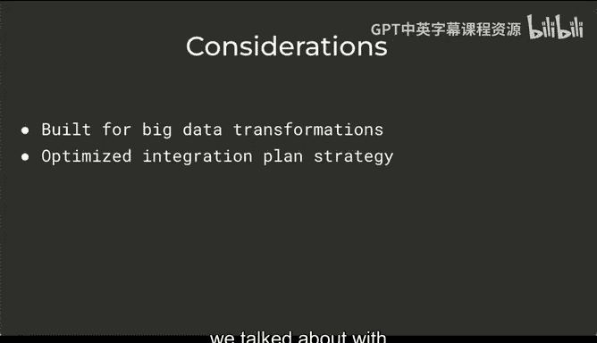

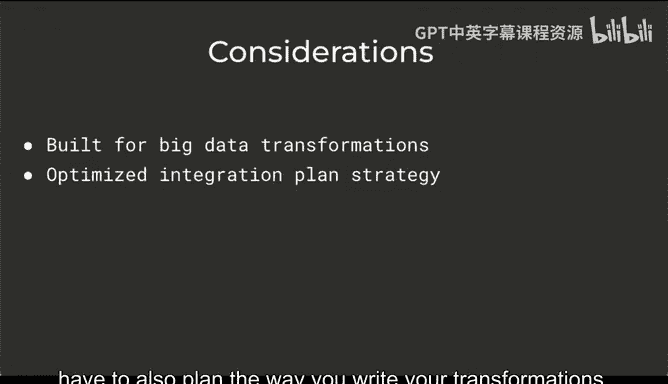

## 选择Spark/PySpark的考量 🤔

那么，在选择Spark与Pandas时需要考虑哪些因素呢？

以下是主要的考量点：

*   **数据规模**：首要且最重要的考量是，你是否真的在处理大数据？如果你处理的CSV文件小于1GB，你可能不需要Spark或其基础设施。但如果你计划处理TB级数据，或者发现你的Pandas实现在尝试进行的转换中性能不足，那么Spark是一个很好的解决方案。
*   **编程策略**：我们讨论过的惰性求值优化计划策略意味着，你也需要规划编写转换操作的方式。如果你编写了一个需要计算的操作（例如，类似于Pandas的`df.head()`，用于打印数据框的前几行），那么就需要运行任何先前的操作，以便在显示结果之前计算出这些结果。这意味着在编写PySpark代码时，你需要理解哪些操作会导致结果被计算，并有策略地决定何时调用这些特定操作。
*   **调试难度**：使用PySpark的另一个考量是，因为它是Spark之上的一层，调试有时可能具有挑战性。通常，当你在日志中查看错误时，你会看到Python异常，然后看到一些与转换层相关的代码，再往下是Scala层的堆栈跟踪。当出现问题时，要梳理这么多信息来找出问题所在可能很困难。

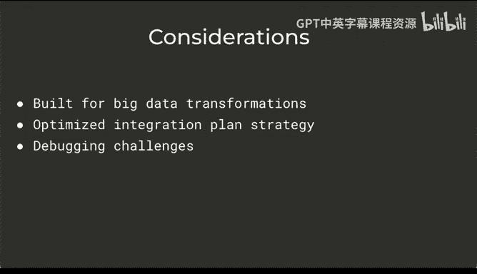

## 总结 📝

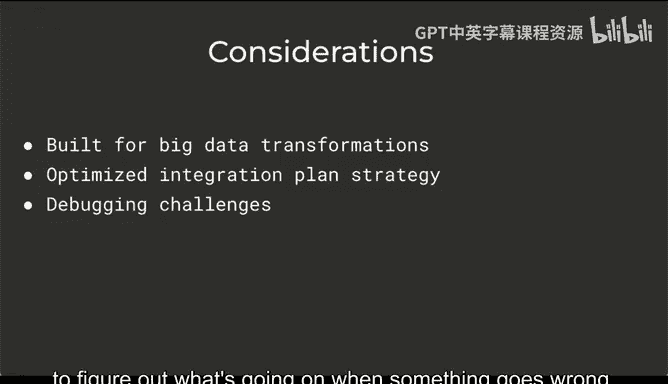

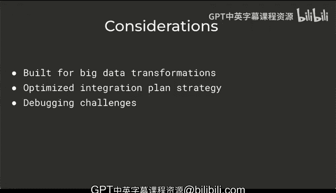

本节课中我们一起学习了Spark与PySpark数据框。我们了解到Pandas适用于单机上的中小型数据集，而Spark通过其分布式数据框和惰性求值机制，为处理TB/PB级别的大数据提供了高效的解决方案。在选择工具时，需要综合考虑数据规模、编程模式的变化以及调试复杂度。尽管存在一些挑战，但Spark和PySpark无疑是进行大数据转换的强大工具。