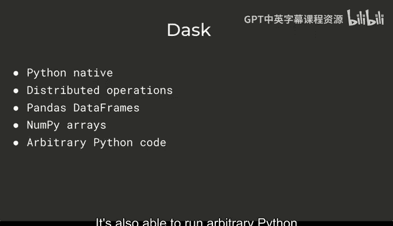
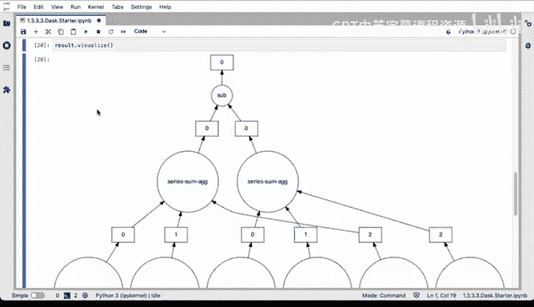
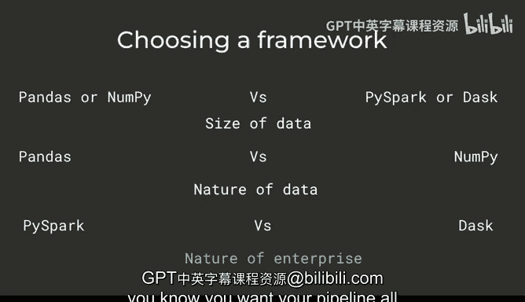

#  037：创建Dask数据框 📊

在本节课中，我们将要学习Dask数据框。我们将了解如何创建Dask数据框，如何使用Dask的惰性求值特性，以及如何可视化Dask任务图。

## 概述

上一节我们介绍了PySpark在处理大数据集时的高效性，但它不具备原生Python库的便利性，也不如pandas数据框功能丰富。本节中我们来看看Dask库。Dask是Python原生的库，专为分布式操作设计，它实际上封装了pandas数据框和NumPy数组。它还能够以高效分布式的方式运行任意的Python代码。

## 创建Dask数据框



让我们来看一个Dask数据框的例子。


在这个Notebook中，我们已经导入了pandas。我们定义了一个包含非常大数字的变量，并用这个数字来填充一个包含数据的字典。基本上，这是为两个不同的键（A和B）生成的大量随机整数。然后，我们获取这些数据并创建了一个名为`df`的数据框，并查看前五行。

我们对同一个数据框调用标准差计算。注意，计算标准差花费了一点时间。这并非说明pandas不可用，但延迟是明显的。

现在，让我们用相同的数据创建一个Dask数据框。

我们使用了`dd.from_pandas`方法，并将我们的pandas数据框作为参数传入，同时定义了希望将数据划分和处理的**分区数量**。

```python
import dask.dataframe as dd
dask_df = dd.from_pandas(df, npartitions=4)
```

如果我们查看这个数据框，会注意到这些单元格中并没有实际的值。如果我们对其调用标准差计算，它同样不会直接给出答案。这是因为Dask使用了**惰性求值**，我们之前在Spark中也见过。

## 惰性求值与计算

为了强制Dask进行计算，我们需要使用`.compute()`方法。

```python
result = dask_df.std().compute()
```

这样我们就能看到结果了。基本上，使用Dask，我们可以执行许多与pandas数据框非常相似的操作。

例如，我们可以对两列求和，然后计算差值。



```python
sum_diff = (dask_df['A'] + dask_df['B']).sum() - (dask_df['A'] - dask_df['B']).sum()
```

但同样，结果直到我们调用`.compute()`时才会被计算。

```python
final_result = sum_diff.compute()
```

## 可视化任务图

Dask一个有趣的特点是，当你构建这一系列操作时，它会在后台创建一个**任务图**。我们可以查看这个图，了解计算最终结果所经历的各个操作步骤。

Dask也提供了可视化这个图的能力。


## 如何选择合适的数据处理框架

我们已经看了几种作为pandas数据框替代方案的不同选项。问题是如何为你的任务选择合适的框架。

从高层次来看，你可能需要知道是想要类似pandas、NumPy这样易于设置、交互性强的工具，还是像PySpark和Dask这样的工具。如果这是你的选择，那么关键取决于**数据的大小**。

以下是选择框架时需要考虑的几个关键点：

*   **大数据场景**：如果你正在处理大数据，或者计划处理大数据，那么应该选择PySpark或Dask。
*   **小数据场景**：如果你的数据量不大，不足以对pandas或NumPy的性能产生影响，那么直接使用它们会简单得多。
*   **pandas vs NumPy**：这取决于数据的性质。如果你的数据都是同一数据类型（例如数值型），并且需要进行高效运算（尤其是需要将数据表示为高维矩阵的运算），那么NumPy是更好的选择。另一方面，如果你处理的是包含不同数据类型的表格数据，那么pandas可能更适合，特别是当你只是进行简单分析或准备可视化时。
*   **PySpark vs Dask**：这取决于企业环境。Spark是一个更成熟的产品，拥有更大的生态系统、支持和文档。如果你的企业已经在使用Spark，或者非常关注产品的成熟度，那么PySpark可能是更好的选择。另一方面，Dask是Python原生的，允许你充分利用pandas和NumPy数据框及数组的全部功能。如果你正在启动一个新项目，并且希望整个数据管道都使用Python，那么Dask是一个很好的选择。



## 总结


本节课中，我们一起学习了如何创建和使用Dask数据框。我们了解了Dask的惰性求值机制，它通过`.compute()`方法触发实际计算。我们还看到了如何可视化Dask在执行过程中生成的任务图。最后，我们讨论了在不同场景（数据大小、数据类型、企业环境）下，如何在pandas、NumPy、PySpark和Dask之间做出合适的选择。理解这些工具的优缺点，将帮助你为数据工程项目构建更高效、更合适的处理流程。