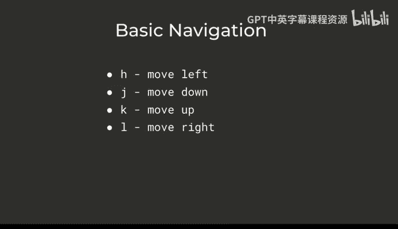
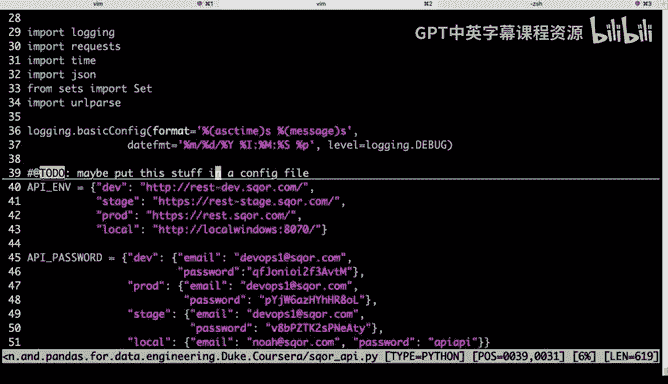
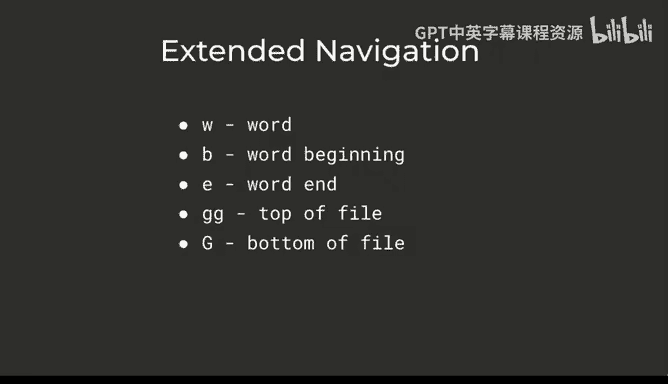
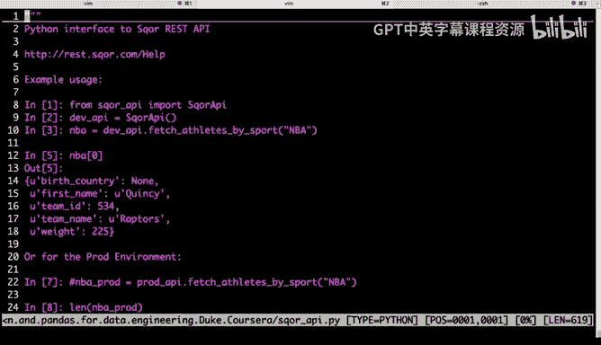
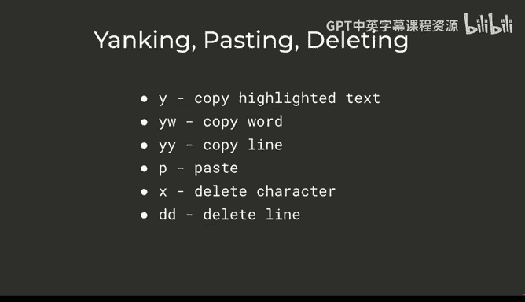
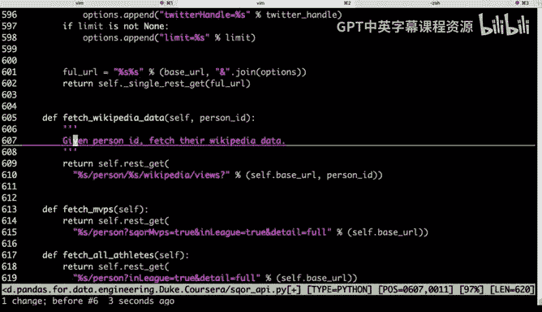
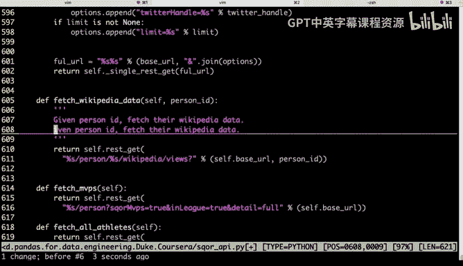
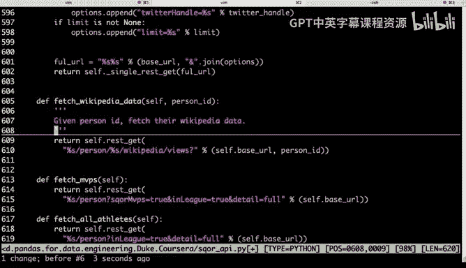
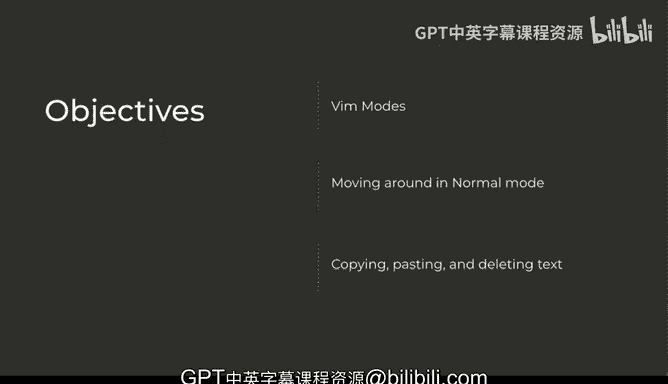

#  039：Vim普通模式入门 🖥️

在本节课中，我们将学习Vim文本编辑器，特别是其核心的“普通模式”。我们将了解Vim的基本概念、如何在不同模式间切换，并重点掌握在普通模式下移动光标、复制、粘贴和删除文本的方法。

---

## Vim是什么？📝

Vim是一个文本编辑器，而不是文字处理器。这是一个重要的区别。

文字处理器（如Microsoft Word）以二进制格式存储文档，其中不仅包含您键入的文本，还包含字体、样式、表格、图像等各种非文本信息的数据。

Vim作为一个文本编辑器，只保存纯文本。您在Vim文件中键入的文本，就是保存在该文件中的全部内容，别无其他。

---

## Vim的历史与特点 🕰️

Vim基于VI文本编辑器，后者是早期Unix系统中可用的编辑器。

正因如此，VI的设计早于计算机鼠标或图形用户界面的出现。当时与计算机交互的唯一方式是通过文本终端。因此，VI以及现在的Vim都基于纯键盘交互。

这意味着在Vim文件中移动，与在依赖鼠标的现代图形界面程序中移动有很大不同。

Vim提供了大量的自定义选项。您可以更改许多设置，并且有一个庞大的插件生态系统。那些依赖Vim作为主要编程界面的开发者会定制他们的配置，以至于几乎每个开发者都有独特的设置。

关于Vim，另一点需要知道的是，由于它源于早期Unix系统中的VI，您可以在任何Unix或Linux机器上找到Vim。这意味着如果您需要登录服务器查看日志或进行其他工作，Vim总是可用的。

---

## Vim的模式 🔄

因为Vim使用您输入文本的同一个键盘来执行所有命令，所以它引入了“模式”的概念。

*   **普通模式**：这是您启动Vim时进入的模式。在此模式下，您可以在文件中移动并执行许多非文本输入类型的操作。
*   **插入模式**：这是您输入文本的模式。
*   **可视模式**：用于进行特殊类型的文本选择。
*   **命令行模式**：用于执行特殊命令、搜索、查找和替换。

为了在不同模式间切换，我们需要使用特殊的按键组合。

普通模式是您的大本营，是您开始的地方。要从任何其他模式返回普通模式，请按 `Esc` 键。这是一个需要记住的重要事项。很多时候，Vim新手会不小心进入某个模式而感到困惑，此时始终可以按 `Esc` 键返回“家”——即普通模式。

---

## 在普通模式下导航 🧭

上一节我们介绍了Vim的模式，本节中我们来看看如何在普通模式下移动光标。这可能是Vim学习曲线中最陡峭的部分，即习惯使用键盘导航。

以下是基本的移动键：

*   `h`：向左移动
*   `j`：向下移动
*   `k`：向上移动
*   `l`：向右移动

您可以在按键前输入一个数字，以移动相应次数的距离。例如，输入 `5l` 会使光标向右移动5个字符。

掌握这些按键需要大量练习，直到它们成为您手指的本能记忆。

---

## 进阶移动方式 🚀

除了被称为“Home键”的基本移动方式外，还有其他在Vim文件中移动的方法。

以下是其他有用的移动命令：

*   `w`：向前移动一个单词
*   `b`：向后移动到当前单词的开头
*   `e`：移动到当前单词的末尾
*   `gg`：移动到文件顶部
*   `G`：移动到文件底部

例如，按 `w` 会跳转到下一个单词的开头，按 `e` 会跳转到当前单词的末尾。

---

## 复制、粘贴与删除 📋

在普通模式下工作时，另一些需要学习的重要按键是用于复制、粘贴和删除文本的键。

以下是相关命令：

*   `y`：将高亮显示的文本复制到缓冲区（称为“拉取”）。`yw` 复制一个单词，`yy` 复制整行。
*   `p`：粘贴
*   `x`：删除光标下的一个字符
*   `dd`：删除整行

例如，执行 `yw` 复制一个单词，然后移动光标并按 `p` 即可粘贴。按 `x` 会删除光标下的字符，按 `dd` 会删除整行。

---

## 总结 📚

本节课中，我们一起学习了Vim的模式，重点掌握了在其普通模式下移动光标、复制、粘贴和删除文本的方法。您现在应该在Vim的普通模式下多加练习，以熟悉这些核心操作。