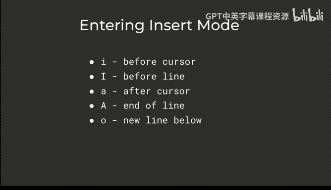
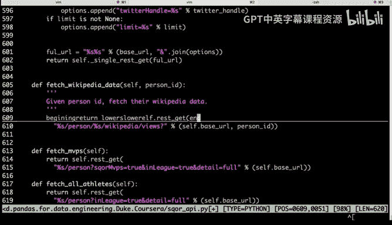
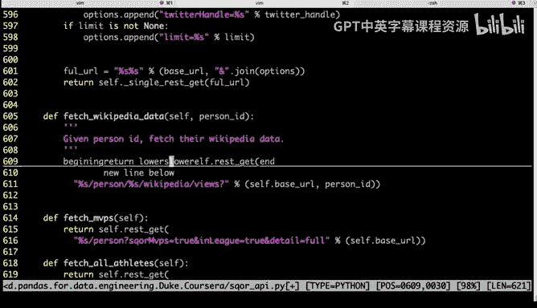
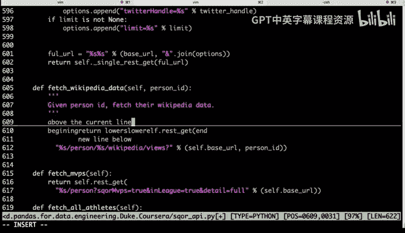
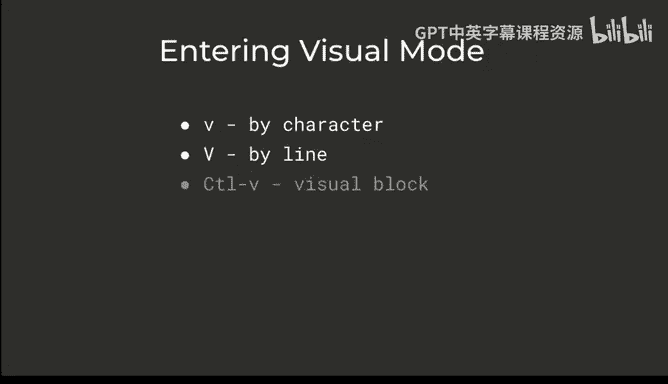
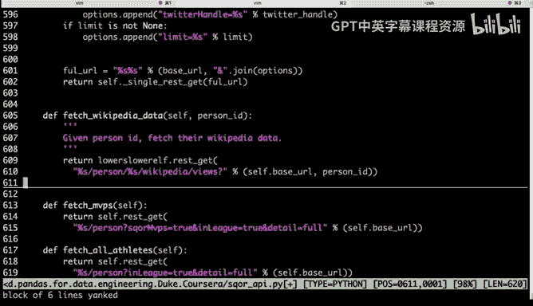
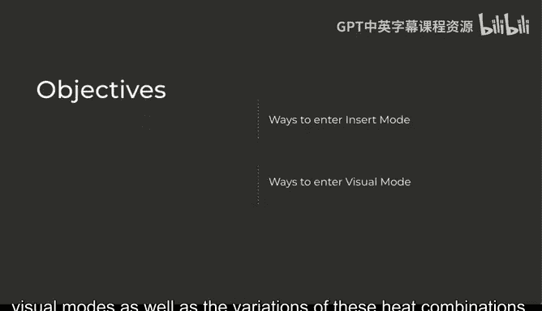

#  040：Vim模式切换教程 🖥️

在本节课中，我们将要学习如何在Vim编辑器中从普通模式切换到插入模式和可视模式。掌握这些切换方式是高效使用Vim进行文本编辑的基础。

## 从普通模式进入插入模式 🔄

上一节我们介绍了Vim的普通模式，本节中我们来看看如何从普通模式进入插入模式以输入文本。

从普通模式切换到插入模式，可以使用 `i`、`a` 或 `o` 键。它们都以不同的方式进入插入模式，并且都有对应的大写字母变体，提供不同的插入起始位置。

以下是具体的按键及其功能：

*   **小写 `i`**：在光标当前位置**之前**开始插入。
*   **大写 `I`**：在当前行的**行首**开始插入。
*   **小写 `a`**：在光标当前位置**之后**开始插入。
*   **大写 `A`**：在当前行的**行尾**开始插入。
*   **小写 `o`**：在当前光标所在行的**下方**创建一个新行，并进入插入模式。
*   **大写 `O`**：在当前光标所在行的**上方**创建一个新行，并进入插入模式。

## 从普通模式进入可视模式 👁️

了解了插入模式的进入方式后，我们再来看看如何进入可视模式以选择文本。

从普通模式切换到可视模式，我们有三个选项：`v`、`V` 和 `Ctrl+v`。它们分别对应不同粒度的文本选择。

以下是三种可视模式的区别：

*   **小写 `v`**：进入**字符可视模式**，允许你按字符选择文本。
*   **大写 `V`**：进入**行可视模式**，允许你按整行选择文本。
*   **`Ctrl + v`**：进入**块可视模式**，允许你选择一个矩形的文本块。

在可视模式下，你可以对选中的文本执行复制（`y`）、删除（`d`）等操作。例如，在字符可视模式下选中一些文本后，按下 `y` 可以复制它们，然后移动光标到别处，按下 `p` 即可粘贴。

---

本节课中我们一起学习了Vim中从普通模式切换到插入模式和可视模式的各种按键组合及其变体。现在，你应该尝试在Vim中练习这些操作，以熟悉不同模式下的编辑方式。