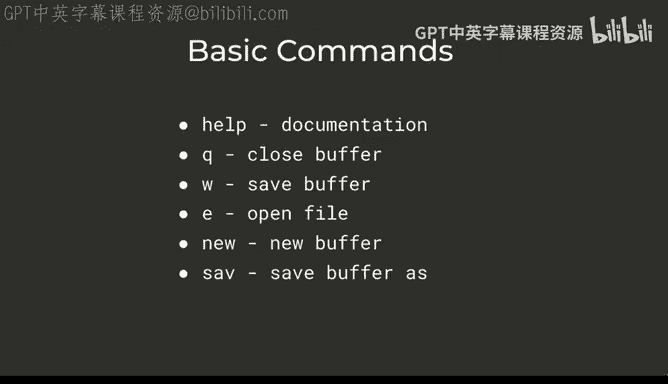
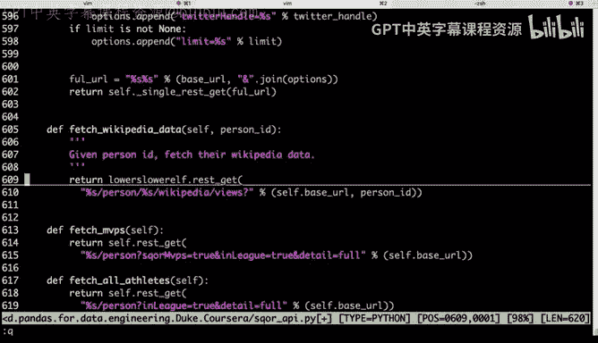
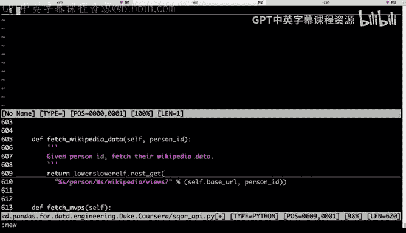
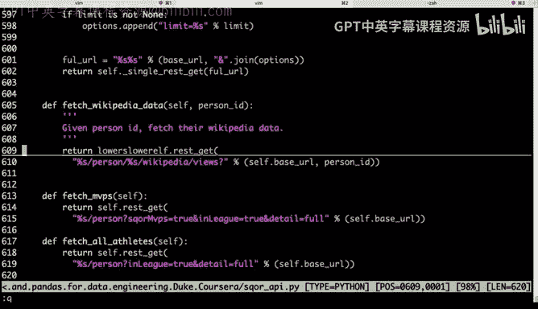
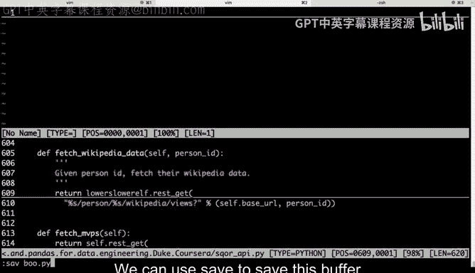
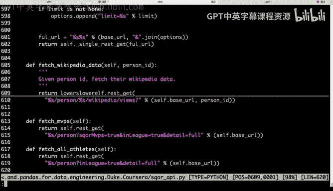
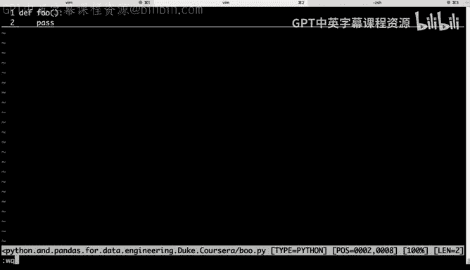
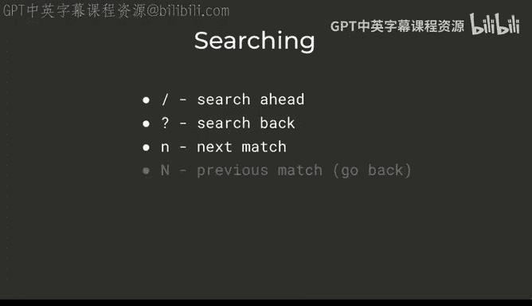
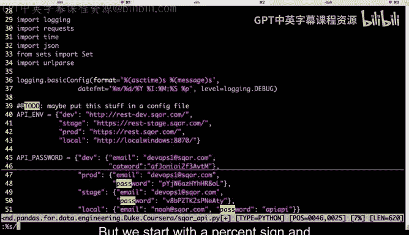
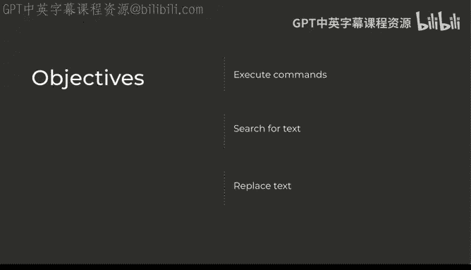

#  041：Vim命令行使用教程 📝

在本节课中，我们将要学习如何在Vim编辑器的命令行模式下执行命令。具体内容包括：如何进入命令行模式、执行基本文件操作命令、在文档中进行搜索，以及如何进行文本的查找和替换。

## 从普通模式进入命令行模式 🔄

上一节我们介绍了Vim的基本模式，本节中我们来看看如何从普通模式切换到命令行模式。

有三种方式可以从普通模式切换到命令行模式，每种方式对应不同的功能：
*   **冒号 (`:`)**：允许我们执行命令。
*   **正斜杠 (`/`)**：允许我们在文档中向下搜索。
*   **问号 (`?`)**：允许我们在文档中向上或向后搜索。

如果我们输入冒号后跟一个感叹号 (`:!`)，这被称为**过滤器命令**，它是一个特殊的命令子集。

## 基本命令行操作 💻

当我们处于命令行模式时，有一些基本命令对于使用Vim至关重要。

以下是几个核心命令及其功能：
*   **`help`**：Vim有内置文档。在命令行模式下输入 `help` 加上你想了解的命令或主题名称，就会调出相关文档。
*   **`q`**：Vim中你看到的窗口被称为**缓冲区**。`q` 命令会关闭当前缓冲区，相当于关闭一个文件。
*   **`w`**：保存当前缓冲区。
*   **`e`**：打开一个文件。输入 `e` 后跟文件路径，即可打开该文件。
*   **`new`**：创建一个新的缓冲区，之后可以将其保存为新文件。
*   **`sav`**：保存当前缓冲区，但可以指定一个新名称。如果你想保存缓冲区的副本，可以使用这个方法。



要使用这些命令，我们首先需要输入冒号 (`:`) 进入命令行模式。

## 命令实践演示 🎬

让我们尝试使用这些命令。



我们按冒号进入命令行模式，输入 `help` 和我们想了解的主题。例如，如果想查看关于命令行模式本身的帮助，我们可以输入：
```
:help command-line-mode
```
这会打开一个新缓冲区，显示该部分的文档。



要关闭这个缓冲区，我们输入：
```
:q
```

要创建一个新缓冲区，我们使用 `new` 命令：
```
:new
```
我们可以看到一个新的空白缓冲区。



要保存这个缓冲区并指定文件名，我们可以使用 `save` 命令：
```
:save new_file.txt
```
然后关闭它。



要打开一个文件，我们可以使用 `e` 命令：
```
:e existing_file.txt
```
文件将被打开。



如果我们进入插入模式添加一些文本，然后返回普通模式，可以使用 `:w` 来保存更改。

在关闭缓冲区之前保存文件是一种相对常见的操作，因此 `:wq`（保存并退出）经常被一起使用。



## 文本搜索功能 🔍

现在让我们看看如何进行搜索。正斜杠 (`/`) 用于向前搜索，问号 (`?`) 用于向后搜索。



一旦找到搜索匹配项，你可以使用 `n` 键移动到下一个匹配项，或使用大写的 `N` 键移动到上一个匹配项。

例如，如果我按下 `/`，然后输入我想搜索的单词，按回车后，光标会跳转到该单词的下一个出现位置。如果我按 `n`，它会跳转到下一个匹配项。如果我按 `N`，它会回到上一个匹配项。

如果我按 `?` 并搜索一个词，它会跳转到光标位置之前的第一个匹配项。在按过 `?` 之后，再按 `n` 会继续在文件中向上搜索，而按 `N` 则会向下或向前搜索。

## 查找与替换功能 ✏️

Vim另一个强大的功能是查找和替换。

要进行查找和替换，请按冒号 (`:`)，然后输入 `s`，接着是一个正斜杠 (`/`)、要替换的词、另一个斜杠、替换成的词，最后是执行范围的标志。

例如，将当前行中的 “pass” 替换为 “cat”：
```
:s/pass/cat/
```



如果我们想替换文件中所有匹配的实例，可以做同样的事情，但在开头加上一个百分号 `%`，它代表整个文件：
```
:%s/pass/cat/g
```
现在，我们已经将文件中所有的 “pass” 实例替换成了 “cat”。

Vim的查找和替换功能非常强大，支持使用**正则表达式**等更复杂的选项，例如在替换中使用匹配到的部分内容。这其中的功能非常丰富，但已超出本课程的范围。

## 课程总结 📚

本节课中我们一起学习了可以在Vim命令行中执行的一些基本命令，也了解了如何搜索文本以及如何进行查找和替换操作。



现在，你应该尝试使用一些这些命令行功能来加深理解。