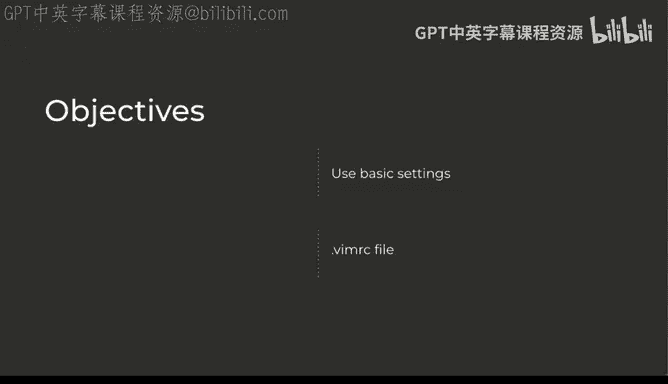
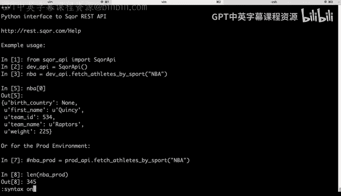
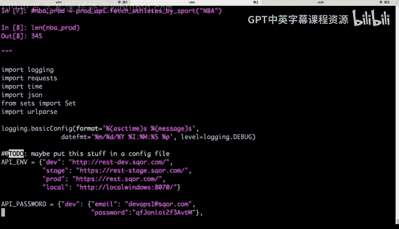
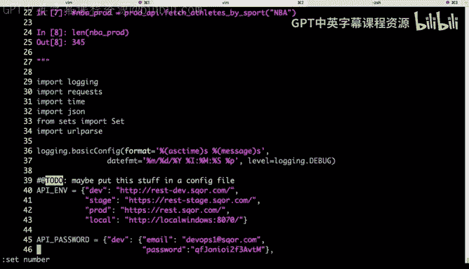
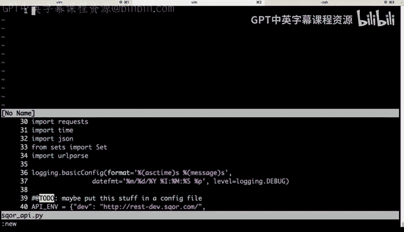
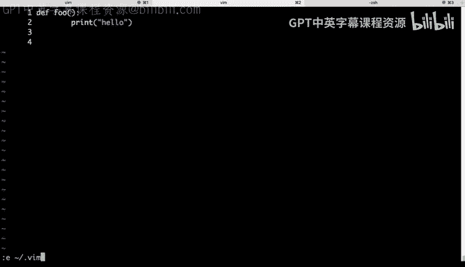
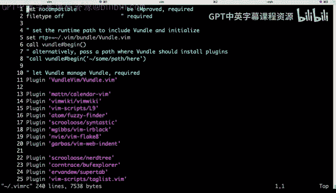
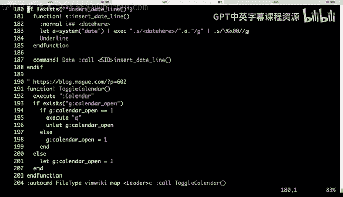
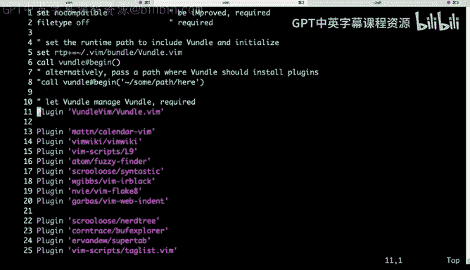
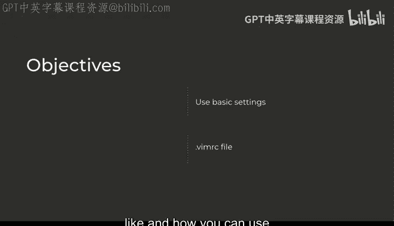

#  042：Vim基础配置教程 🛠️

在本节课中，我们将学习如何对Vim文本编辑器进行一些基础配置，并了解如何通过`.vimrc`文件持久化这些设置，以提升你的编码体验。

## 概述 📋

Vim是一个功能强大的文本编辑器，但其默认配置可能并不符合每个人的使用习惯。通过调整一些基础设置，我们可以让Vim变得更易用、更高效。本节将引导你完成这些基础配置。

## 默认Vim与配置后的Vim

到目前为止，我们看到的Vim是我个人配置后的版本。如果你使用的是未经配置的“开箱即用”版Vim，它的界面会更简单。

以下是同一文件在未配置Vim中的样子。

## 基础设置命令

我们可以通过命令行在Vim会话中临时调整一些设置。

以下是几个实用的基础设置命令：

*   **开启语法高亮**：输入命令 `:syntax on`。这会让代码根据其语法以不同颜色显示，使其更易读。在文件中向下滚动时，效果会更明显。
*   **显示行号**：输入命令 `:set number`。这些行号仅在你查看文件时显示，并不会被插入到文件内容中。但在处理代码时，它们非常有用。
*   **启用自动缩进**：输入命令 `:set autoindent` 或 `:set ai`。启用后，当你换到新行时，Vim会根据代码语法自动为你缩进。请注意，这需要Vim知道文件的语法类型。

## 文件类型与设置

当我们开始编辑一个新文件时，Vim可能不知道使用哪种语法高亮规则，因为文件尚未保存，没有文件扩展名。

使用保存命令（例如 `:w test.py`）保存文件。因为我们已经用 `.py` 扩展名保存了它，所以Vim现在会使用Python的语法高亮规则。

我们还可以设置显示标尺。输入命令 `:set ruler`。设置后，我们可以在界面底部看到光标的位置信息，包括行号和在该行中的列号。

## 持久化配置：.vimrc 文件

像上面这样每次打开文件都重新设置会很麻烦。Vim提供了一个名为 `.vimrc` 的配置文件来解决这个问题。

这个文件通常保存在你的用户主目录下，名为 `.vimrc`。在这个文件中，你可以写入之前那些相同的设置命令。

让我们看一下我的 `.vimrc` 文件示例。你可以看到里面有很多不同的配置命令，正是这些命令给了我个性化的Vim配置。

这样，每次我启动Vim时，它都会自动读取这个文件，并按照我喜欢的方式设置好开发环境。

## 插件生态系统

`.vimrc` 文件不仅能保存设置，还能管理插件。Vim拥有一个庞大的插件生态系统。

在我的 `.vimrc` 文件中，你也能看到所有我为自己工作安装的插件列表。

## 总结 🎯

本节课中，我们一起学习了如何定制Vim编辑器。你看到了一些可以用来个性化Vim会话的基础设置，也了解了 `.vimrc` 文件的样子，以及如何利用它来持久保存这些配置，让你每次都能在熟悉、高效的环境中工作。