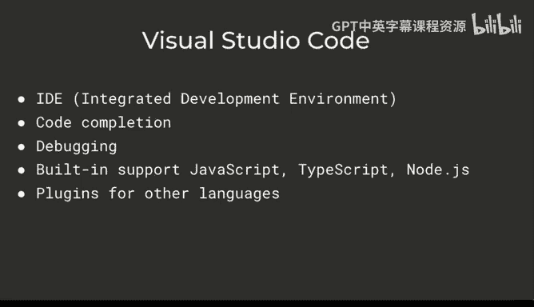

#  043：Visual Studio Code介绍 🖥️

在本节课中，我们将学习集成开发环境的定义，并对Visual Studio Code进行一个高层次的介绍。

## 什么是集成开发环境？

上一节我们提到了文本编辑器与IDE的区别，本节中我们来看看什么是集成开发环境。

集成开发环境是一个可以编写代码的地方，它通常拥有远超于编写文本文件的功能。例如，IDE通常具备调试代码的方式，可以在IDE应用程序内运行代码，并且它们常常与版本控制系统集成。

## Visual Studio Code简介

现在，让我们来谈谈Visual Studio Code。

Visual Studio Code是一个IDE，即集成开发环境。之前我们讨论过Vim本质上是一个文本编辑器，通过其插件生态系统，你可以添加插件将Vim变得非常类似于一个IDE，但开箱即用，它本身并不是一个IDE。与某些IDE相比，Visual Studio Code是一个非常轻量级的IDE，但它确实拥有一个允许你扩展它的插件环境。

以下是Visual Studio Code的一些核心特性：

*   **代码补全**：帮助编辑代码。
*   **交互式调试**：当你的代码出现问题时，这非常有用。
*   **内置语言支持**：对JavaScript、TypeScript和Node.js提供内置支持。
*   **丰富的插件生态系统**：为其他语言提供了庞大的插件生态系统。

## Visual Studio Code高层次概览

现在，让我们回顾一些关于Visual Studio Code的高层次概念。

本节课中，我们一起学习了集成开发环境的定义，并对Visual Studio Code这一轻量级但功能强大的IDE进行了介绍，了解了其核心特性，如代码补全、调试支持和可扩展的插件系统。