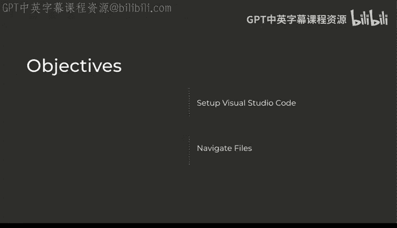
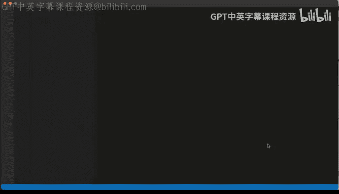
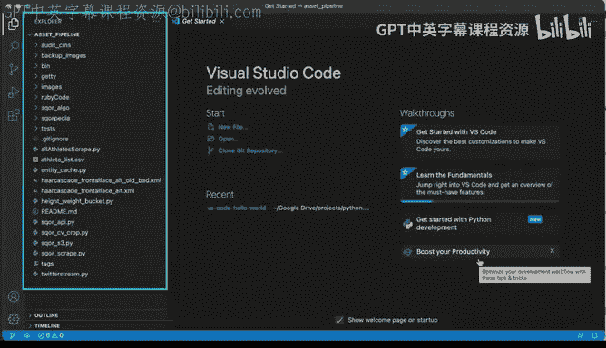
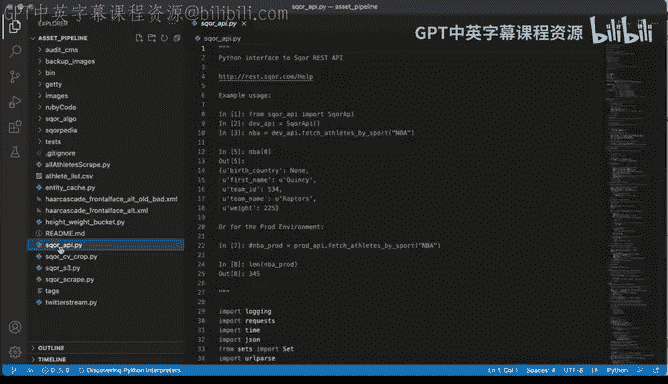
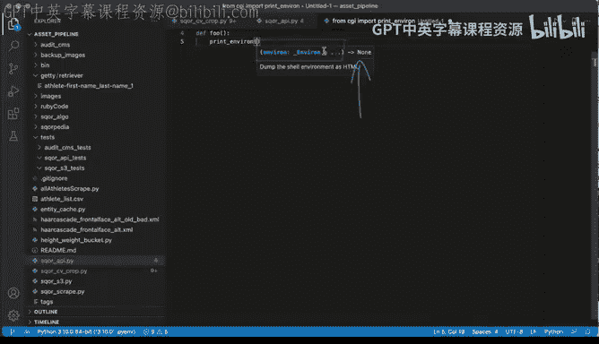
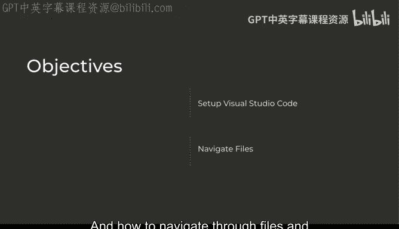

#  044：Visual Studio Code设置 🛠️

在本节课中，我们将学习如何设置Visual Studio Code（VS Code）集成开发环境，并掌握在VS Code中浏览文件和使用核心功能的基本方法。

## 初始界面与侧边栏

当你打开Visual Studio Code时，会看到类似下图的界面。

界面中包含一个“入门”页面，提供了有用信息的链接。左侧是侧边栏，包含以下主要图标：
*   **搜索**：用于在项目中搜索文本。
*   **源代码管理**：如果你使用Git等版本控制工具，可以在这里管理。
*   **运行和调试**：用于运行和调试你的程序。
*   **扩展**：用于安装和管理扩展插件。

## 安装Python扩展

由于我们使用Python，需要安装Python扩展来获得更好的开发支持。

以下是一个流行的Python扩展。安装过程需要一些时间。扩展安装完成后，它可能会询问是否要安装Python解释器。我们已经安装了Python，因此不需要这一步。

## 打开文件夹与浏览文件

现在，如果我们打开一个文件夹，例如一个包含`pipeline`项目的文件夹。

我们可以在资源管理器视图中看到该文件夹内的所有文件。

通过点击文件，可以打开它。

请注意，编辑器右侧有一个**大纲视图**，展示了整个文件的结构概览。你可以点击大纲视图中的条目，快速跳转到文件的特定部分。

## 文件导航与代码补全

如果我们打开了多个文件，并希望轻松地在它们之间切换，可以使用以下几种方法：
*   查看编辑器顶部的**标签页**。
*   使用左侧的**资源管理器**。
*   按下 `Ctrl + Tab` 快捷键，会显示所有已打开文件的列表。

让我们向项目中添加一个新文件。现在，我们有了一个未命名的文件。将其设置为Python文件后，当我们输入代码时，编辑器会提供**代码补全**建议。

我们可以看到从不同的建议中进行选择。当选择一个方法时，它会显示该方法的参数信息。对于这个特定的方法，显示的是它的帮助文档、所接受的参数以及它的返回值。

## 动手实践

现在，你已经了解了如何设置Visual Studio Code，包括为我们使用的编程语言安装特定扩展，以及如何在编写代码时浏览文件和使用代码补全功能。

让我们开始动手实践吧。

---

**本节课总结**

在本节课中，我们一起学习了Visual Studio Code的基本设置与核心操作：
1.  认识了VS Code的初始界面和主要侧边栏功能。
2.  学会了如何安装必要的**Python扩展**来增强开发体验。
3.  掌握了**打开项目文件夹**、使用资源管理器浏览文件以及通过大纲视图导航代码结构的方法。
4.  了解了在多个打开文件之间切换的几种方式。
5.  体验了强大的**代码自动补全**功能，它能提示方法参数和返回值，提升编码效率。