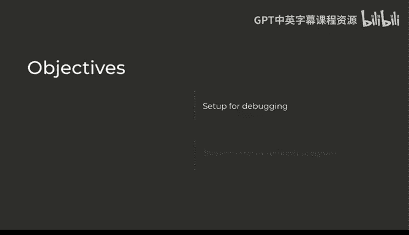
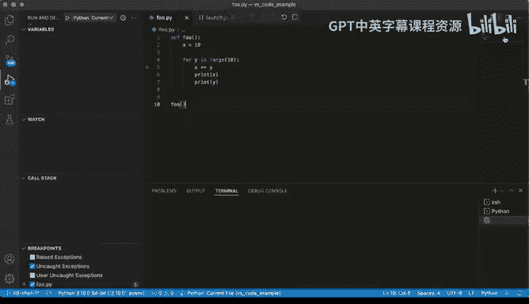
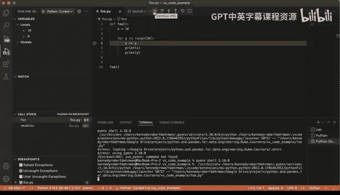
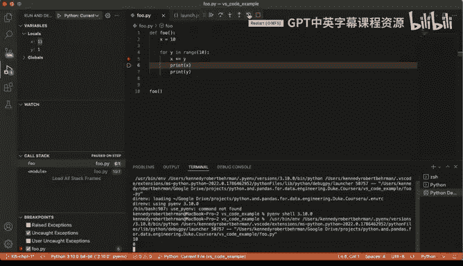
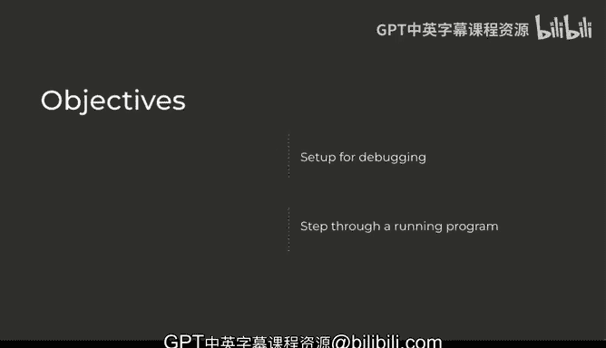

#  045：Visual Studio Code调试 🐛

在本节课中，我们将学习如何在 Visual Studio Code 中进行调试。你将学习如何设置调试环境，包括创建调试配置文件、设置断点，以及如何逐步执行一个正在运行的程序。



---

上一节我们介绍了 Visual Studio Code 的基本操作，本节中我们来看看如何使用其强大的调试功能。

这里我们有一个简单的 Python 程序示例。我们定义了一个名为 `foo` 的函数，设置了一个变量，遍历一个范围，然后打印变量并执行一些操作。最后，我们调用了这个函数。

```python
def foo():
    x = 10
    for i in range(5):
        y = i * 2
        print(f"i: {i}, y: {y}")
        x += y
    print(f"Final x: {x}")

foo()
```

如果我们直接运行它，可以在终端看到输出结果。现在，如果我们想调试这个函数，需要先进行设置。

首先，我们需要为调试器创建一个配置文件。我们想要一个 Python 调试配置。我们可以添加到此配置中，但为了示例的简洁性，我们将保持其默认设置。

接下来，我们回到代码中设置断点。断点是程序执行时会暂停的位置。让我们运行调试。



程序开始运行，但由于我们在循环开始处设置了断点，程序在首次执行到该行时暂停，因此尚未打印任何内容。

在调试侧边栏，我们可以看到变量的当前值。例如，`x` 是 10，`y` 是 0。

然后，我们可以在这里控制执行。我们可以选择 **继续**，这将使程序运行直到下一次遇到断点。它会再执行一次循环。

我们可以看到，终端已经打印出了循环第一次迭代的值。同时，侧边栏更新了变量的当前值。

我们还可以使用 **单步跳过**，它只向前移动一行，如果遇到嵌套函数调用，不会进入函数内部。



或者使用 **单步进入**，这将进入被调用的函数内部。

如果我们已经进入了一个函数，可以使用 **单步跳出** 来退出该函数。

此外，我们可以 **重新启动** 整个调试过程。

这就是调试的基本工作流程。当你的软件项目出现问题时，这是一种非常重要且实用的方法，可以帮助你查看问题所在。

---

现在，你已经了解了如何在 Visual Studio Code 中导航、如何通过插件进行设置、如何在文件中导航以及如何设置调试。



让我们尝试将所有这些知识结合起来运用。

---



本节课中我们一起学习了 Visual Studio Code 的调试功能。我们掌握了如何创建调试配置、设置断点，以及使用继续、单步跳过、单步进入和单步跳出等控制命令来逐步检查程序状态。这是定位和修复代码问题的核心技能。