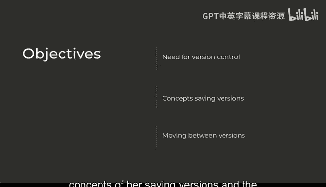
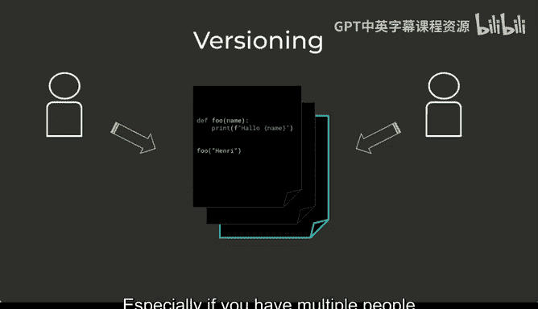
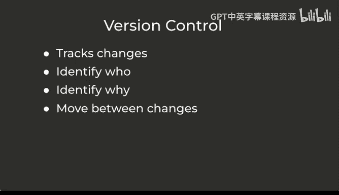
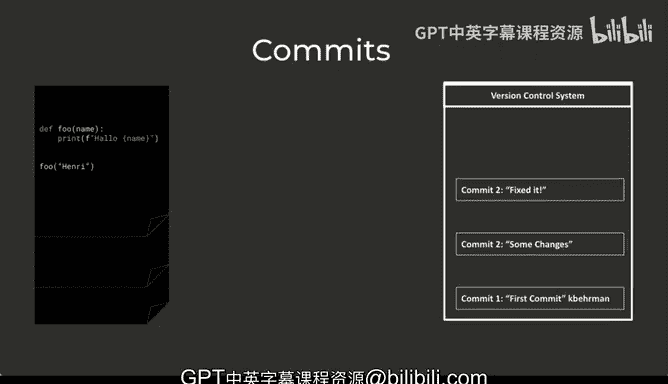

#  046：什么是版本控制 🗂️

在本节课中，我们将要学习**版本控制**的概念。我们将讨论为什么需要版本控制，以及如何保存和在不同版本之间切换。

---

在项目开发过程中，你会不断进行修改。当你做出更改后，有时可能需要回到之前的某个版本。例如，你可能尝试重写一个函数，但后来发现**早期版本**的解决方案实际上更好。

如果你只进行了短时间的开发，要回到早期版本相对容易。你的集成开发环境或文本编辑器通常都有“撤销”按钮。然而，对于一个大型项目，或者经过较长时间后，要回到某个早期版本就变得非常复杂。如果有多人同时为同一个项目做贡献，情况会更加棘手。

---

这正是**版本控制**发挥作用的地方。版本控制系统会跟踪所有更改，识别是谁做出了更改，并且可以选择记录更改的原因。它还允许你在项目的不同更改和不同版本之间自由切换。

---

那么，版本控制是如何工作的呢？它的核心思想是将一组更改**提交**到版本控制系统中。

当你首次提交项目时，意味着你启动项目并到达一个你认为值得保存的节点。此时，你进行一次**提交**。每次提交都可以附带一条提交信息。你应该包含一条信息，并确保该信息能描述本次提交的内容。

提交进入版本控制系统后，系统会为这次提交生成一个**唯一标识符**，记录提交信息以及提交者。之后，当你继续开发并准备进行下一次提交时，版本控制系统不会提交整个已更改的文件或整个项目。相反，它会计算**当前更改**与**上一次提交**之间的差异，只提交这些差异本身，而不是整个项目。

通过这种方式，系统构建了一个**更改历史记录**。它可以通过按顺序应用所有更改来构建出最新的版本。一旦版本控制系统中有了这一系列提交，你就可以轻松地回到任何一个早期版本进行查看，或者从中提取某些内容，然后再轻松地返回到最新版本。

因此，使用版本控制系统，你可以：
*   识别是谁进行了提交。如果你想知道某个更改的原因，可以找到对应的人进行沟通。
*   记录你自己进行更改的原因。
*   在这些更改的不同版本之间来回切换。

---

本节课中，我们一起学习了版本控制的基本概念。我们了解到版本控制通过跟踪更改、记录提交者和原因，并管理不同版本之间的差异，来帮助开发者在项目开发过程中高效地协作和回溯。掌握版本控制是进行任何规模软件开发或数据工程项目的基础技能。