#  047：Git与Git概念介绍 🚀

在本节课中，我们将介绍Git版本控制系统。你将学习如何设置仓库、管理提交以及如何创建和合并分支。

---

上一节我们介绍了Git的基本概念，本节中我们来看看一些我们将要使用的基础Git命令。

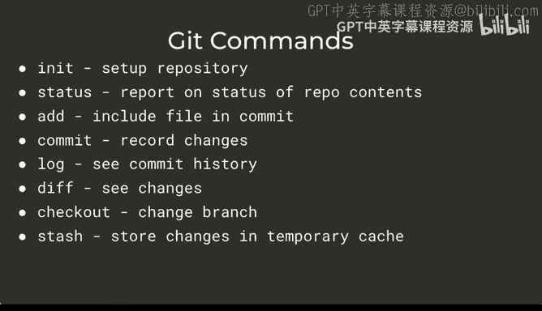

以下是核心的Git命令列表：
*   `git init`：初始化一个新的Git仓库。
*   `git status`：查看仓库当前状态。
*   `git add`：将文件添加到暂存区，准备提交。
*   `git commit`：将暂存区的更改记录到仓库历史中。
*   `git log`：查看提交历史记录。
*   `git diff`：查看工作区与最后一次提交之间的差异。
*   `git checkout`：切换分支或恢复文件。
*   `git stash`：将当前未提交的更改临时保存起来。
*   `git merge`：将指定分支的更改合并到当前分支。

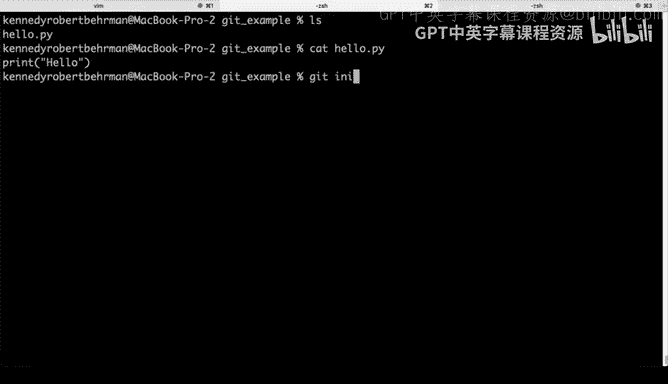

---

现在，让我们通过一个具体示例来实践这些命令。假设我们有一个目录，里面创建了一个简单的Python脚本。

首先，我们需要初始化一个Git仓库。使用命令：
```bash
git init
```
这个命令会在当前目录创建一个新的Git仓库。

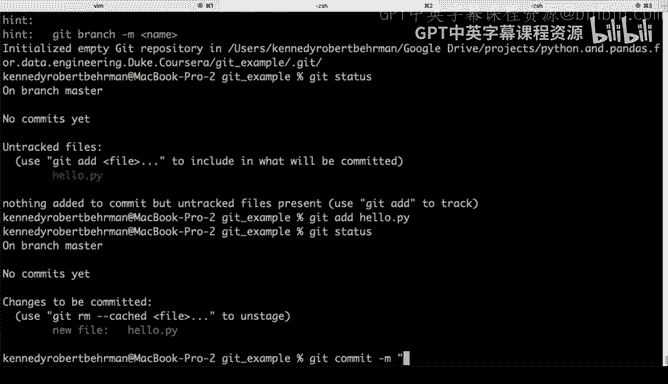

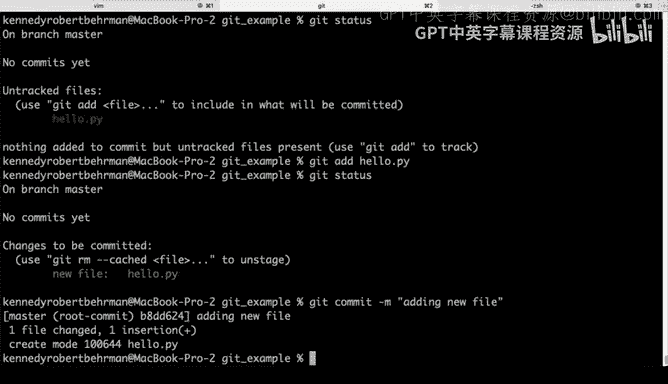

初始化后，我们可以使用`git status`来查看仓库状态。默认情况下，Git会创建一个名为`master`的主分支。此时，你会看到还没有任何提交，并且有一个名为`hello.py`的未跟踪文件。

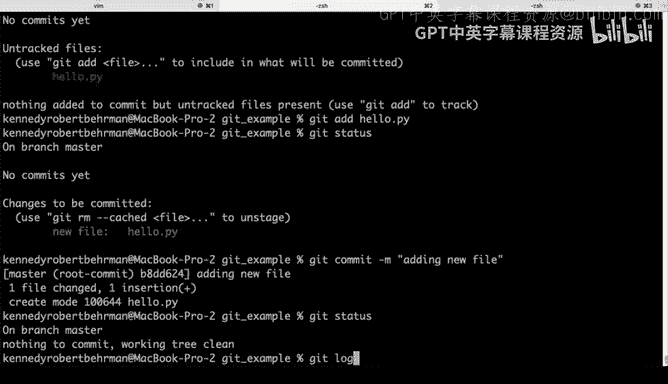

为了开始跟踪这个文件，我们使用`git add`命令：
```bash
git add hello.py
```
执行后，该文件已被添加到暂存区，等待下一次提交。

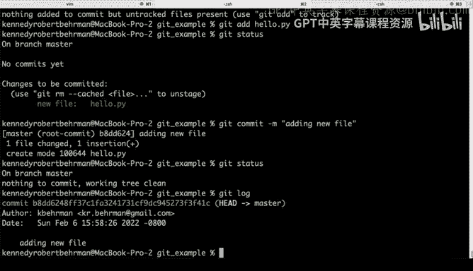

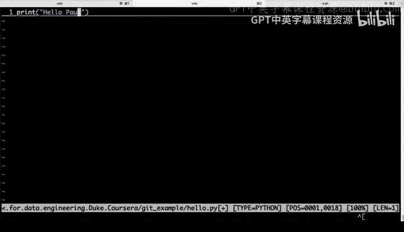

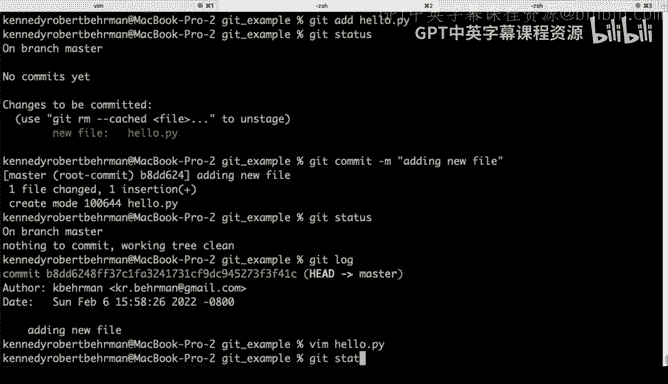

接下来，我们进行提交。提交时附带描述信息是一个好习惯。使用命令：
```bash
git commit -m “添加新文件”
```
现在，文件已被正式提交到仓库。再次运行`git status`，会显示没有新的更改需要提交。

我们可以使用`git log`来查看提交历史：
```bash
git log
```
这会显示我们刚刚完成的提交及其信息。

---

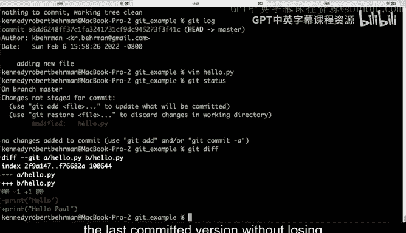

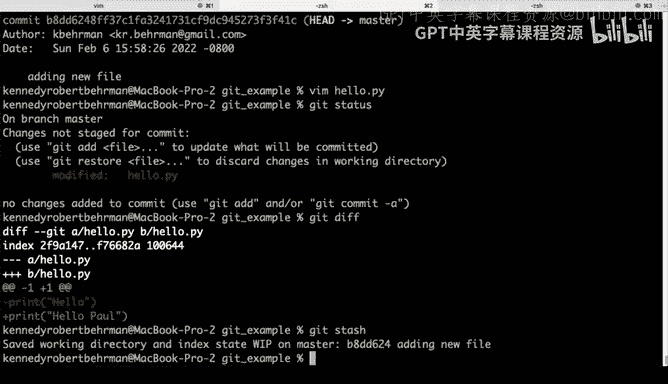

如果我们修改了`hello.py`文件，然后运行`git status`，Git会提示该文件已被修改。

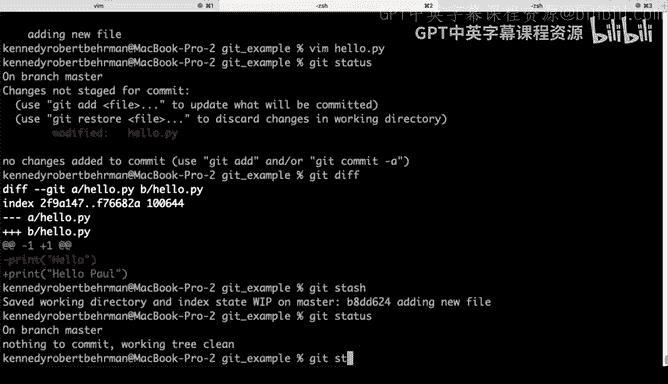

在提交之前，我们可以使用`git diff`来查看具体修改了哪些内容：
```bash
git diff
```
这个命令会显示工作区文件与最后一次提交版本之间的差异。

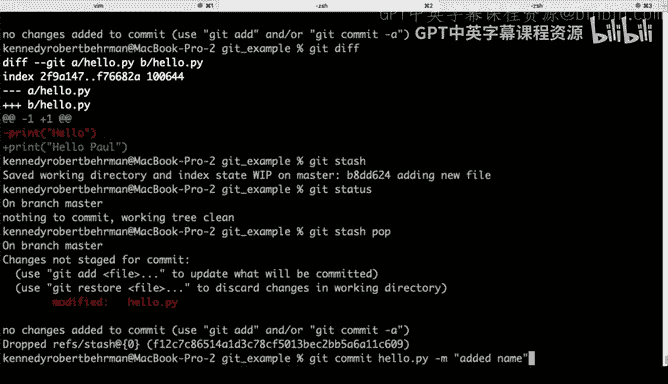

假设我们暂时不想提交这些修改，但又不想丢失它们，可以使用`git stash`将更改临时存储起来：
```bash
git stash
```
这会将当前的修改保存到一个临时区域。之后，我们可以使用`git stash pop`来恢复这些更改。

当我们决定提交时，可以直接在`git commit`命令中指定文件，这样就无需先执行`git add`：
```bash
git commit -m “更新问候语” hello.py
```

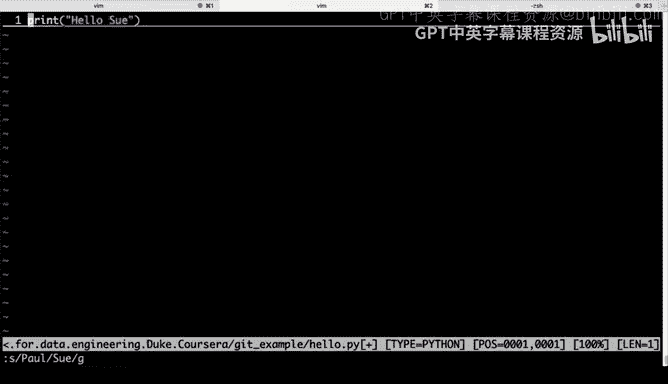

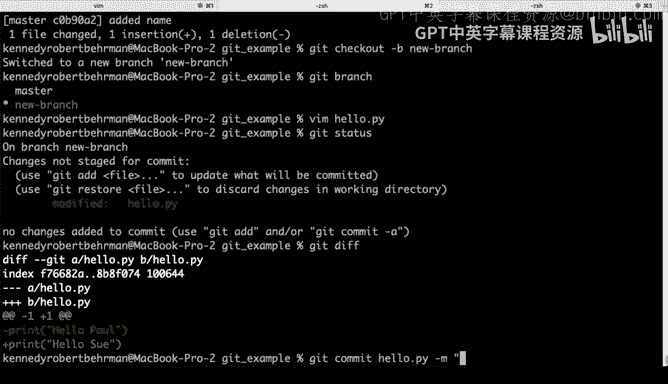

---

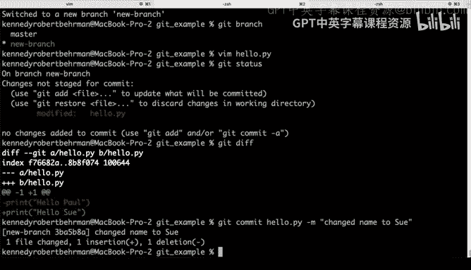

在协作项目中，最佳实践是在独立的分支上进行工作。我们可以使用`git checkout`命令创建并切换到一个新分支：
```bash
git checkout -b new-feature
```
使用`git branch`命令可以查看所有分支，并确认当前所在的分支。

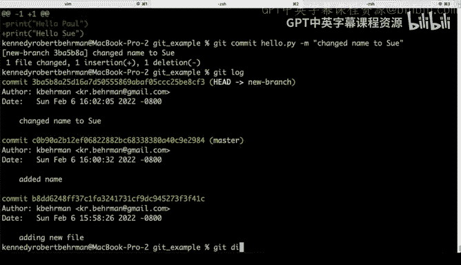

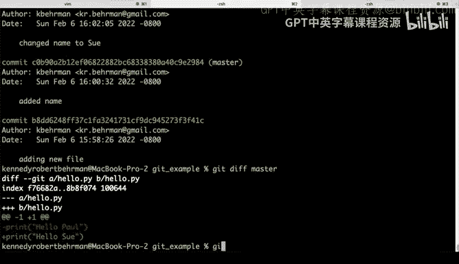

在新分支上，我们可以自由地进行修改和提交。这些更改只会影响当前分支。

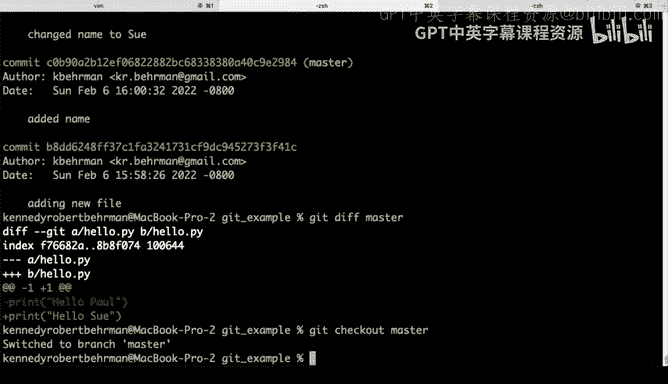

要查看当前分支与`master`分支的差异，可以运行：
```bash
git diff master
```

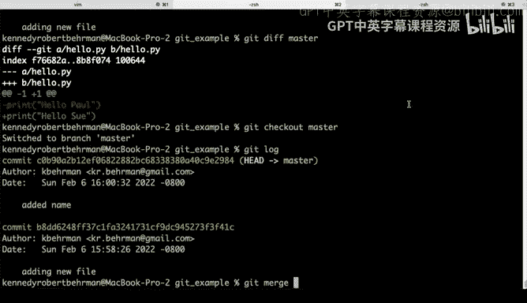

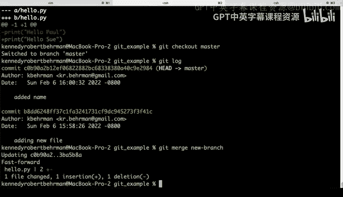

当我们完成新功能开发后，需要切换回`master`分支：
```bash
git checkout master
```
此时，查看`git log`，你会发现新分支上的提交在`master`分支的历史中并不存在。

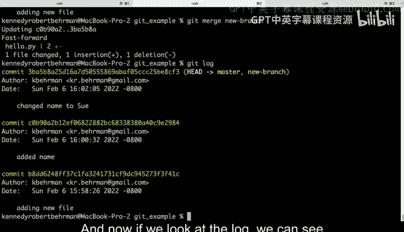

最后，要将新分支的更改合并到`master`分支，使用`merge`命令：
```bash
git merge new-feature
```
合并后，再次查看`git log`，就能看到来自新分支的更改已经整合到`master`分支的历史中了。

---

本节课中我们一起学习了Git版本控制的核心操作。我们回顾了从初始化仓库（`git init`）、跟踪和提交更改（`git add`, `git commit`），到查看状态与历史（`git status`, `git log`, `git diff`）的完整流程。此外，我们还实践了如何使用分支（`git checkout`, `git branch`）进行隔离开发，以及如何临时保存更改（`git stash`）和最终合并分支（`git merge`）。掌握这些基础命令是进行高效代码管理和团队协作的第一步。