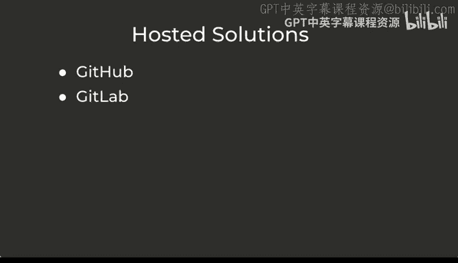
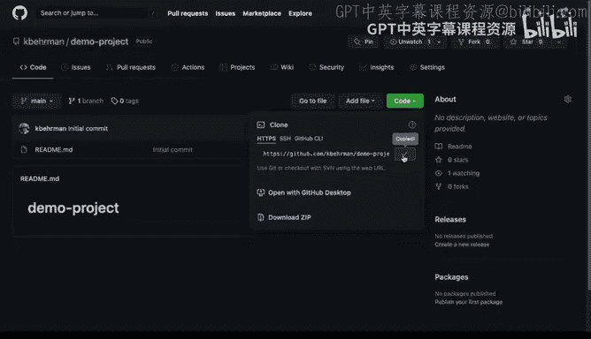
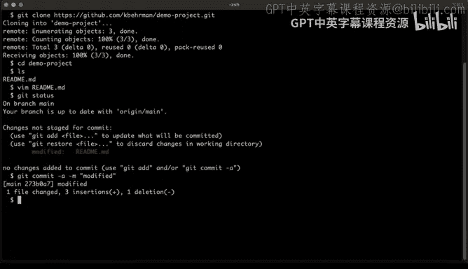
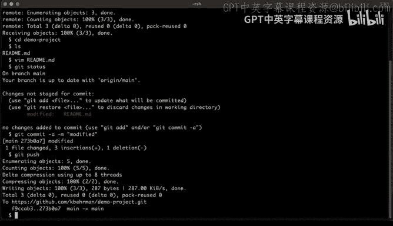
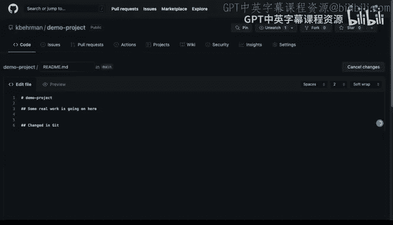
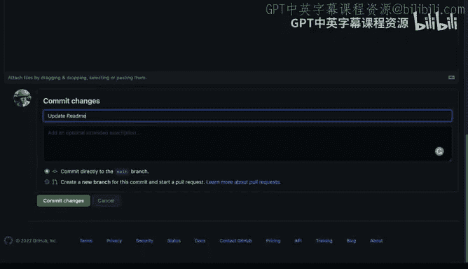
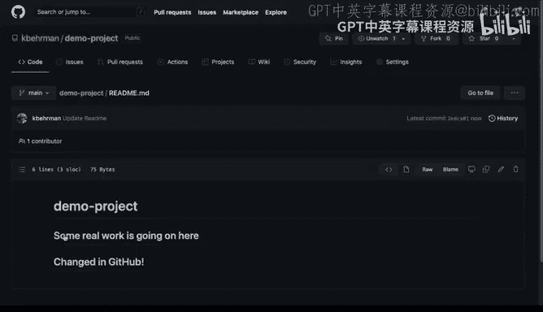
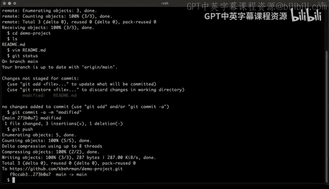
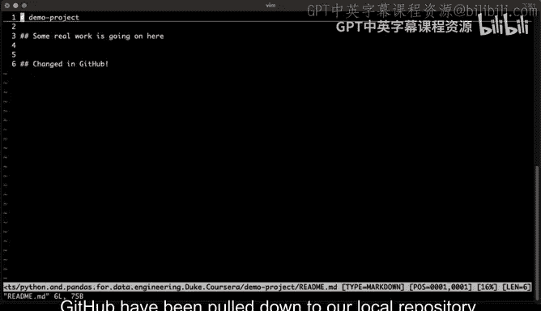
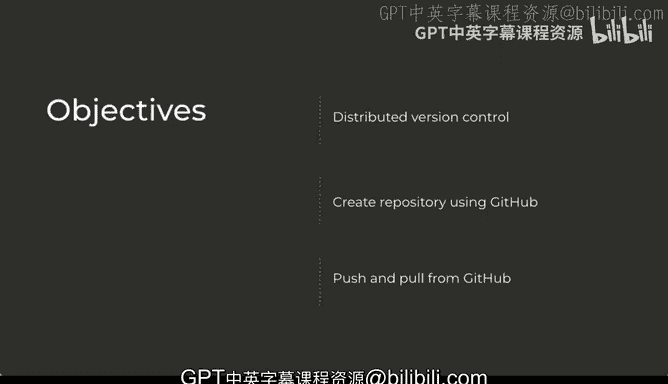

#  048：使用GitHub进行版本控制 🚀

在本节课中，我们将要学习如何使用GitHub进行版本控制。我们将首先介绍分布式版本控制的概念，然后学习如何在GitHub上创建仓库，以及如何将本地更改推送到GitHub，或从GitHub拉取更改到本地。

## 分布式版本控制介绍

上一节我们介绍了Git的基本操作，本节中我们来看看分布式版本控制系统的概念。

Git版本控制系统是一个**分布式版本控制系统**。这意味着你可以拥有同一个仓库的多个副本。这些副本都是完整的，并且可以独立工作。

如果你在一个仓库副本中进行提交，你可以将这些提交分享给另一个仓库副本，反之亦然。Git本身支持在开发者各自的机器之间进行这种操作，但更常用的解决方案是使用一个托管式的集中服务器版本。每个开发者都向该服务器推送或从该服务器拉取更改。

在Git世界中，有两个非常流行的基于服务器的托管解决方案：**GitHub**和**GitLab**。从开发者的角度来看，它们的工作方式非常相似，因此我们仅以GitHub为例进行讲解。

## 创建GitHub仓库

理解了分布式版本控制的基本概念后，接下来我们看看如何在GitHub上创建一个新的仓库。

首先，访问 [github.com](https://github.com) 并注册一个免费账户。




注册并登录GitHub后，你会看到类似下图的界面。这个区域显示的是仓库。在我的GitHub账户中，你可以看到一些我创建并拥有的仓库，以及一些我被授权参与协作的仓库。

要创建一个新项目或新仓库，请点击“New repository”按钮。

以下是创建新仓库时需要填写的几个关键信息：
*   **仓库名称**：为仓库命名。
*   **描述**：可选的描述信息。
*   **可见性**：选择公开（其他人可以发现）或私有（由你控制谁可以查看）。
*   **初始化文件**：可以选择用一些项目常用文件来初始化仓库，例如：
    *   **README文件**：用于描述项目如何工作以及如何使用。
    *   **.gitignore文件**：告诉Git忽略某些类型的文件，使它们不会出现在`git status`的结果中。
    *   **许可证**：可以选择一个许可证。

在本例中，我们仅选择添加一个README文件。现在，我们已经成功创建了一个仓库。

## 克隆仓库与本地操作

创建好远程仓库后，我们需要将其复制到本地进行工作。这个过程称为“克隆”。

查看仓库页面时，我们可以看到分支列表（目前只有默认的`main`分支），以及允许我们“克隆”此仓库的信息。克隆意味着在其他地方创建它的副本。

我们有以下几种克隆选项。如果我们在本地终端中，可以使用`git clone`命令来下载项目的副本。

```bash
git clone <仓库URL>
```

现在，我们在本地拥有了项目，并且可以看到它已经创建了一个README文件。如果我们修改这个README文件，然后使用`git status`命令，可以看到文件已被修改。我们可以将其提交到本地仓库。

## 推送更改到GitHub

在本地完成提交后，我们需要将这些更改同步到远程的GitHub仓库。



如果我们想将本地更改推送到GitHub，我们使用`git push`命令。

```bash
git push origin main
```




现在，如果我们切换回GitHub页面，可以看到有了一次新的提交，这正是我们在本地终端中进行的提交。我们可以查看文件，确认我们的更改已被添加。


## 在GitHub上直接修改与拉取

版本控制是双向的，我们也可以在GitHub上直接修改文件。

你也可以直接在GitHub网页上修改文件并提交更改，通常需要为其提供一个提交信息。








现在，如果我们回到本地终端，并希望将这些在GitHub上所做的更改拉取到本地机器，我们使用`git pull`命令。

```bash
git pull origin main
```




现在，如果我们查看本地的README文件，可以看到我们在GitHub上所做的更改已经被拉取到了本地仓库中。

## 课程总结

本节课中，我们一起学习了分布式版本控制系统的概念。我们演示了如何使用GitHub创建仓库，以及如何从本地机器向GitHub推送更改，或从GitHub拉取更改到本地。通过`git push`和`git pull`命令，你可以在本地和远程仓库之间轻松同步工作进度。






