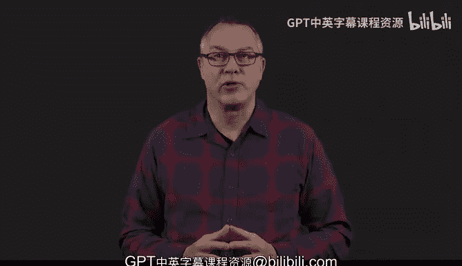

#  049：Python与Pandas数据工程总结 🎯

在本节课中，我们将对“Python与Pandas数据工程”部分的学习内容进行总结。我们将回顾从项目环境搭建到核心工具使用的整个学习路径，帮助你巩固所学知识。

恭喜你，你已经完成了数据工程中的Python和Pandas部分的学习。

现在，你已经掌握了如何设置项目环境、Python和Pandas编程的基础知识，以及如何使用Vim和Visual Studio Code进行开发。

上一节我们介绍了具体的开发工具，本节中我们来看看整个课程的收获与总结。

我希望你喜欢这门课程，并祝愿你在未来的数据工程道路上一切顺利。

以下是本课程涵盖的核心技能点回顾：

*   **项目环境设置**：学会了为数据工程项目创建和管理独立的Python环境。
*   **Python编程基础**：掌握了变量、数据类型、控制流和函数等核心语法。
*   **Pandas库应用**：理解了如何使用Pandas进行数据加载、清洗、转换和分析。核心操作通常涉及类似 `df = pd.read_csv(‘data.csv’)` 的代码。
*   **开发工具使用**：熟悉了在命令行中使用Vim编辑器以及在集成开发环境（IDE）中使用Visual Studio Code进行高效开发。

本节课中我们一起学习了数据工程中Python与Pandas部分的关键技能。你已从零开始，逐步掌握了构建数据工程解决方案所需的基础编程能力和工具链。这些知识是通往更高级数据操作、自动化脚本和数据分析的坚实基石。请继续实践和探索，将这些技能应用于实际项目中。