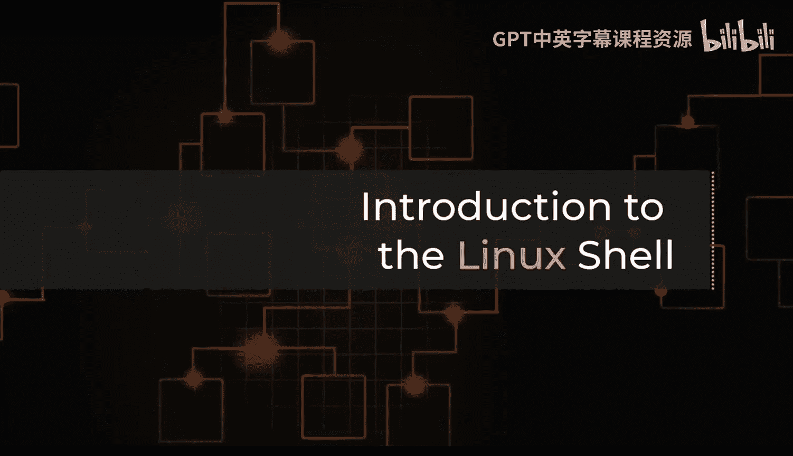
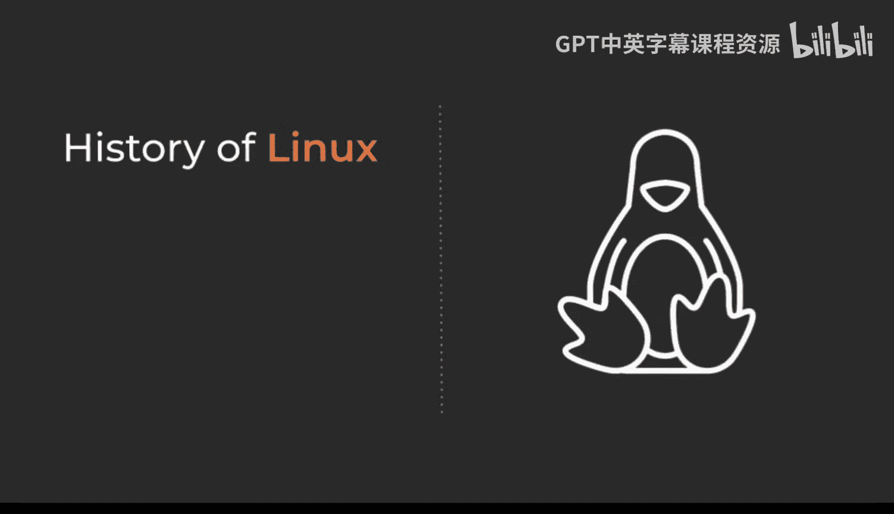
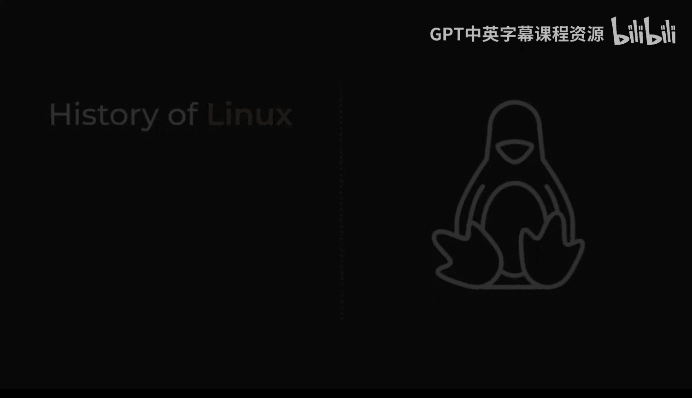

#  005：Linux Shell简介 🐧

在本节课中，我们将要学习Linux Shell。Linux Shell是现代云计算和机器学习中一个极其重要的核心组件。它是一个如今在云计算领域无处不在的环境。如果你从事数据工程或数据科学工作，几乎不可能不接触到Linux Shell。即使是在Jupyter Notebook或容器中，你也很可能会遇到某种Linux环境。它始于90年代的一个学生项目，如今已发展成为拥有超过2800万行代码的庞大系统。接下来，让我们深入了解Linux Shell的细节，探讨它如何能帮助你。

## 什么是Linux？如何开始？

首先，我们将介绍什么是Linux以及如何开始使用它。Linux之所以重要，是因为它作为一个执行环境，在你编写的任何代码中都扮演着普遍存在的角色。

## 介绍Shell环境

上一节我们介绍了Linux的基本概念，本节中我们来看看Shell环境。Shell中有哪些关键特性是重要的？你可以通过自动化或快捷方式来简化哪些操作？

以下是关于Shell的一些关键点：
*   Shell是一个命令行界面，允许用户与操作系统交互。
*   它支持通过脚本实现任务自动化。
*   用户可以利用别名和快捷键来提高工作效率。

## 不同的云Shell环境

了解了Shell的基础后，我们来看看不同的云Shell环境。有趣的是，一旦你熟悉了一种云Shell环境，通常可以很容易地切换到另一种。

以下是几种常见的云Shell环境：
*   **AWS Cloud 9**：一个基于云的集成开发环境，包含Shell功能。
*   **AWS CloudShell**：AWS提供的浏览器内Shell环境。
*   **Google Cloud Shell**：Google Cloud平台提供的浏览器内Shell环境。
*   **Azure Cloud Shell**：微软Azure平台提供的浏览器内Shell环境。
*   **本地终端**：你自己机器上的终端程序。

我们将比较这些不同的环境，看看如何优化各自的工作流程，以获得最高效的体验。

## Linux的历史

最后，我们来谈谈Linux的历史。Linux本身已经存在了相当长的时间。它由赫尔辛基大学的**Linus Torvalds**在1991年创立。当时他对专有软件感到沮丧，于是开发了如今有史以来最成功的开源项目之一。

本节课中，我们一起学习了Linux Shell的基础知识，包括其定义、重要性、Shell环境的关键特性、不同的云Shell实现选项，以及Linux项目的起源和历史。掌握这些内容，是高效进行数据工程和云计算工作的第一步。