#  006：Linux安装与访问 🐧


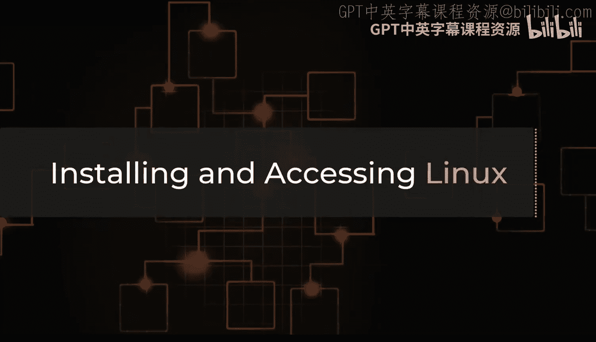

在本节课中，我们将学习如何开始使用Linux操作系统。Linux是全球最流行的操作系统之一。如果你要部署代码，它很可能会被部署到云端的Linux环境或你自己的物理数据中心。Ubuntu和Red Hat Linux是两个最流行的版本。此外，还有云服务商特定的Linux版本，例如Amazon Linux。本教程将讨论如何开始使用Linux，如何安装它，以及你可以选择哪些选项，例如在桌面上使用Parallels、在云端启动虚拟机，甚至使用Docker在你的物理工作站上运行Linux。我们将尝试其中几种不同的方式，然后你将能够选择最适合你的Linux发行版和技术。让我们开始吧。

## 安装Linux的方法 💻

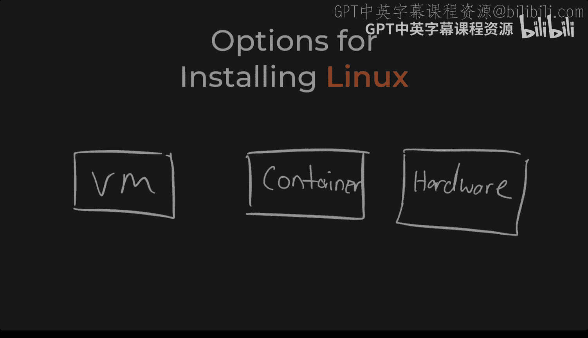

上一节我们介绍了Linux的重要性，本节中我们来看看如何安装Linux。这是使用Linux操作系统的第一步。安装Linux有多种方法，你可以根据自己的需求和环境选择最合适的一种。

以下是几种主要的安装选项：

*   **虚拟机**：这是一种非常流行的方式。你可以在云端或本地桌面（使用Parallels、VMware等软件）上运行Linux虚拟机。对于数据工程师来说，这很常见，因为最终你的代码很可能就部署在这样的环境中。
*   **容器**：使用Docker等软件可以在你的桌面机器上运行Linux容器。这是开始使用Linux的一个绝佳方式，它为使用容器进行开发提供了非常好的工作流程。
*   **云平台**：直接在云平台（如AWS、Google Cloud）上启动Linux虚拟机或使用Kubernetes部署容器。这也是非常普遍的做法，例如使用Amazon EC2实例或Google Kubernetes引擎。
*   **物理硬件**：你可以在笔记本电脑或服务器上直接安装Linux。例如，我有一台安装了Linux的戴尔笔记本电脑，用于测试特定的配置。

Linux操作系统的使用方式多种多样，由你选择安装的位置。接下来，我们将逐步展示这些方法。

## 方法一：使用桌面虚拟机（如Parallels） 🖥️

现在，让我们看看如何使用VMware Parallels Desktop这类软件。Parallels Desktop允许我使用不同的虚拟机。例如，我这里有一个Ubuntu 18.04的虚拟机。如果你刚开始使用Linux，这通常是一个起点。

需要注意几点：在配置中，我可以指定虚拟机使用6个处理器核心和10GB内存。你还可以调整图形设置等，让这个“访客”系统在你的桌面上获得完整的体验。

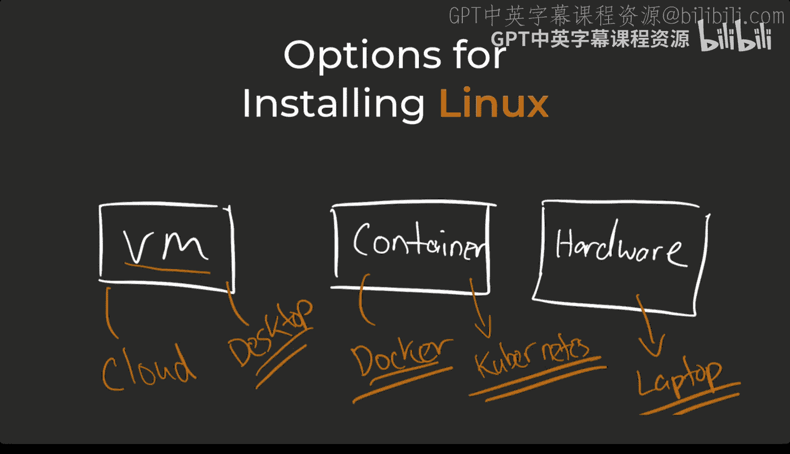

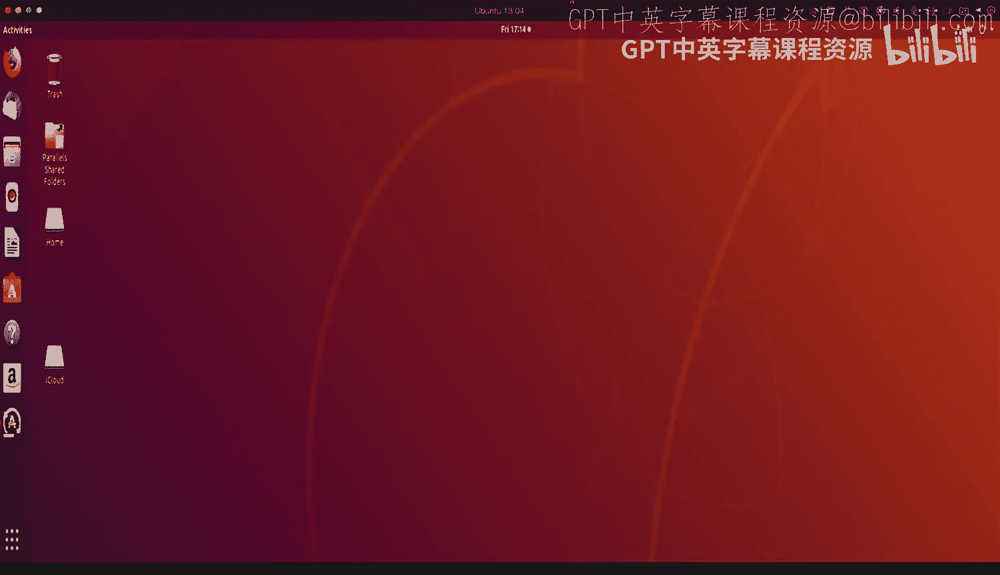

对于数据工程师，你通常会打开一个终端。例如，我可以搜索并打开终端，然后运行`ls`命令来列出文件，或者运行`top`命令查看系统进程。我也可以使用`cd`命令切换到桌面目录。

```bash
cd ~/Desktop
```

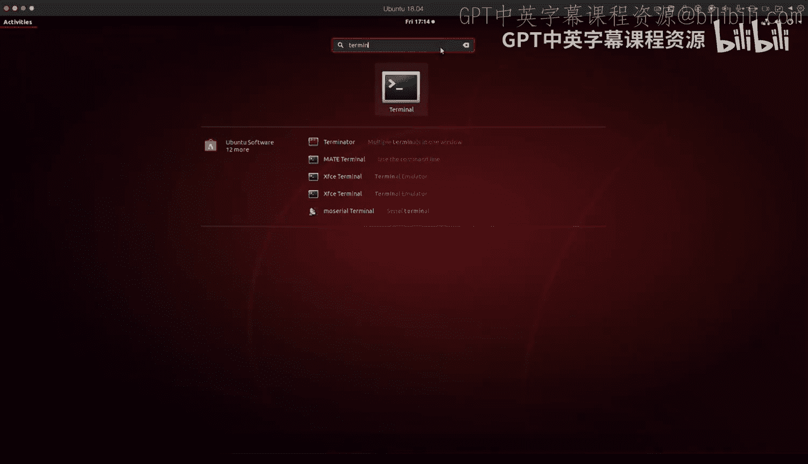

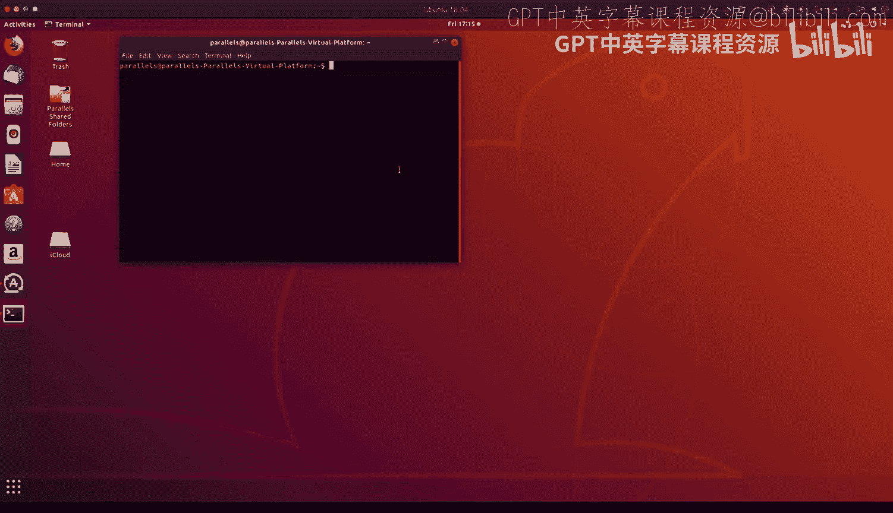

在这里，由于Parallels的共享文件夹功能，如果我创建一个文件：

```bash
echo "hello" > test_file.txt
```

你会发现这个文件也出现在我宿主机的桌面上。通过Ubuntu虚拟机，你可以安装软件、更新系统，完全模拟运行Linux的体验。这是大多数人初次使用Ubuntu的方式。

除了使用预建的虚拟机，你也可以轻松添加自己的。在Parallels中点击“+”号，可以选择从微软获取Windows 10、从DVD安装，或者在“免费系统”中下载Ubuntu Linux。例如，选择下载Ubuntu 20.04.2，点击下载后，软件会解压并引导你完成安装过程。

安装过程中，通常需要你设置一个密码。完成这些步骤后，Ubuntu就设置好了，你可以开始使用了。整个过程非常简单。

## 方法二：使用Docker容器 🐳

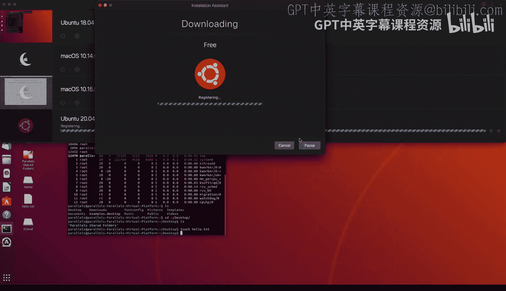

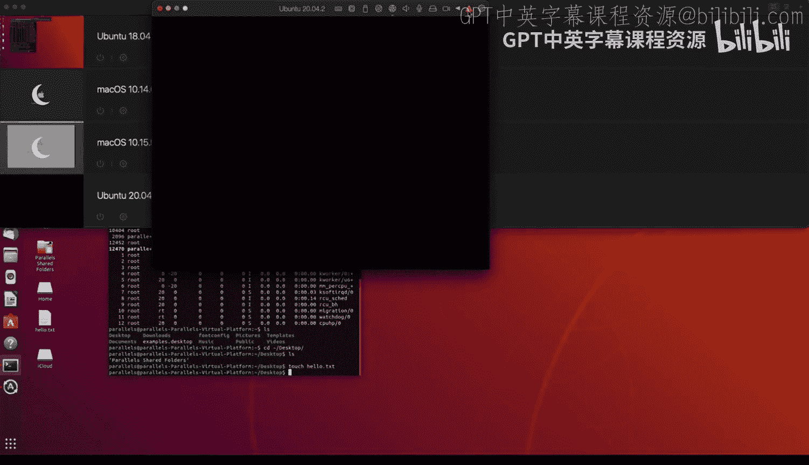

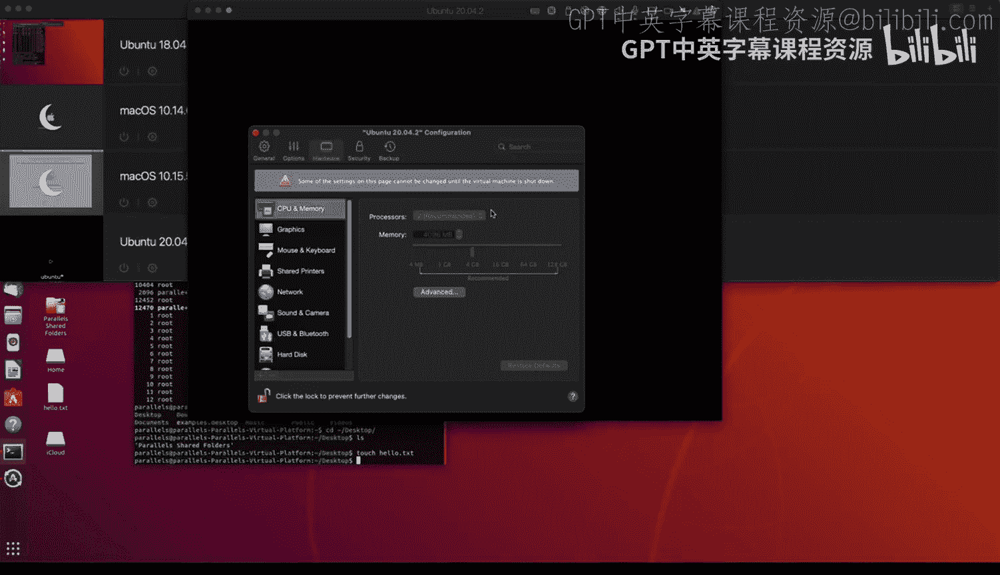

上一节我们体验了桌面虚拟机，本节中我们来看看更轻量级的方法——Docker。Docker是你安装在桌面上的软件。在配置中，你可以设置Docker是否随登录启动，分配多少CPU和内存资源，以及是否启用Kubernetes。

因为Docker正在运行，我可以在终端（这里是macOS的终端）输入命令来查看运行中的容器：

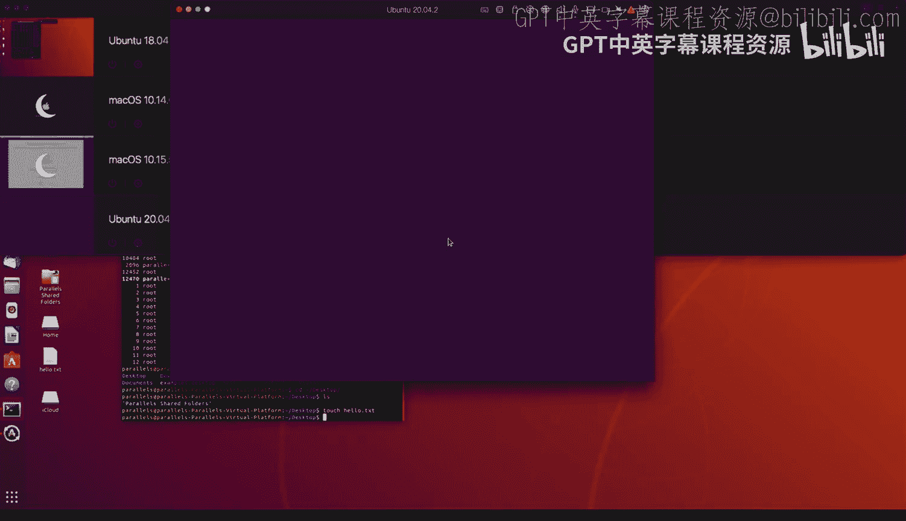

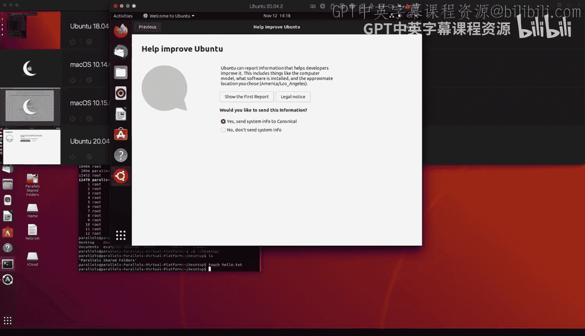

```bash
docker ps
```

目前没有容器在运行。现在，让我们运行一个Ubuntu容器：

```bash
docker run -it ubuntu
```

这个命令会检查本地是否有Ubuntu镜像，如果没有则会拉取。运行后，我就进入了容器的Shell。输入`uname -a`可以看到，虽然宿主机是macOS，但我已经进入了Linux环境。

```bash
uname -a
```

这可能是使用Ubuntu或其他Linux操作系统最简单的方法之一。再次运行`docker ps`，现在可以看到一个容器正在运行。Docker方法非常便捷，我经常使用它。

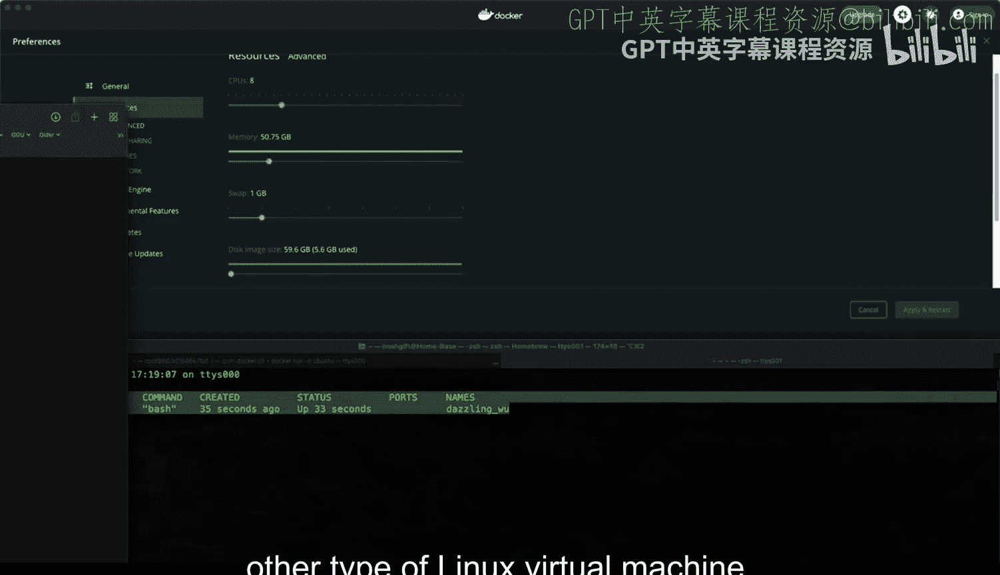

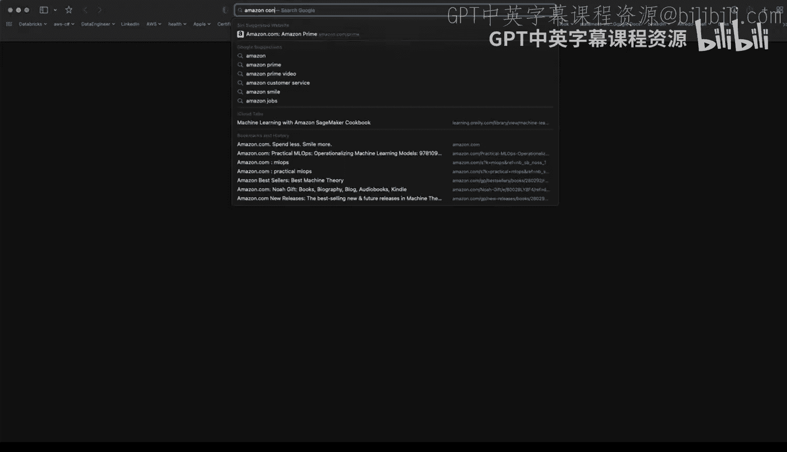

## 方法三：使用云平台（如AWS） ☁️

现在让我们转向第三种方法，即直接在云端启动Ubuntu虚拟机或其他Linux虚拟机。我将使用亚马逊云控制台。

登录AWS控制台后，我可以快速启动一个虚拟机。这是云计算的常规操作：进入控制台，启动虚拟机。在系统选择界面，我可以选择macOS或其他系统，但作为数据工程师，我会选择Linux，因为这才是代码最终部署的环境。

选择Linux镜像后，点击“审核和启动”，确认设置后即可启动实例。我可以看到实例状态从“pending”变为“running”。然后，我就可以通过SSH协议连接到这台机器。

此外，AWS还提供了Cloud9，这是一种专门为云端开发设计的环境，使用起来更简单。创建环境时，我可以选择Linux，并使用一个微型实例。我推荐使用Amazon Linux，如果你在AWS上工作的话。创建完成后，它会打开一个Shell，这就是一个Linux终端。从这里，我可以开始开发软件、运行命令，进行任何数据工程相关的工作。

---

**总结**

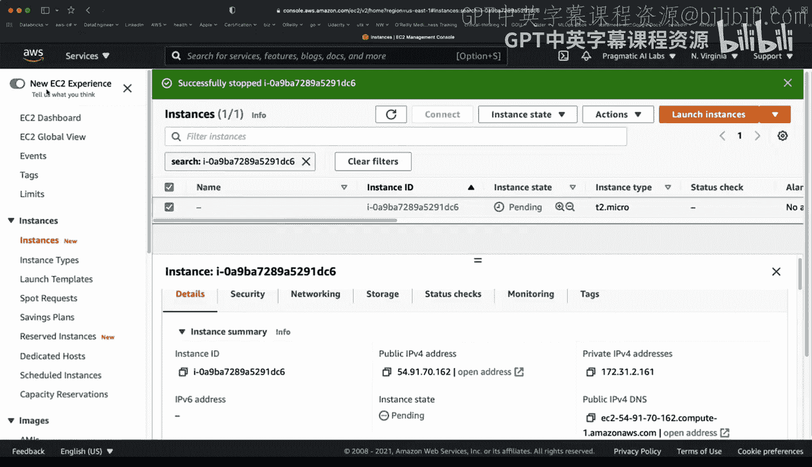

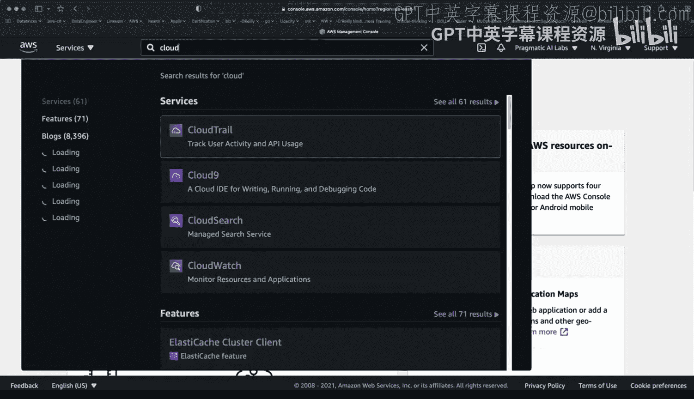

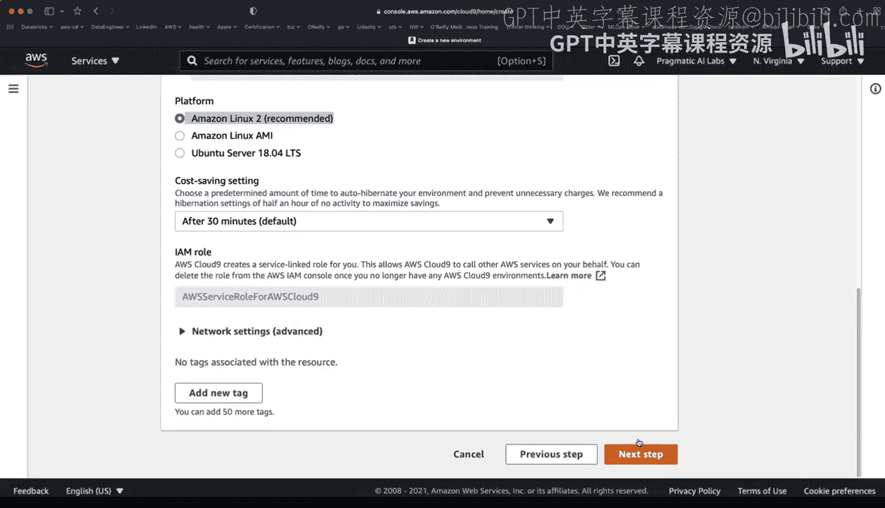

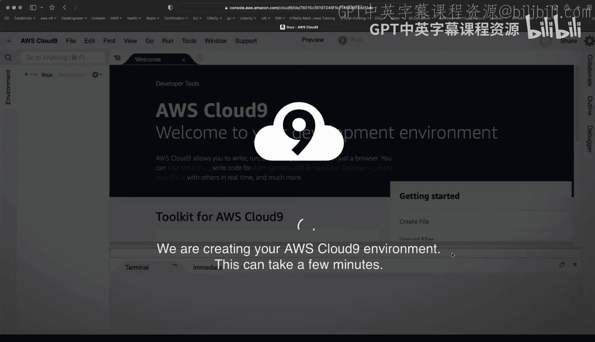

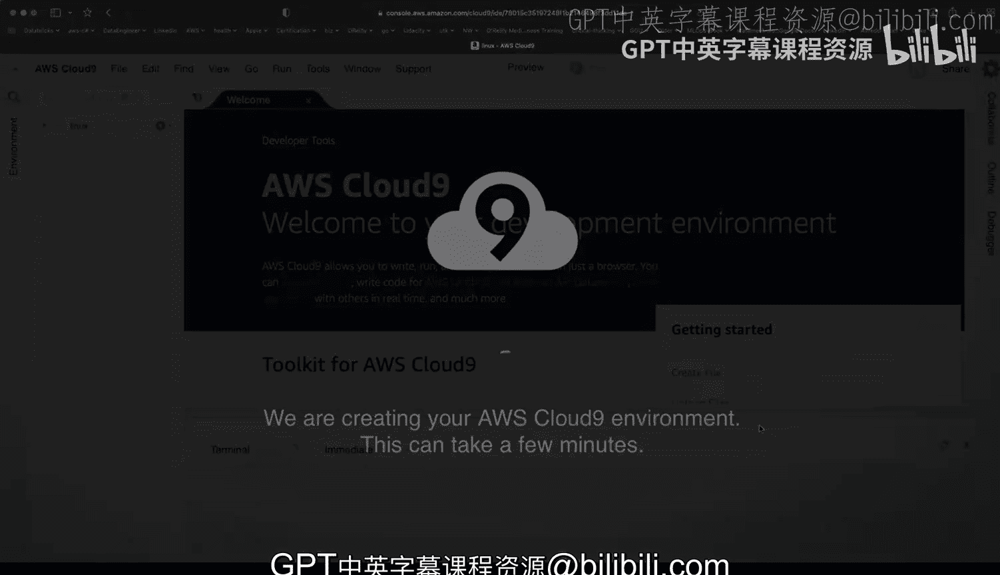

本节课中我们一起学习了开始使用Linux的几种主要方法。我们介绍了在桌面使用虚拟机软件（如Parallels）来模拟完整的Linux环境，使用Docker容器快速获得轻量级的Linux Shell，以及直接在云平台（如AWS）上启动Linux虚拟机或使用Cloud9开发环境。每种方法都有其适用场景，你可以根据自己的开发、测试或部署需求选择最合适的一种。掌握这些访问Linux的方式，是成为一名数据工程师的重要基础。