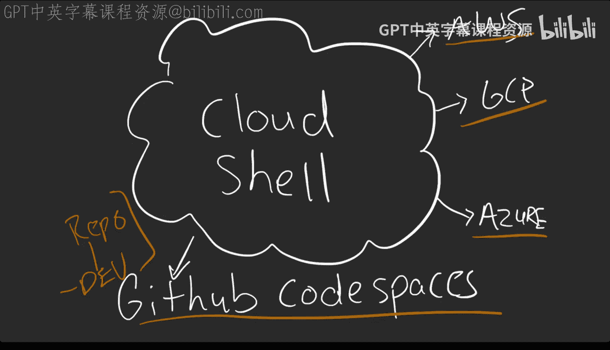
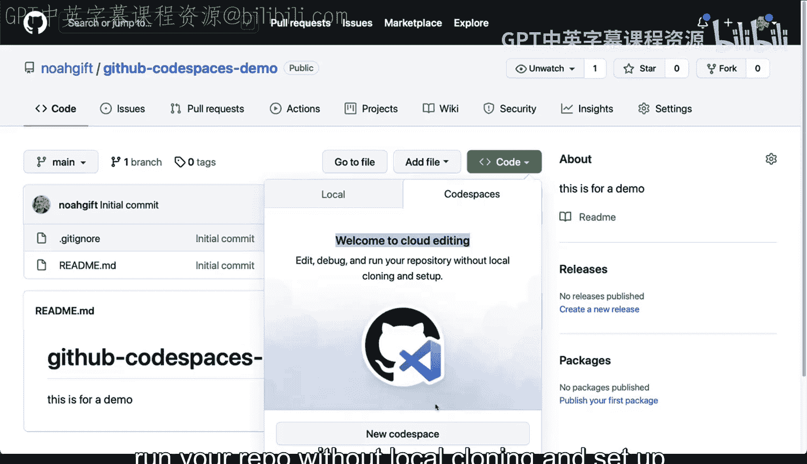
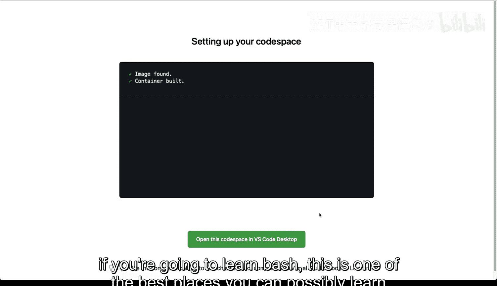
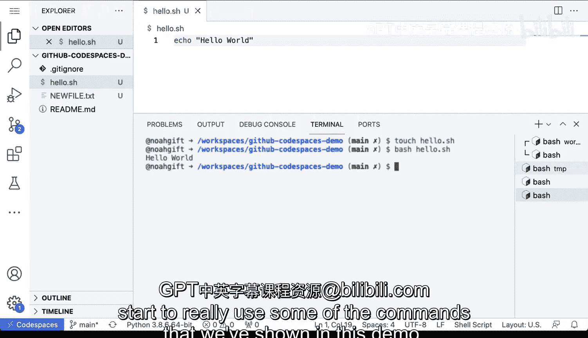

#  007：GitHub Codespaces入门 🚀


在本节课中，我们将学习如何使用GitHub Codespaces这一基于云的开发环境。我们将了解其核心优势，并通过实际操作演示如何在其中使用Bash终端进行基本的文件操作和环境配置。

---

## 概述



GitHub Codespaces提供了一个完全在云端运行的开发环境。它的主要优势在于，你可以直接与代码仓库交互，并使用一个预先配置好的开发环境，无需在本地进行任何复杂的安装和设置。这对于学习Bash、进行软件开发或数据工程项目来说，是一个理想且高效的起点。

---

## 云开发环境的优势

上一节我们提到了云开发环境的概念，本节中我们来看看它的具体优势。

使用GitHub Codespaces这类云环境，你可以直接与代码仓库对话，同时也能使用一个功能完整的开发环境。这与AWS、GCP或Azure提供的服务类似，你可以在其中访问它们的服务并使用其开发工具。

这代表了一种软件开发的新范式。我们将直接进入GitHub Codespaces，探索那些能让你高效工作的功能。

---





## 创建并进入Codespace

以下是创建GitHub仓库并启动Codespace的步骤。

1.  在GitHub上，点击“New repository”创建一个新仓库。
2.  将仓库命名为“GitHub-Codespaces-Demo”，并添加描述。
3.  勾选“Add a README file”选项。
4.  在“.gitignore”模板中选择“Python”，以忽略不必要的文件。
5.  点击“Create repository”完成创建。

创建仓库后，你可以直接在GitHub环境中进行软件开发。这是数据工程、软件工程和机器学习工程的基础。

点击仓库页面的“Code”按钮，你可以选择将代码克隆到本地。但我们选择“Codespaces”选项卡。这里提示：“欢迎使用云端编辑。你无需本地克隆和设置即可编辑、调试和运行你的仓库。”这确实是软件开发的未来。

如果你想学习Bash，这里是最好的起点之一。你可以通过创建一个这样的临时仓库，立即开始在Codespace中构建项目。

---

## 探索Bash终端

现在我们已经进入了Codespace，本节中我们来看看如何使用其中的Bash终端。

这个环境已经为你编写代码所需的一切做好了准备。对于软件工程师来说，这是一个开始实践和探索的理想场景。让我们看看在终端里能做什么。

首先，我喜欢输入以下命令来查看操作系统信息：
```bash
uname -a
```
这个命令会显示操作系统详情，例如“Ubuntu 18.04”，以及系统创建时间等信息。

接下来，运行`ls`命令来列出当前目录下的文件：
```bash
ls
```
这就像打开房间的灯，让你看清里面有什么。同时，输入`pwd`可以查看当前所在的完整路径。

如果你想创建一个新文件，可以使用`touch`命令：
```bash
touch new_file.txt
```
执行后，文件管理器中会出现这个新文件。点击它，你可以进行编辑。例如，输入“This is really cool.”并保存。

如果要从终端读取这个文件的内容，可以使用`cat`命令：
```bash
cat new_file.txt
```
按`Tab`键可以自动补全文件名。这是一个非常常见的工作流程：用`uname`了解系统，用`ls`查看目录，用`touch`创建文件。

注意，`touch`命令是**幂等**的。这意味着无论你运行多少次，效果都相同。如果文件不存在，它会创建文件；如果文件已存在，它不会做任何事。Linux的许多工具都采用这种设计，提供稳定可靠的小功能。

---

## 目录导航与界面定制

上一节我们介绍了基本的文件操作，本节我们来学习如何切换目录和个性化你的工作区。

使用`cd`命令可以切换目录。例如，进入临时目录：
```bash
cd /tmp
```
然后使用`pwd`确认当前位置。如果想返回硬盘的根目录，可以输入：
```bash
cd /
```
如果想回到工作区，可以输入`cd /workspaces/GitHub-Codespaces-Demo`。

在GitHub Codespaces中，你可以通过“View”菜单下的“Appearance”和“Layout”选项来调整界面布局和外观，这是很常见的操作。

你还可以配置终端，例如设置不同的快捷键绑定或为不同语言进行定制。在这个云环境中，你拥有文件资源管理器（可以开关）、文件搜索、代码调试、源代码控制管理等功能。

例如，你可以搜索并安装插件。如果想找一个Bash代码格式化工具，可以搜索“bash beautifier”。你也可以通过命令面板添加各种功能。

核心要点是，使用基于云的开发环境，你可以自由地做任何想做的事。

---

## 高级终端操作与环境配置

现在我们已经熟悉了基本操作，本节中我们来看看一些更高级的终端技巧和环境配置方法。

在Bash工作区中，你可以拆分终端，让多个终端并排显示，这是一种常见做法。只需点击终端界面上的拆分图标即可。

你可能会想编辑环境配置。注意到终端提示符有各种炫酷的显示吗？你可以通过编辑`~/.bashrc`文件来修改提示符的样式，很多人都会这么做。

另一个实用的技巧是设置**别名**。别名就像是命令的快捷方式或书签。例如，创建一个快速进入`/tmp`目录的别名：
```bash
alias tmptop='cd /tmp'
```
这样，以后只需输入`tmptop`就能直接跳转到`/tmp`目录。

创建别名后，需要让当前环境重新加载配置才能生效。有两种方法：
1.  打开一个新的终端窗口。
2.  在当前终端使用`source ~/.bashrc`命令。

之后，输入`alias`命令就能看到新设置的`tmptop`别名了。输入`tmptop`，你会发现它成功地将工作目录切换到了`/tmp`。

我强烈推荐使用云开发环境，如GitHub Codespaces或AWS Cloud Shell。这能让你放心地动手实践Bash，配置环境，而无需担心搞坏任何东西，因为这些环境都是可以随时丢弃和重建的。

---

## 创建并运行你的第一个Bash脚本

最后，让我们以传统的方式，创建一个“Hello World”脚本作为结束。

首先，使用`touch`命令创建一个脚本文件：
```bash
touch hello.sh
```
然后，编辑这个文件，输入以下内容：
```bash
echo "Hello world"
```
保存后，如何运行这个Bash脚本呢？很简单，使用`bash`命令：
```bash
bash hello.sh
```
终端会输出：“Hello world”。就这样，你成功在Codespaces开发环境中创建并运行了第一个脚本。

你可以自己多玩玩，尝试使用我们在本演示中展示过的各种命令。

---

## 总结

本节课中，我们一起学习了GitHub Codespaces这一强大的云开发环境。我们从创建仓库和启动Codespace开始，逐步探索了Bash终端的基本命令（如`uname`, `ls`, `pwd`, `touch`, `cat`, `cd`）、目录导航、界面定制、终端拆分、环境配置（如编辑`.bashrc`和设置别名），最后创建并运行了一个简单的Bash脚本。



通过使用这种预先配置好、可随时重置的云环境，你可以无风险地练习和掌握Bash及软件开发的基础技能，这是迈向数据工程和软件工程的重要一步。