#  008：Linux Shell环境对比 🖥️

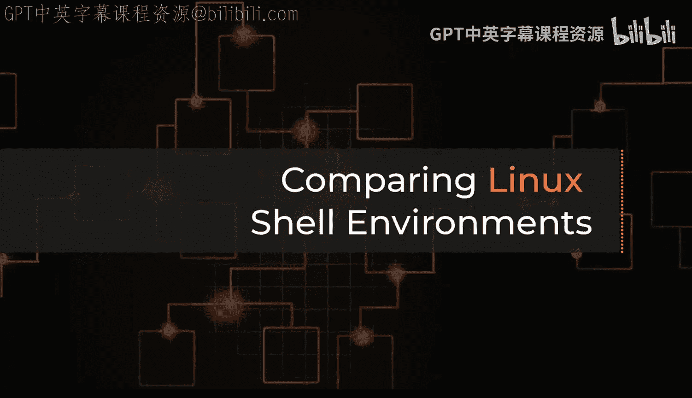

在本节课中，我们将学习如何比较不同的终端环境，包括本地终端和基于云的Shell环境。我们将探讨如何根据具体任务选择合适的工具，并了解如何通过安装第三方工具来增强本地Shell的功能。

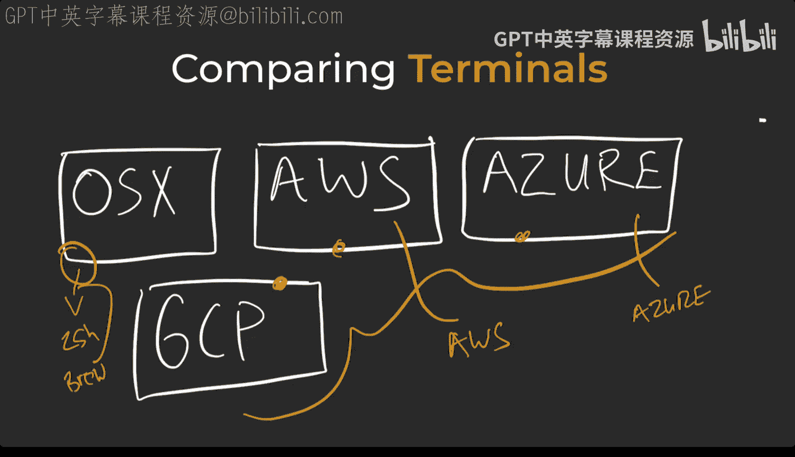

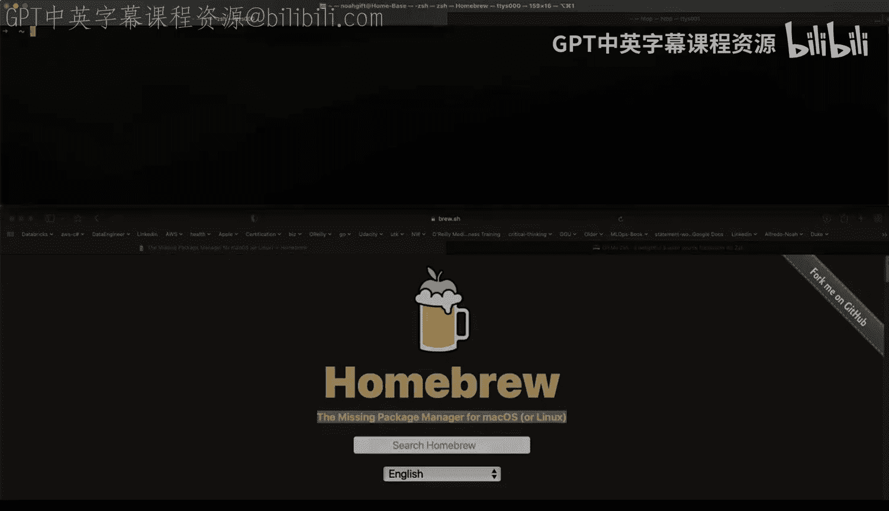

---

## 本地终端环境：macOS

上一节我们介绍了终端环境的基本概念，本节中我们来看看具体的本地环境示例。以macOS（OS X）为例，其自带的终端功能强大，但用户可以通过安装第三方工具来获得更佳的体验。

以下是两个在macOS上非常实用的增强工具：

1.  **Homebrew**：这是一个macOS上缺失的软件包管理器。开发者常用它来安装开源项目文档中提到的各种工具。其核心作用是补充macOS系统预装软件的不足。
    *   **安装命令示例**：`/bin/bash -c "$(curl -fsSL https://raw.githubusercontent.com/Homebrew/install/HEAD/install.sh)"`
    *   **使用示例**：系统自带的 `top` 命令可以查看进程，而通过Homebrew安装的 `htop` 提供了更强大的功能，如彩色显示、树状视图和更直观的交互。
        *   安装：`brew install htop`
        *   运行：`htop`

2.  **Oh My Zsh**：这是一个流行的Zsh（Z Shell）配置框架。Zsh本身提供了强大的自动补全等功能，而Oh My Zsh使其更易于配置和使用。
    *   **安装命令示例**：`sh -c "$(curl -fsSL https://raw.githubusercontent.com/ohmyzsh/ohmyzsh/master/tools/install.sh)"`
    *   **功能示例**：启用`auto_cd`功能后，无需输入`cd`命令，直接输入目录名即可切换。输入波浪号`~`可直接返回用户主目录。

**核心思想是**：你可以通过安装像Homebrew和Oh My Zsh这样的第三方工具，来显著增强你在macOS上的本地开发体验。

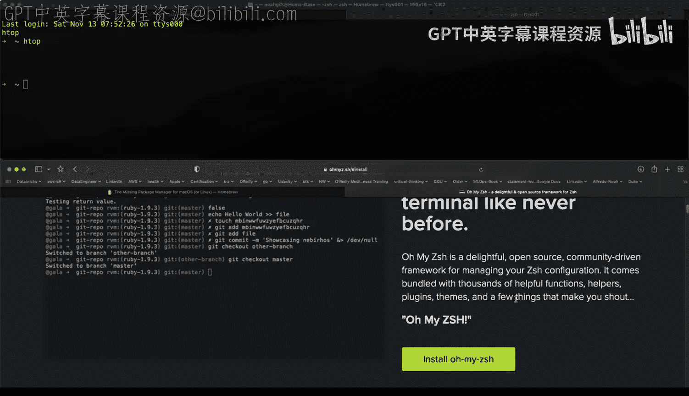

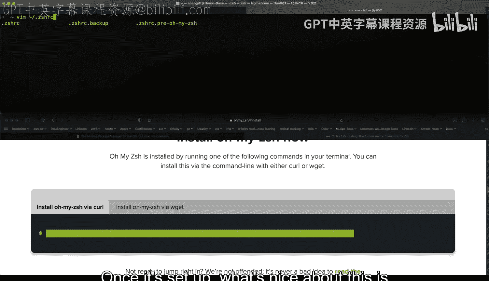

---

## 云端Shell环境

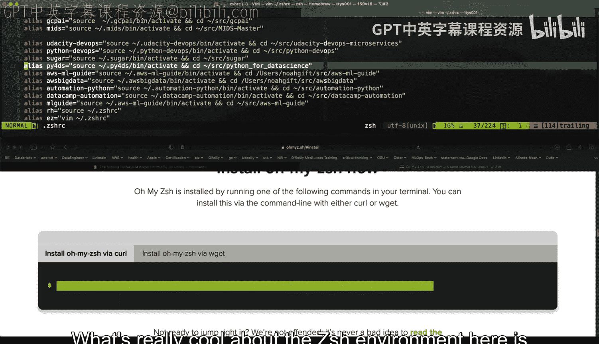

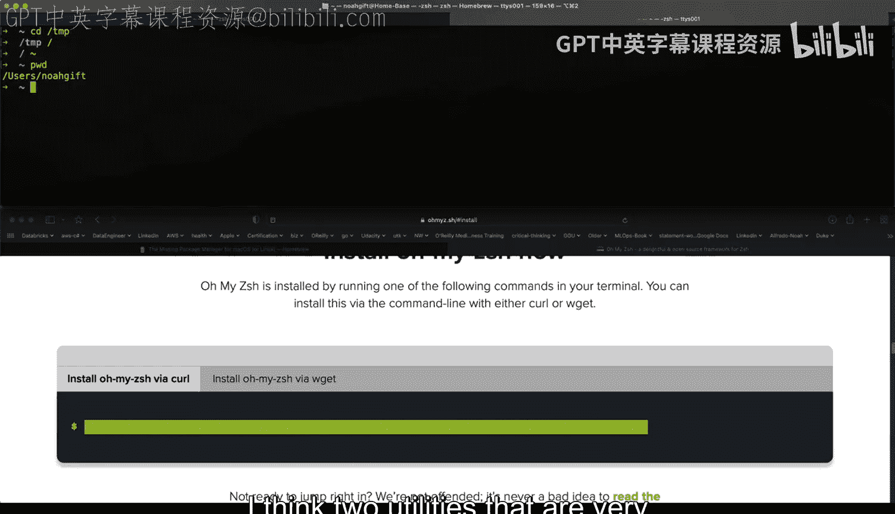

了解了本地环境后，我们来看看云端环境。所有主流云服务提供商（如AWS、Google Cloud、Azure）都提供了类似的云端Shell环境。这对于在对应云平台上进行开发和操作非常方便。

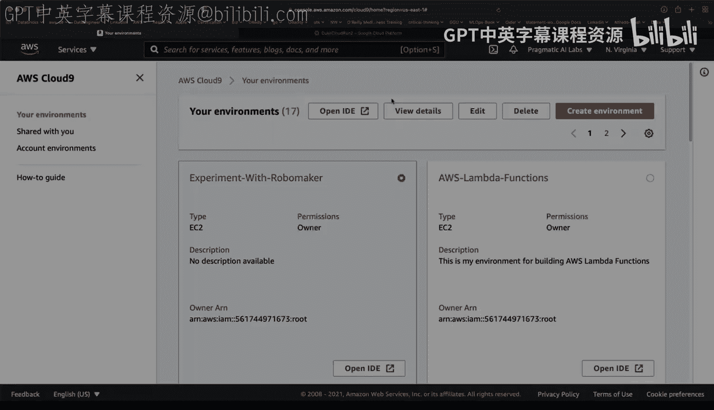

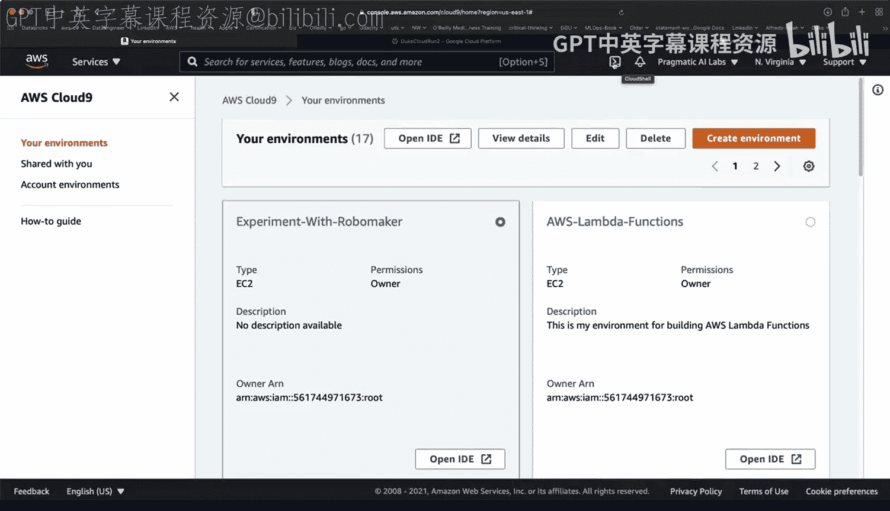

以下是各云平台Shell环境的共同特点和使用方法：

1.  **通用模式**：点击云控制台中的“Cloud Shell”图标，平台会为你临时配置一个免费的Shell环境。这个环境预装了与该云平台交互所需的所有命令行工具（Bash工具）。

2.  **环境定制**：与本地环境一样，你可以通过编辑Shell的配置文件（如 `~/.bashrc`）来定制环境，例如设置别名或环境变量。
    *   **编辑配置文件**：`nano ~/.bashrc` 或 `vim ~/.bashrc`
    *   **添加自定义命令**：在文件中添加一行，例如 `echo "欢迎使用我的Shell"`
    *   **使配置生效**：保存文件后，运行 `source ~/.bashrc` 或新开一个终端窗口，即可看到效果。

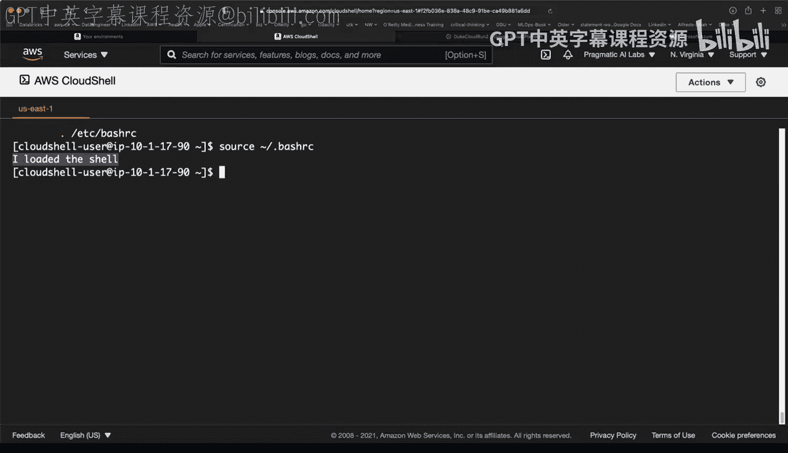

3.  **平台专用命令示例**：
    *   **AWS Cloud Shell**：可以使用 `aws s3 ls` 命令列出账户中的所有S3存储桶。结合 `wc -l` 命令可以计数。
        *   **代码示例**：`aws s3 ls | wc -l`
    *   **Google Cloud Shell**：可以使用 `gcloud` 开头的系列命令管理资源。
    *   **Azure Cloud Shell**：可以使用 `az` 开头的系列命令与各项服务交互。

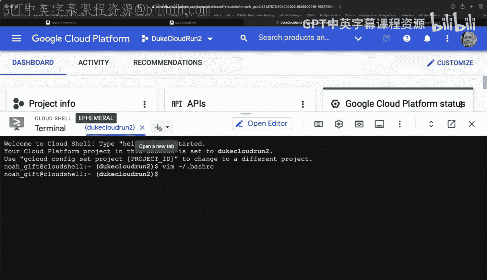

**关键在于**：一旦你掌握了Bash，你就掌握了驾驭多种云环境和本地环境的钥匙。它们虽然预装工具不同，但核心的Shell操作逻辑是相通的。

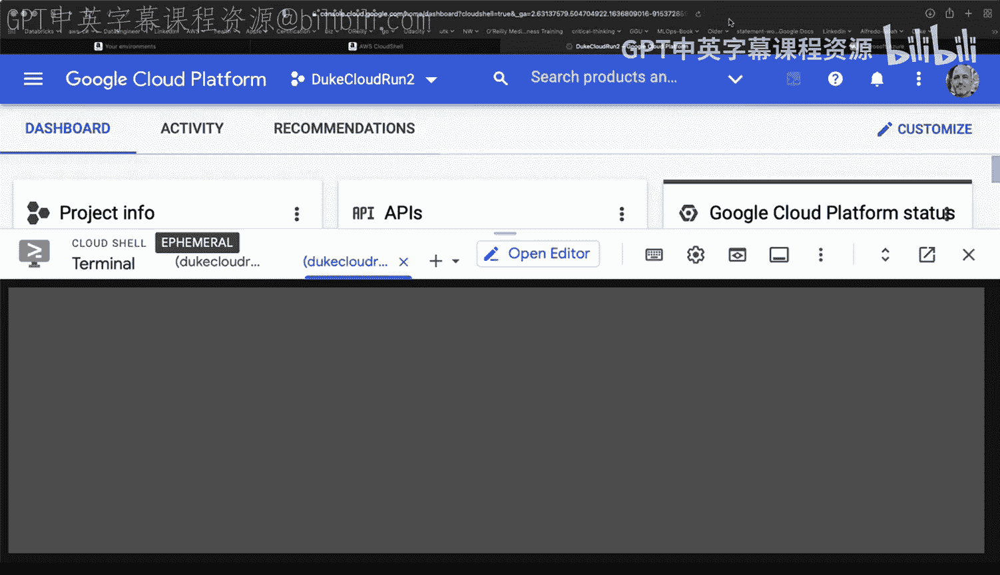

---

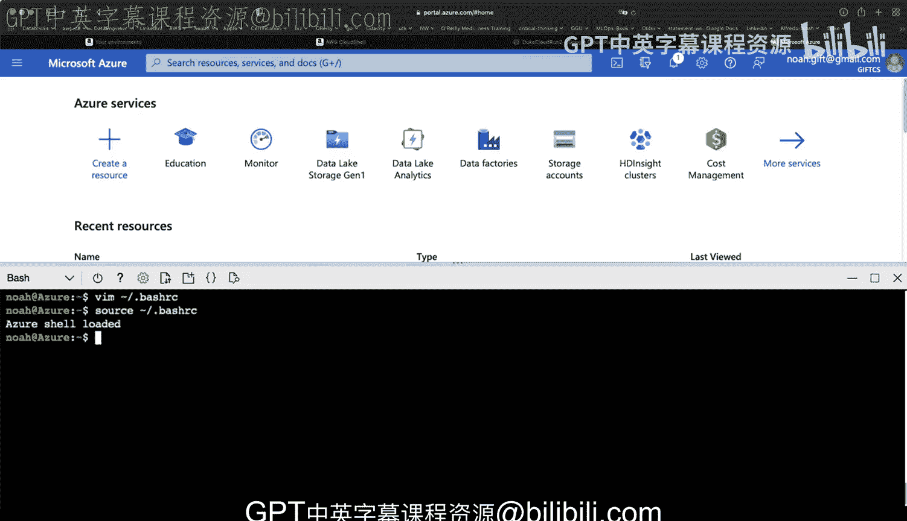

本节课中我们一起学习了如何对比和选择不同的Linux Shell环境。我们探讨了如何通过Homebrew和Oh My Zsh等工具增强本地macOS终端的功能，也了解了AWS、Google Cloud和Azure等云平台提供的Cloud Shell环境及其基本用法。记住，根据你当前的工作场景（本地开发或特定云平台操作）选择最合适的环境，是提高效率的关键。