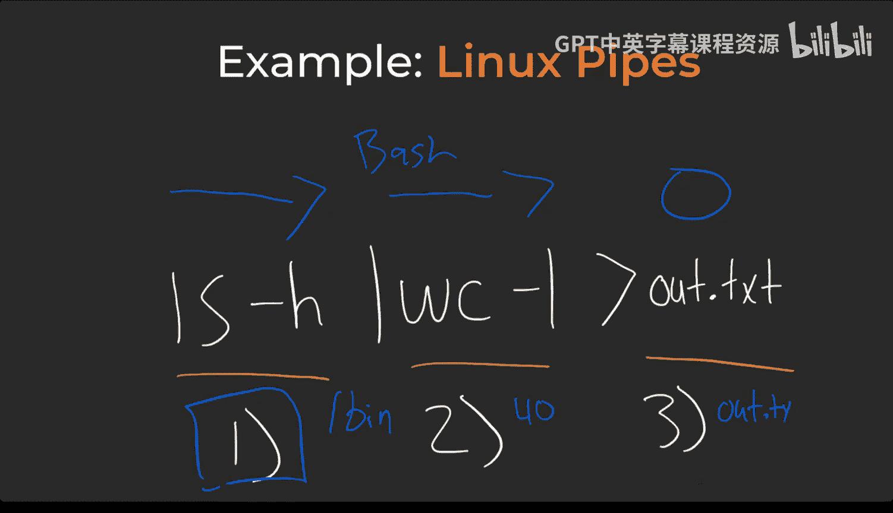

#  012：什么是Shell管道 🚰

在本节课中，我们将要学习Shell编程中的一个核心概念——管道。管道是连接不同命令的桥梁，它允许我们将一个命令的输出作为另一个命令的输入，从而构建出强大的数据处理流程。

## 概述

理解Bash管道的一个好方法是类比其他系统。一个很好的例子就是你家的供水系统。

## 管道概念类比：家庭供水系统 🏠

上一节我们提到了类比的概念，本节中我们来看看具体的例子。家庭供水系统清晰地展示了管道的三个核心阶段：输入、处理和输出。

**输入阶段**：城市供水是源头。人们从这里获取饮用水，也为家中的各种电器供水。如果没有这个核心的输入，就无法完成诸如使用洗碗机、洗衣服或洗热水澡等高级功能。同样，在构建Bash脚本时，你也需要输入。这个输入至关重要，因为你需要有东西来进行处理。

**处理阶段**：在这个例子中，我们以洗碗机为例。它也可以是淋浴、洗衣机、水疗池或游泳池等。这就是处理阶段。Bash管道的关键在于，你通常会将某些东西送入一个进程并进行操作，例如翻译某些内容、反转字符或提取特定的关键短语。

**输出阶段**：这里是下水道阶段，也就是输出。在这个具体例子中，盘子清洗完毕后，你希望含有食物残渣的水排入污水系统以便处理。这在Bash场景中是一个类似的概念。输出可能不是污水系统，而可能是写入一个输出文件，例如 `output.txt`。或者，如果我们想要一个更贴切的例子，这可能是类似 `/dev/null` 的东西，这非常常见，用于将你不希望看到结果的输出导入其中。因此，这与家庭管道和Bash管道非常相似。

## 从理论到实践：一个Bash管道示例 💻

现在，让我们遵循刚才讨论的房屋和管道范式，来看下面这个具体例子。

这是一个命令：`ls | wc -l`。请注意，我首先列出了某个目录中的一些文件内容。接下来，我将结果通过管道传输到下一个部分。所以，这里是起点，这是**进程一**。

**进程二**是：然后我会计算目录中出现的条目数量。想象一下，例如我在 `/bin` 目录中，该目录下可能有40个不同的实用程序。如果我将所有这些条目通过管道传输到 `wc -l` 这个命令，它实际上会返回40。

这个结果是一个我可以进一步处理的结果。在示例中，我们看到它可能被输出到一个文件，比如 `outfil.txt`。在这个特定例子中，这样做的好处是，我可以将这些结果交给其他人，也许我可以通过电子邮件发送这些结果，或者通过短信等方式以某种方式处理它。

Bash中的这种管道概念确实与进入你家的水非常相似：水进入洗碗机，清洗一些东西，然后排到别处。因此，一旦你理解了这个概念，就很容易用Bash管道构建复杂的工具。

## 总结

本节课中我们一起学习了Shell管道的核心概念。我们通过家庭供水系统的类比，理解了管道在数据流中的三个关键角色：**输入**、**处理**和**输出**。并通过 `ls | wc -l` 这个具体命令，看到了如何将一个命令（`ls`）的输出作为另一个命令（`wc -l`）的输入，从而完成计算文件数量的任务。掌握管道是编写高效Bash脚本和进行命令行数据处理的基石。