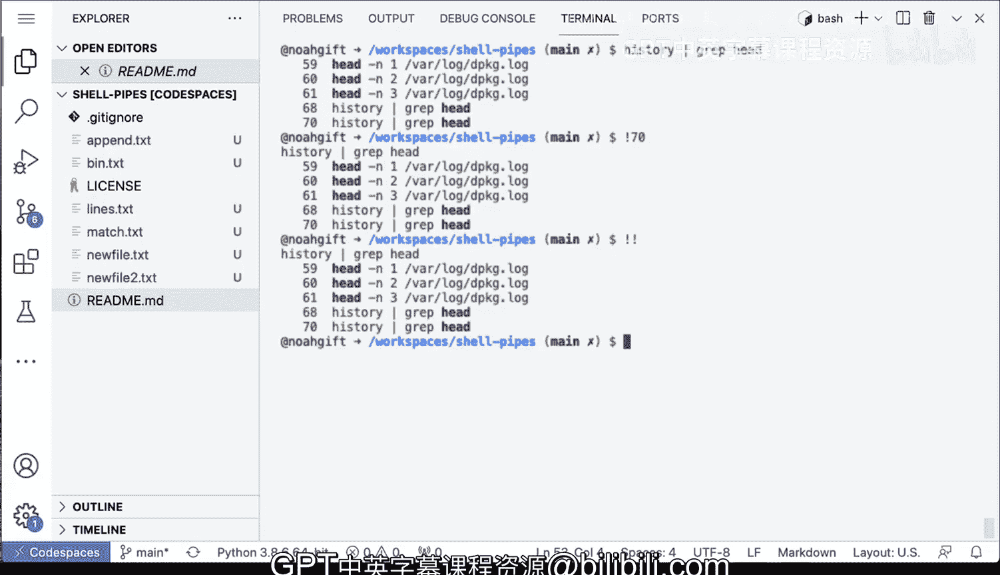

#  013：Shell管道实例演练 🐚


在本节课中，我们将通过一系列实例，深入探索Shell中管道的强大功能。我们将学习如何将多个命令连接起来，处理数据流，以及利用管道和重定向来高效地完成文件操作和日志分析等常见任务。

## 探索管道的力量

上一节我们介绍了管道的基本概念，本节中我们来看看如何在实际操作中运用它。一个经典的管道使用例子是结合 `ls` 和 `wc` 命令。

首先，我们使用 `ls` 命令列出 `/usr/bin` 目录下的所有文件。这个目录包含大量文件，手动计数非常困难。

```bash
ls /usr/bin
```

为了统计文件数量，我们可以将 `ls` 的输出通过管道 `|` 传递给 `wc -l` 命令。`wc -l` 会计算输入的行数。

```bash
ls /usr/bin | wc -l
```
执行后，我们得知该目录下有 **1059** 个条目。这避免了手动滚动和计数的繁琐。

我们还可以更进一步，利用命令历史记录和输出重定向。使用上箭头键可以调出刚才执行的命令，然后我们可以将其输出重定向到一个文件中。

```bash
ls /usr/bin | wc -l > bin_count.txt
```
`>` 操作符将命令的标准输出重定向到 `bin_count.txt` 文件，而不是显示在终端上。查看文件内容，可以看到统计结果已被保存。

```bash
cat bin_count.txt
```
这种模式非常常见：第一步列出文件，第二步通过管道计数，第三步将结果重定向到文件。

## 条件执行操作符

现在让我们转向另一个操作：条件执行。这在 Dockerfile 或 Makefile 等场景中非常常见。

条件执行使用 `&&` 操作符。它表示只有前一个命令成功执行（返回退出状态码0），后一个命令才会运行。

例如，尝试列出一个不存在的目录会失败：
```bash
ls /non_existent_directory
```
这个命令会报错。如果我们将其与 `touch` 命令用 `&&` 连接：
```bash
ls /non_existent_directory && touch new_file.txt
```
由于 `ls` 命令失败，`touch` 命令不会执行，因此 `new_file.txt` 文件不会被创建。

现在，我们执行一个会成功的命令：
```bash
ls README.md && touch new_file.txt
```
因为当前目录存在 `README.md` 文件，`ls` 命令成功，所以 `touch` 命令得以执行，创建了 `new_file.txt`。再次执行（使用上箭头键调出命令）会创建第二个文件 `new_file2.txt`。

```bash
ls README.md && touch new_file2.txt
ls
```
通过 `ls` 可以看到两个新文件都被创建了。这种链式操作确保了一系列命令必须全部成功，如果中间任何一步失败，则后续步骤不会执行，这对于构建脚本和自动化流程至关重要。

## 处理多行文本的管道

接下来，我们看一个更复杂的例子：处理多行文本。首先，我们创建一个包含多行文本的变量。

```bash
STR='1. This is a line\n2. This is a line\n3. This is a line'
```
使用 `echo` 命令并加上 `-e` 选项（用于解释反斜杠转义字符）来查看变量内容：
```bash
echo -e "$STR"
```
输出为三行独立的文本。

我们可以将此输出重定向到一个文件：
```bash
echo -e "$STR" > lines.txt
```
现在，我们可以对文件内容进行各种管道操作。例如，使用 `cat` 查看文件，然后通过管道传递给 `sort -r` 进行反向排序：
```bash
cat lines.txt | sort -r
```
原本以“1.”开头的行现在变成了以“3.”开头。

如果文件内容很多，我们可以再管道传递给 `less` 命令进行分页查看：
```bash
cat lines.txt | sort -r | less
```
在 `less` 视图中，可以使用上下箭头键浏览，按 `q` 键退出。这是查看和处理大型日志文件的常用模式。

另一个常见操作是使用 `grep` 进行模式匹配。例如，我们只想查看包含数字“3”的行：
```bash
cat lines.txt | grep 3
```
`grep` 会高亮显示匹配的行。我们也可以将匹配的结果保存到新文件：
```bash
cat lines.txt | grep 3 > matched_line.txt
cat matched_line.txt
```
这演示了如何从数据流中精确提取所需信息。

## 文件的重定向与追加

之前我们使用了 `>` 进行输出重定向，它会覆盖目标文件。有时我们需要追加内容，而不是覆盖。

使用 `>` 会覆盖文件：
```bash
echo “First line” > append_file.txt
cat append_file.txt
```
文件内容为“First line”。如果再次使用 `>`：
```bash
echo “Second line” > append_file.txt
cat append_file.txt
```
文件内容被替换为“Second line”，“First line”丢失了。

要追加内容，需要使用 `>>` 操作符：
```bash
echo “Third line” >> append_file.txt
cat append_file.txt
```
现在文件包含了“Second line”和“Third line”两行内容。这在持续记录日志或错误信息时非常有用。

## 丢弃错误输出

在脚本中，我们有时希望忽略命令的错误信息，避免其干扰正常输出。标准错误流（stderr）的文件描述符是 `2`。

例如，一个失败的命令会产生错误输出：
```bash
ls /non_existent_directory
```
为了丢弃这些错误信息，我们可以将标准错误重定向到 `/dev/null`（一个特殊的设备文件，会丢弃所有写入的数据）：
```bash
ls /non_existent_directory 2> /dev/null
```
现在，终端上不再显示错误信息。这是一种清理脚本输出的有效模式。

## 查看文件头部与尾部

在数据工程中，经常需要查看日志文件。`tail` 和 `head` 命令是这方面的利器。

`tail` 命令默认显示文件的最后10行。使用 `-f` 选项可以实时追踪文件的新增内容（常用于监控日志）：
```bash
tail -f /var/log/syslog
```
（按 `Ctrl+C` 退出追踪模式）

如果只想查看最后几行，可以使用 `-n` 选项指定行数：
```bash
tail -n 2 /var/log/dpkg.log
```
这会显示该日志文件的最后两行。

相应地，`head` 命令用于查看文件的开头部分：
```bash
head -n 1 /var/log/dpkg.log
```
这会显示文件的第一行。

## 高效使用命令历史

Shell 会记录你执行过的命令历史。使用 `history` 命令可以查看。

```bash
history
```
历史记录可能很长，这时管道就派上用场了。我们可以用 `less` 来分页查看：
```bash
history | less
```
在 `less` 中可上下滚动，按 `q` 退出。

更常见的是，我们使用 `grep` 在历史中搜索特定命令：
```bash
history | grep “ls”
```
这会列出所有包含“ls”的历史命令。

找到想重复执行的命令后，有一个快捷方式：使用 `!` 加历史行号。
例如，`history` 显示你想运行的命令在第70行，只需输入：
```bash
!70
```
Shell 就会重新执行该行命令。

还有两个特别有用的快捷方式：
*   `!!`：重复执行上一条命令。
*   `!$`：代表上一条命令的最后一个参数。

此外，编辑长命令时，快捷键可以提高效率：
*   `Ctrl + A`：光标跳到行首。
*   `Ctrl + E`：光标跳到行尾。
*   `Ctrl + L`：清屏。

## 总结



本节课中我们一起学习了 Shell 管道的核心应用。我们掌握了如何用 `|` 连接命令，用 `>` 和 `>>` 重定向输出，用 `&&` 实现条件执行。我们还实践了使用 `grep`、`sort`、`head`、`tail` 和 `less` 等工具来处理文本流，并学习了高效利用命令历史的技巧。这些技能是进行文件操作、日志分析和自动化脚本编写的基础，对于数据工程师至关重要。