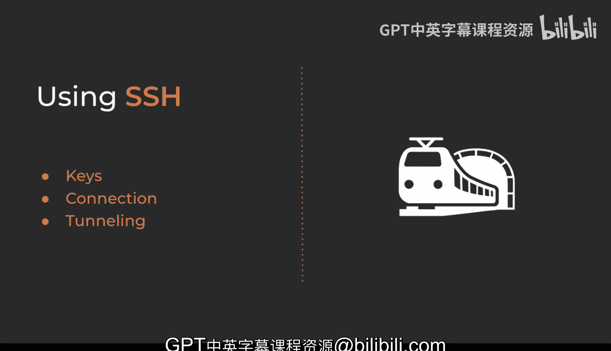

#  014：SSH入门 🔐


在本节课中，我们将要学习SSH（Secure Shell）协议。SSH是连接远程服务器、进行安全通信和隧道传输的核心工具。我们将从了解SSH的基本概念开始，逐步学习如何创建密钥、连接到服务器以及使用端口转发功能。

## 什么是SSH？

SSH的关键特性之一是它创建了一个加密且安全的隧道。这个隧道可以保护你的数据在传输过程中不被窃听或篡改。

上一节我们介绍了SSH的整体目标，本节中我们来看看SSH协议本身的具体细节和最佳实践。

## 创建SSH密钥

创建SSH密钥对是与远程服务器或代码托管平台（如GitLab或GitHub）安全通信的常用方法。你需要知道如何生成公钥和私钥对，并将公钥配置到远程服务器上。

以下是创建和使用SSH密钥对的基本步骤：

1.  **生成密钥对**：使用 `ssh-keygen` 命令生成公钥和私钥。
    ```bash
    ssh-keygen -t rsa -b 4096 -C "your_email@example.com"
    ```
2.  **存储密钥**：将生成的私钥（如 `id_rsa`）安全地保存在本地，将公钥（如 `id_rsa.pub`）添加到远程服务器的授权列表中。
3.  **配置使用**：通过SSH客户端连接时，系统会自动使用本地私钥进行身份验证。

## 连接到服务器与端口转发

在创建好密钥后，下一步就是学习如何连接到远程服务器。此外，SSH的端口转发功能非常强大，例如，它允许你将远程服务器上正在开发的网站（如WordPress站点）安全地转发到本地机器进行预览，而无需立即公开上线。

以下是连接和隧道操作的核心步骤：

1.  **基本连接**：使用 `ssh` 命令连接远程服务器。
    ```bash
    ssh username@remote_server_ip
    ```
2.  **本地端口转发**：将远程服务器的某个端口映射到本地端口。例如，将远程的MySQL服务（3306端口）转发到本地的3307端口。
    ```bash
    ssh -L 3307:localhost:3306 username@remote_server_ip
    ```
3.  **远程端口转发**：将本地服务的端口暴露给远程服务器访问。

所有这些操作都有一个共同点：你正在创建一个隧道，你的数据就在这条通道的中间。这很像一列火车，你所有的包裹、乘客等一切都在车厢内，你需要安全地将它们从一个地点运送到另一个地点，确保不被他人拦截。本质上，SSH就是一个用于连接服务器、建立隧道以及远程管理源代码的工具箱。

---



本节课中我们一起学习了SSH的三个主要领域：密钥管理、服务器连接和隧道技术。掌握这些技能对于安全地进行远程操作和数据传输至关重要。