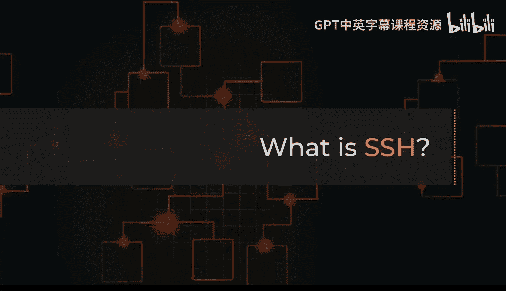
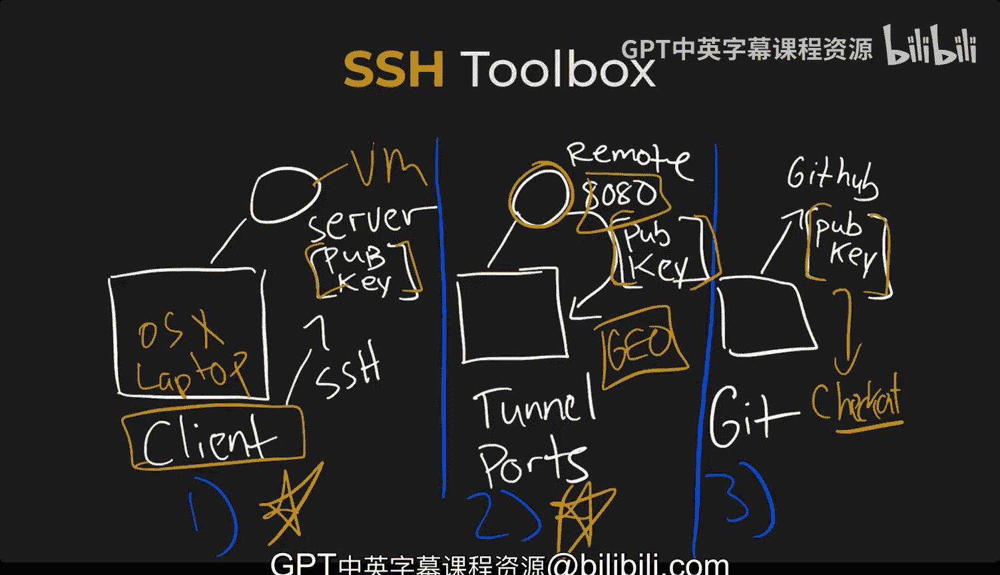

**数据工程基础：2-4：什么是SSH 🔐**



在本节课中，我们将要学习SSH（Secure Shell）协议。SSH是数据工程和软件开发中一个极其重要的工具箱，它允许你安全地连接到远程服务器、执行命令、管理密钥以及进行端口转发。掌握SSH将极大地提升你在分布式计算和远程开发中的工作效率。

---

上一节我们介绍了SSH的整体概念，本节中我们来看看SSH最常见的三种用途。

**1. 远程登录与命令执行**
通过SSH，你可以从本地客户端（如你的笔记本电脑）安全地登录到远程服务器（例如云端的虚拟机）。登录后，你可以在远程服务器的终端中执行任何Bash命令，就像在本地操作一样。这种方式非常适合需要在特定环境（如生产服务器）中运行代码的开发者。

其基本命令格式为：
```bash
ssh username@remote_server_ip
```

**2. 端口转发（隧道）**
端口转发是SSH一个强大的功能。它允许你将远程服务器上的某个网络端口映射到本地机器的端口上。例如，远程服务器上运行着一个在8080端口的Flask应用，你可以通过SSH隧道将其转发到本地的8080端口。这样，你就能在本地浏览器中访问`localhost:8080`来调试远程应用，无需在远程服务器上开放公共端口，增强了安全性。

其基本命令格式为：
```bash
ssh -L local_port:localhost:remote_port username@remote_server_ip
```

**3. 使用SSH密钥与GitHub等服务通信**
在GitHub等代码托管平台使用SSH密钥，可以实现免密码认证。你将本地生成的**公钥**（`id_rsa.pub`）添加到GitHub账户中。之后，当你执行`git clone`或`git push`等操作时，SSH协议会使用你的**私钥**进行加密认证，无需每次手动输入密码，既安全又便捷。

生成SSH密钥对的命令为：
```bash
ssh-keygen -t rsa -b 4096
```

---




本节课中我们一起学习了SSH的三大核心功能：远程命令执行、安全的端口隧道以及基于密钥的认证。SSH作为一个多功能的安全协议，是连接本地与远程资源、实现安全自动化工作流的基石工具。在接下来的实操演示中，我们将具体练习这三种方法。