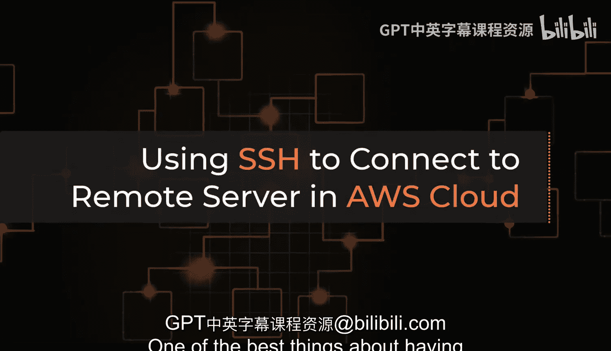
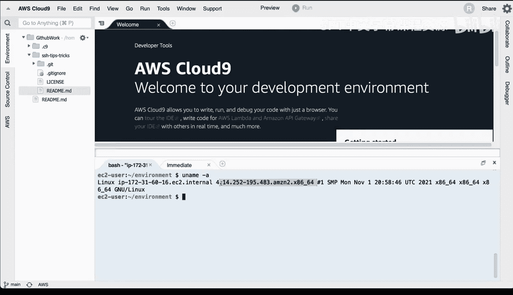
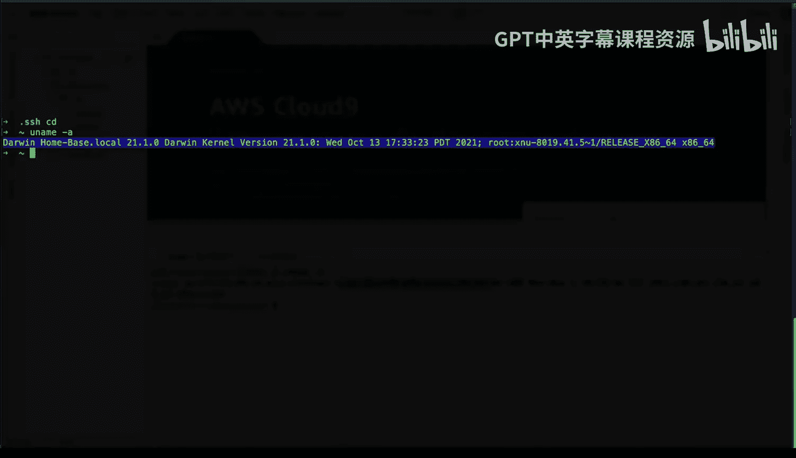
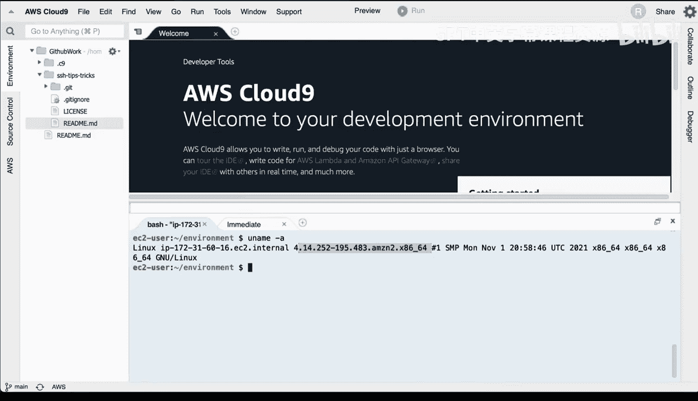
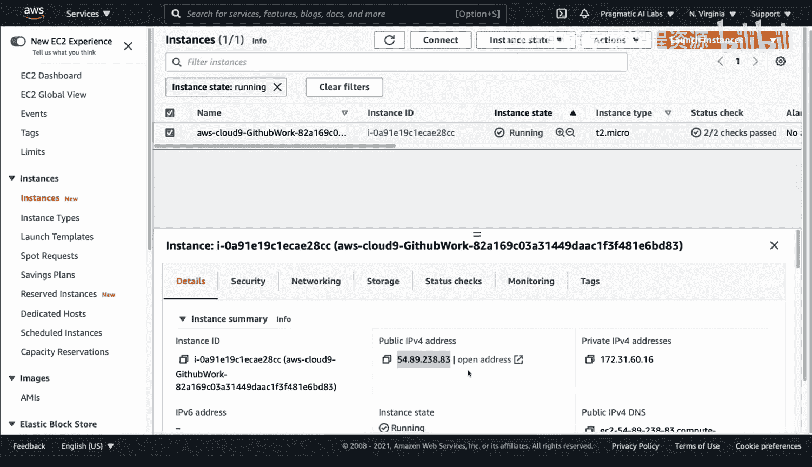
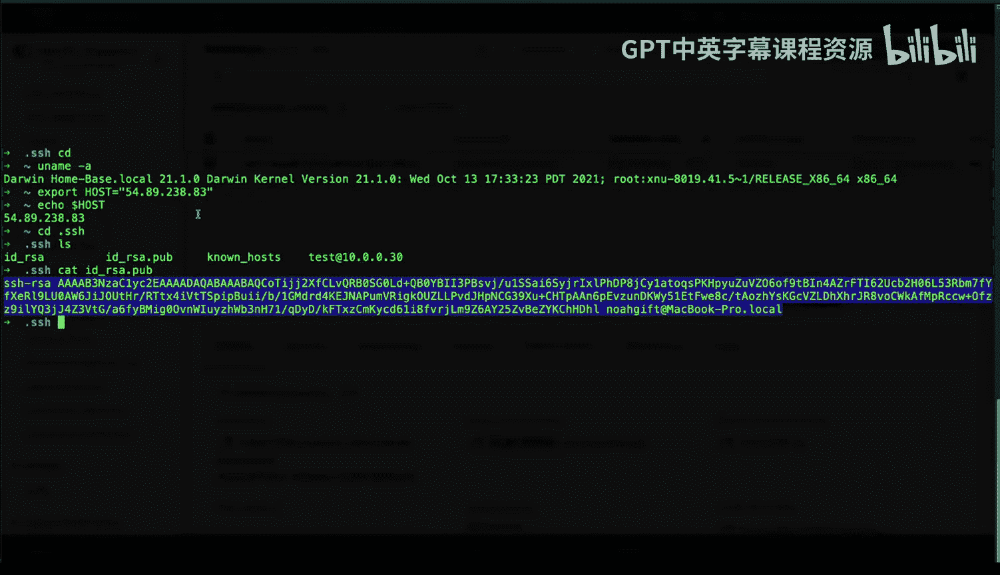
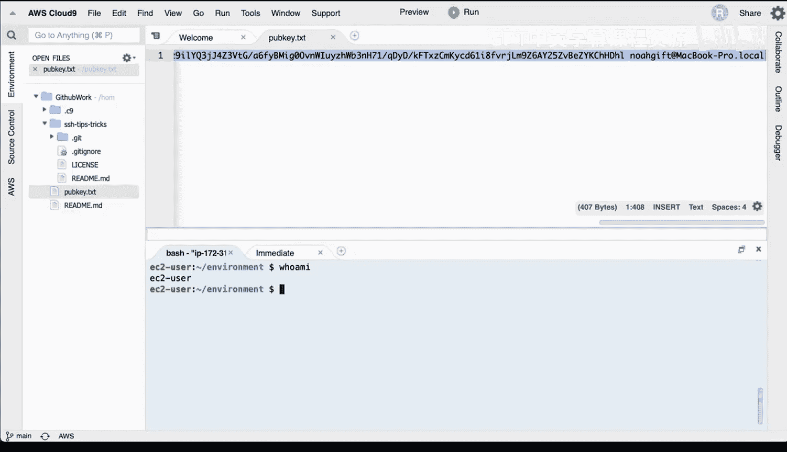
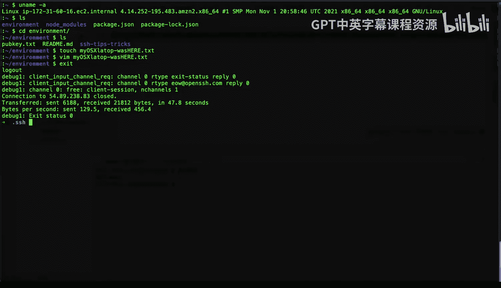
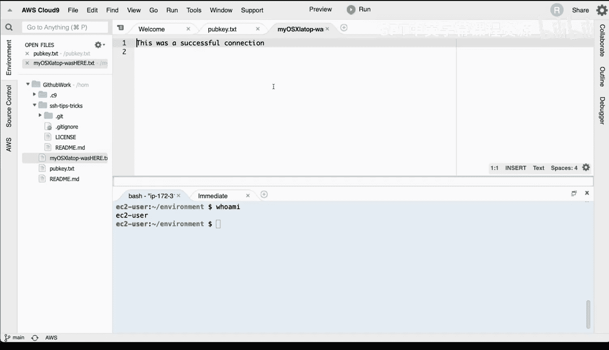
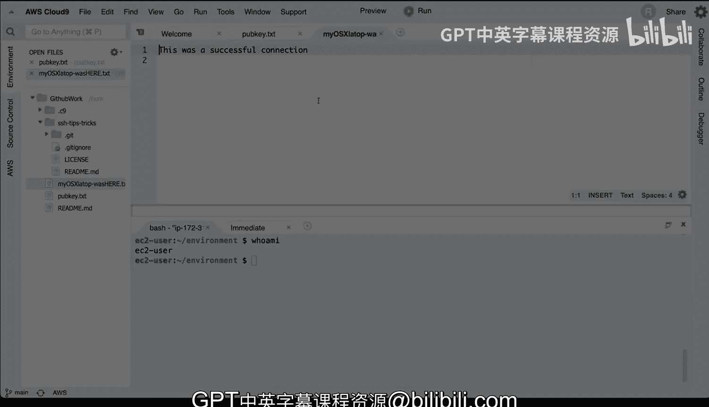

#  017：使用SSH连接AWS云远程服务器 🖥️➡️☁️




在本节课中，我们将学习如何使用SSH（Secure Shell）协议，从本地计算机连接到AWS云上的远程服务器。你将了解配置安全组、获取连接信息以及建立SSH连接的全过程。

---



基于云的开发环境最大的优势之一是，它已经预装了我所需的所有工具，并且位于能够快速访问其他服务器的位置。

事实上，如果我输入一个像 `uname -a` 这样的命令，可以看到它显示运行的是Amazon Linux。这让我知道我正在一台传统的Linux机器上。

现在，如果我切换到另一个位置，例如我的本地OSX桌面，并输入 `uname -a`，可以看到这是一个完全不同的操作系统。

那么，我如何让我的本地桌面能够与那台远程服务器通信并运行命令呢？我们可以通过SSH来实现。

## 配置AWS安全组 🔐





上一节我们确认了本地与远程环境的差异，本节中我们来看看如何为远程服务器打开连接端口。

我需要回到AWS控制台，进入EC2服务。在这里我可以看到所有正在运行的服务器。向下滚动并清除筛选器，我可以看到实例状态。这里有一个是我的Cloud9环境。

点击这个实例，在安全设置下，我可以进行增强配置，使安全组允许我与之通信。为此，我需要编辑入站规则。

请注意，这里的SSH连接规则。我不必添加一条新规则，但需要确保它允许来自我本地机器的连接。一个简单的开始方式是允许来自“任何地方”的连接，即设置源为 `0.0.0.0/0`。这表示允许我的OSX机器进行通信。我给自己添加一个备注，然后保存更改。

## 获取连接信息 🔗



仅仅打开端口还不够，我还需要知道一些其他信息才能建立连接。

首先，我需要知道这台远程服务器的公共IP地址，以便与之通信。幸运的是，在实例详情页面可以直接找到它。我将复制这个IP地址。

回到我的本地终端，我可以创建一个变量来存储这个IP地址，这样就不需要每次都记住它。

```bash
HOST="你的公共IP地址"
```

输入 `echo $HOST` 可以验证变量已设置。

接下来，我需要准备SSH公钥。进入我的 `~/.ssh` 目录，查看 `id_rsa.pub` 文件的内容。这个文件包含我的公钥信息。



```bash
cat ~/.ssh/id_rsa.pub
```

复制显示的公钥内容。

## 在远程服务器上授权密钥 🔑

现在，我需要回到AWS上的远程服务器，将我的公钥添加到授权列表中，这样我才能无需密码登录。

根据AWS文档，我们需要将公钥内容放入 `~/.ssh/authorized_keys` 文件中。这个过程相对直接。

在远程服务器的终端中，使用 `vim` 编辑器打开（或创建）该文件：

```bash
vim ~/.ssh/authorized_keys
```

将之前复制的公钥内容粘贴到文件末尾。熟悉 `vim` 编辑器在这里很有帮助。在 `vim` 中，可以输入 `:set paste` 来启用粘贴模式，然后粘贴密钥。确保密钥格式正确（以 `ssh-rsa` 开头）。完成后，保存并退出 `vim`（`:wq`）。

## 建立SSH连接 ⚡



现在，所有设置都已完成，理论上我应该能够从本地连接到远程主机了。

我需要知道的最后信息是远程服务器上的用户名。对于AWS EC2上的Amazon Linux，默认用户名通常是 `ec2-user`。

回到我的本地Shell，现在可以尝试连接了。使用以下命令，其中 `-v` 参数表示详细输出，有助于调试：

```bash
ssh -v ec2-user@$HOST
```

系统可能会询问是否确认连接，输入 `yes`。如果一切配置正确，我们将成功登录到远程服务器。

登录后，可以再次输入 `uname -a` 来确认我们确实在Amazon Linux服务器上。我们还可以在远程服务器上创建文件或运行命令，例如创建一个标记连接成功的文件。



完成后，输入 `exit` 即可退出SSH会话，回到本地终端。

## 总结 📝

本节课中我们一起学习了如何使用SSH连接AWS远程服务器。我们首先在AWS控制台配置了安全组规则，打开了SSH端口。然后，我们获取了远程服务器的公共IP地址和本地SSH公钥。接着，我们将公钥添加到远程服务器的授权密钥文件中。最后，我们使用 `ssh` 命令成功建立了安全连接，并验证了操作环境。





使用SSH可以打开一个全新的世界，你可以登录到单台机器，甚至可以登录到机器集群。这是与基于云的机器进行通信非常常见且高级的技术。