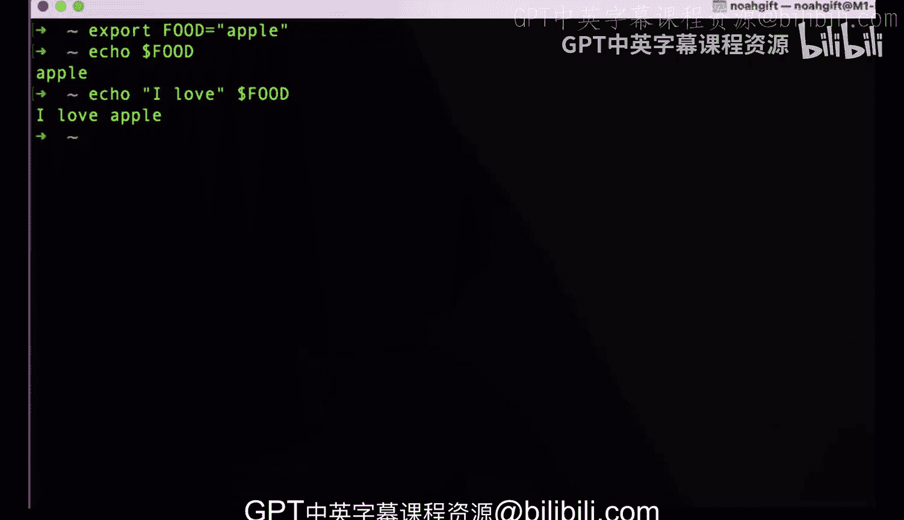

#  025：什么是Shell变量 🐚

在本节课中，我们将要学习Shell变量的概念、作用以及基本使用方法。Shell变量是存储数据的一种方式，这些数据可以在脚本或其他进程中使用，尤其在处理API密钥和敏感信息时非常有用。

---

上一节我们介绍了Shell的基本概念，本节中我们来看看Shell变量的具体定义和用途。

Shell变量本质上是一种存储数据的方式，以便在其他脚本或进程中使用。当您使用API构建项目时，它们会频繁出现。关键原因在于，您希望将这些特殊的密钥存储在某个地方，以免它们被意外提交到代码仓库中。

以下是常见的做法：
*   您会使用一个 `.gitignore` 文件，它告诉源代码控制系统忽略某些特定文件。
*   在这个文件中，您可能会指定忽略一个名为 `.env` 的文件。
*   在这个 `.env` 文件中，您会存放云服务提供商、第三方服务的API密钥，或者数据库的认证凭证。
*   所有这些信息都存储在仅对您本地机器可见的文件中。

这样，当您与团队中的其他开发者协作时，只需告诉他们需要创建自己的 `.env` 文件，并将所需内容放入其中。然后，在处理特定项目时，您需要“获取”（source）这个 `.env` 文件。

您甚至可以更进一步，将其作为 `.bashrc` 文件的一部分，这样每次切换到特定目录时，它都会自动获取该项目的环境变量。仅通过使用Shell变量，就可以实现很多自动化操作。

---

了解了Shell变量的用途后，让我们来看看其背后的基本原理和语法。理论部分并不复杂。

首先，您需要在Bash中使用 `export` 命令创建一个变量。

这个 `export` 命令的好处在于，您可以清楚地看到 `food` 是变量名，而 `Apple` 是变量的值。

接下来，如果您想使用这个变量，只需在运行第一条命令后，在 `echo` 命令中引用 `$food` 即可。

因此，使用Shell变量构建内容的关键在于，必须通过在变量名前加美元符号 `$` 来访问它。这意味着Shell知道如何解释这是一个变量。

如果您想使用稍微复杂一点的语句（其实也并不复杂），可以将其放入一个句子中。如下例所示，您可以说 `echo "I love $food"`。这在调试时非常常见。我经常这样做，例如，当我有一个很长的路径、数据库凭证或某个服务的URL时，我会将其放入变量中，然后用 `echo` 打印出来，以确保我理解当前的情况。

---

现在，让我们通过实际操作来巩固对理论的理解。我们将演示刚才提到的例子。

首先，我输入 `export food=Apple` 来创建变量。

现在，我该如何访问这个值呢？输入 `echo $food`。这里有一个很棒的技巧：如果我只输入部分内容（比如 `echo $f`），然后按 `Tab` 键，它会自动补全剩余部分。这是一个非常推荐的专业技巧，使用 `Tab` 键来探索，它就像在谷歌中进行自动搜索一样，可以让您在输入更少的情况下发现正确的值。这不仅节省时间，还能让您在构建内容时更高效，避免出错。

看，我得到了那个值。接下来，让我们把它放到一个句子里。我可以输入 `echo "I love $food"`。

这本质上就是在Bash提示符下编写变量的“Hello World”。在Z shell中操作是完全相同的，开始编写Shell变量非常容易。

---

本节课中我们一起学习了Shell变量的核心概念。我们了解到，Shell变量是存储数据（尤其是敏感信息如API密钥）的重要工具，通过 `export` 命令定义，并通过 `$变量名` 的方式引用。我们还实践了变量的创建、访问以及在字符串中的使用，并掌握了使用 `Tab` 键自动补全以提高效率的技巧。理解Shell变量是自动化脚本和安全管理项目配置的基础。