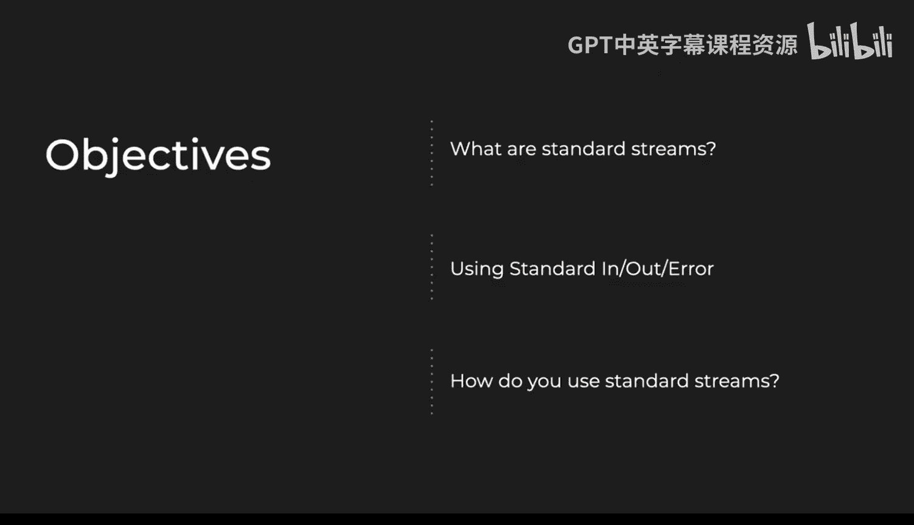

#  028：标准流入门 🚀

在本节课中，我们将学习标准流的概念，包括标准输入、标准输出和标准错误。我们将探讨它们各自的作用，以及如何从Bash脚本的角度来理解和使用它们，以提升编程效率。

---


## 什么是标准流？ 💡


标准流是操作系统为程序提供的预定义通信通道。每个程序启动时都会自动打开三个流：**标准输入**、**标准输出**和**标准错误**。它们分别服务于不同的目的，是程序与外部环境交互的基础。

上一节我们介绍了课程概述，本节中我们来看看标准流的具体定义。

*   **标准输入**：程序读取数据的来源，通常来自键盘。
*   **标准输出**：程序正常输出结果的去向，通常显示在终端。
*   **标准错误**：程序输出错误信息的去向，通常也显示在终端。

在Bash中，它们分别对应文件描述符 `0`、`1` 和 `2`。

---

## 使用标准输入、输出和错误 🔧

理解了基本概念后，本节我们将深入探讨如何具体使用这三个标准流。

### 标准输入

标准输入是程序获取数据的主要方式。数据可以来自用户的键盘输入，也可以来自其他程序或文件。

以下是使用标准输入的常见方式：

*   **键盘输入**：程序运行后，等待用户在终端键入内容。
*   **重定向**：使用 `<` 符号将一个文件的内容作为程序的输入。
    ```bash
    # 将 file.txt 的内容作为 cat 命令的输入
    cat < file.txt
    ```
*   **管道**：使用 `|` 符号将一个命令的输出作为另一个命令的输入。
    ```bash
    # 将 ls 命令的输出作为 grep 命令的输入
    ls -l | grep ".txt"
    ```

### 标准输出

标准输出用于打印程序的常规运行结果。

以下是处理标准输出的方法：

*   **终端显示**：默认情况下，标准输出会显示在终端屏幕上。
*   **重定向**：使用 `>` 或 `>>` 符号将输出保存到文件。
    ```bash
    # 将输出覆盖写入 file.txt
    echo "Hello" > file.txt
    # 将输出追加到 file.txt 末尾
    echo "World" >> file.txt
    ```
*   **管道**：如前所述，可以通过管道将输出传递给下一个命令。

### 标准错误

标准错误专门用于输出错误和诊断信息，这有助于将正常输出与错误信息分开处理。

以下是处理标准错误的方法：

*   **终端显示**：默认情况下，错误信息也会显示在终端上，与标准输出混合。
*   **重定向**：可以单独重定向错误流。`2>` 表示重定向文件描述符2（即标准错误）。
    ```bash
    # 将错误信息写入 error.log 文件
    command_that_might_fail 2> error.log
    ```
*   **合并重定向**：使用 `2>&1` 将标准错误合并到标准输出。
    ```bash
    # 将标准输出和标准错误都写入 output.log
    command > output.log 2>&1
    ```

---

## 如何运用标准流？ 🎯

我们已经分别了解了三个标准流。在实际的Bash编程中，灵活运用它们是关键。

核心在于理解数据流向。你可以通过重定向和管道，精确控制信息的来源和去向。例如，你可以让一个脚本从文件读取输入，将正常结果写入一个日志文件，同时将错误信息发送到另一个错误日志文件，甚至通过邮件通知管理员。

这种分离控制使得脚本更健壮，也便于调试和自动化。

---



## 总结 📝

本节课中我们一起学习了标准流的核心概念。我们明确了标准输入、标准输出和标准错误各自的作用，并掌握了通过重定向和管道来操作它们的基本方法。熟练运用这些概念是成为一名高效Bash程序员的基础，它能帮助你更好地构建、调试和集成数据处理的脚本与流程。