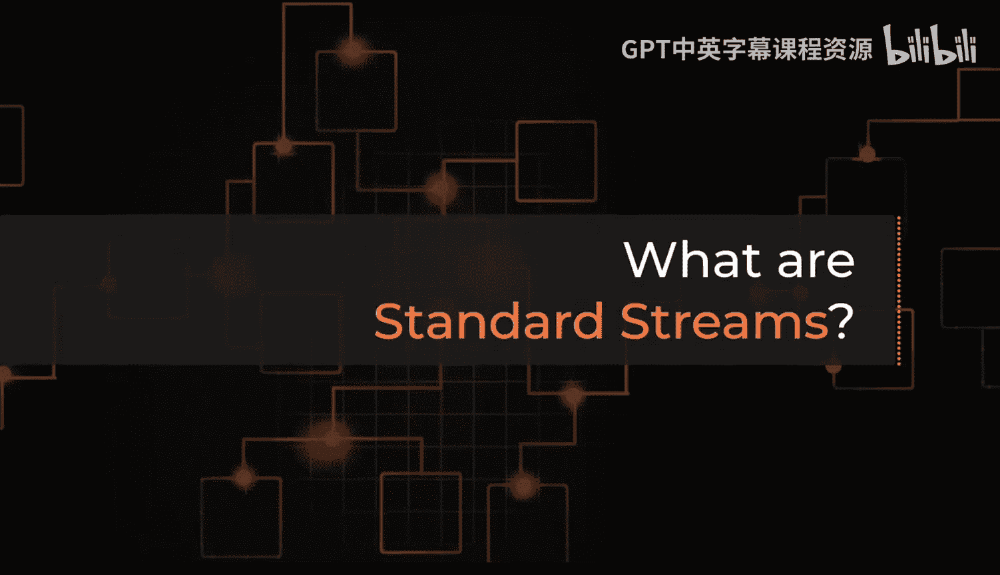
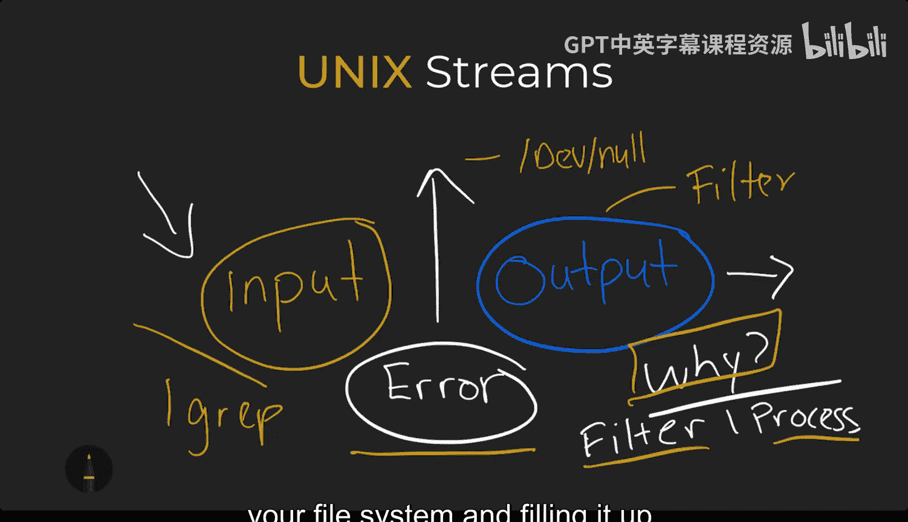

#  029：什么是标准流

在本节课中，我们将要学习Unix系统中的标准流概念。标准流是程序与外部环境（如终端、文件或其他程序）进行输入输出通信的核心机制。理解标准流对于高效地使用命令行处理数据至关重要。

## 什么是标准流？💡

标准流是一种捕获数据输入并对其进行过滤的方式。这在数据科学中非常常见。例如，你会通过SQL查询来过滤数据，或者使用Pandas库遍历并选取数据的某个子集，以便在后续流程中进行处理。同样地，当你有输出数据时，你会将这些数据通过管道传输到其他位置。因此，你可以将标准流想象成水管中的水流。如果你把水引入房屋，你会处理这些水，例如通过污水系统、洗碗机以及房屋内的各种电器。Unix系统中的数据处理、过滤和流传输概念与此非常相似，存在多种方法。

## 标准流图解与分析 🔍

上一节我们介绍了标准流的基本概念，本节中我们来看看一个具体的Unix标准流示意图。通过分析这个图表，我们可以更直观地理解数据是如何流动的。

请看这个Unix标准流图表。在输入侧，这是你将数据传递给Unix实用程序的地方。这方面有很多例子。例如，如果你想通过管道将数据传递给`grep`命令，你可以搜索某个关键词以在日志文件中查找模式。同样，很多时候你会将数据通过管道输出到一个文件，而在输出之前，你可能会进行一些处理，比如截断数据、打乱顺序或进行某种过滤操作。这是非常常见的做法。

因此，当你思考在使用标准流时“我在做什么”以及“为什么这么做”时，答案通常是：你将要过滤数据和处
理数据。这些是最常见的操作。如果你在处理数据，命令行是更强大、更高效的方式之一。

图表中还有“错误”流。很多时候，你要么捕获错误并将其放入一个文件，要么将错误转移到可以丢弃的位置。在某些情况下，你不希望这些错误消息污染你的文件系统并使其被填满，你会将其通过管道传输到类似`/dev/null`这样的位置。

## 总结 📝

本节课中我们一起学习了Unix标准流。我们了解到，标准流是程序进行输入、输出和错误信息通信的三种预定义数据流。它们使得数据过滤、处理和重定向变得非常高效，是命令行数据操作的核心。通过将程序像水管一样连接起来，我们可以构建强大的数据处理流水线。