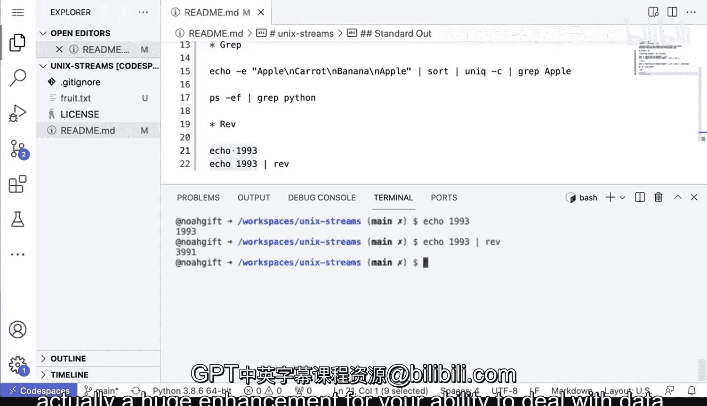

#  030：标准输出使用 📤


在本节课中，我们将学习如何在命令行中使用标准输出。标准输出是程序将其结果信息打印到终端屏幕的默认方式。通过管道和重定向，我们可以将这些输出保存到文件，或者传递给其他命令进行进一步处理，这是数据工程中处理文本和数据流的基础技能。

## 标准输出的基础：`echo` 命令

上一节我们介绍了标准输出的概念，本节中我们来看看最基础的命令：`echo`。`echo` 命令的作用是将其接收的参数原样打印到标准输出。

例如，以下命令会输出三行文本：
```bash
echo -e "apple\ncarrot\nbanana"
```
这里的 `-e` 选项允许解释反斜杠转义字符，`\n` 代表换行。执行后，终端会显示：
```
apple
carrot
banana
```

## 重定向输出到文件

`echo` 命令的输出不仅可以显示在屏幕上，还可以通过重定向操作符保存到文件中。

以下是两种主要的输出重定向方式：
*   **`>`**：将命令的标准输出重定向到一个文件。如果文件已存在，则会**覆盖**原有内容。
*   **`>>`**：将命令的标准输出**追加**到一个文件的末尾。如果文件不存在，则会创建它。

例如，将水果列表保存到 `fruit.txt` 文件：
```bash
echo -e "apple\ncarrot\nbanana" > fruit.txt
```
要查看文件内容，可以使用 `cat` 命令：
```bash
cat fruit.txt
```

## 使用管道连接命令

标准输出最强大的功能之一是**管道**，它允许我们将一个命令的输出直接作为另一个命令的输入。管道操作符是 `|`。

例如，我们可以将 `echo` 的输出通过管道传递给 `sort` 命令进行排序：
```bash
echo -e "apple\ncarrot\nbanana" | sort
```
执行后，输出会按字母顺序排列：
```
apple
banana
carrot
```
我们还可以将排序后的结果再次重定向回文件，覆盖原内容：
```bash
echo -e "apple\ncarrot\nbanana" | sort > fruit.txt
```

## 组合使用管道与过滤器

通过管道，我们可以将多个命令串联起来，形成强大的数据处理流水线。

以下是几个有用的文本处理命令，常与管道配合使用：
*   **`sort`**：对输入的行进行排序。
*   **`uniq -c`**：报告或忽略重复的行。`-c` 选项会在每行前加上该行重复出现的次数。
*   **`grep`**：用于搜索文本，输出包含指定模式的行。

让我们看一个组合示例。首先，创建一个包含重复项的列表：
```bash
echo -e "apple\ncarrot\nbanana\napple" > fruits_with_dup.txt
```
然后，使用管道链进行排序、去重并计数：
```bash
cat fruits_with_dup.txt | sort | uniq -c
```
输出结果会显示每个唯一水果及其出现次数：
```
      2 apple
      1 banana
      1 carrot
```
如果只想查看“apple”的统计，可以在管道链末尾加入 `grep`：
```bash
cat fruits_with_dup.txt | sort | uniq -c | grep apple
```

## 实际应用示例

管道和过滤在系统管理中非常实用。例如，`ps ef` 命令会列出系统所有进程，但输出通常很长。

如果我们只想查看与Python相关的进程，可以使用 `grep` 进行过滤：
```bash
ps ef | grep python
```
这样，终端就只显示包含“python”关键词的进程行，便于我们快速定位。

另一个有趣的例子是反转文本。`rev` 命令可以反转每一行的字符顺序：
```bash
echo "1993" | rev
```
输出结果为：
```
3991
```



本节课中我们一起学习了标准输出的核心操作。我们掌握了使用 `echo` 生成输出，使用 `>` 和 `>>` 重定向到文件，以及使用 `|` 管道连接多个命令（如 `sort`， `uniq`， `grep`）来构建数据处理流程。熟练运用这些技巧，能极大地提升你在命令行中处理和转换数据文本的效率。