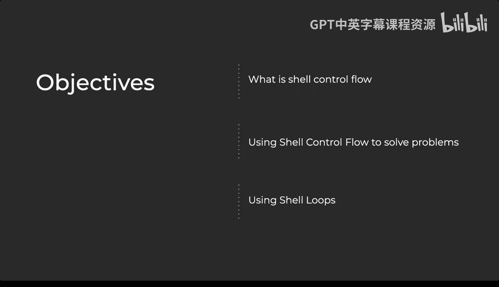

#  034：Shell逻辑与控制流简介 🐚

在本节课中，我们将学习如何在Shell脚本中使用逻辑判断和控制流结构。这些工具能让我们编写出能够自动决策、重复执行任务的脚本，从而高效地解决实际问题。

上一节我们介绍了Shell脚本的基础知识，本节中我们来看看如何让脚本变得更“智能”。

## 什么是Shell控制流？


Shell控制流指的是在脚本中控制命令执行顺序的结构。它主要包括**条件判断**和**循环**。通过它们，脚本可以根据不同的情况执行不同的命令，或者重复执行某些命令直到满足特定条件。


## 控制流操作

以下是Shell脚本中常用的控制流操作，它们构成了脚本逻辑的基石。

### 条件判断：`if` 语句

`if`语句允许脚本根据条件测试的结果来决定执行哪部分代码。其基本语法结构如下：

```bash
if [ condition ]
then
    # 条件为真时执行的命令
else
    # 条件为假时执行的命令
fi
```

条件测试使用方括号 `[ ]`，内部可以比较数字、字符串或检查文件状态。例如，`[ $a -eq $b ]` 检查两个变量是否相等。

### 循环结构

循环用于重复执行一系列命令。Shell中主要有两种循环：`for`循环和`while`循环。

**`for` 循环**
`for`循环会遍历一个列表中的每个项目，并对每个项目执行相同的命令块。

```bash
for variable in list
do
    # 使用 $variable 执行命令
done
```

**`while` 循环**
`while`循环会一直执行，只要给定的条件保持为真。

```bash
while [ condition ]
do
    # 要重复执行的命令
done
```

## 在脚本中实现控制流

理解了基本结构后，关键在于将它们组合到脚本中。一个典型的脚本可能以`#!/bin/bash`开头，然后定义变量，接着使用`if`语句做检查，最后用循环来处理多个项目。

记住，脚本中的命令是从上到下顺序执行的，但控制流结构可以改变这个顺序。

## 使用Shell控制流解决问题

学习语法的最终目的是应用。Shell控制流的核心价值在于解决重复性或条件性的任务。

例如，你可以编写一个脚本：
1.  检查某个目录是否存在（使用`if`和`-d`测试）。
2.  如果不存在则创建它。
3.  使用`for`循环遍历当前目录下的所有`.txt`文件。
4.  对每个文件进行备份（例如，复制并重命名）。

这只是一个简单例子，结合管道、命令替换和变量，你可以构建出非常强大的自动化工具。

## 使用Shell循环

让我们更具体地看看循环的威力。`for`循环特别适合处理已知集合，比如文件列表或数字序列。

以下是一个遍历数字序列的示例：

```bash
for i in {1..5}
do
    echo "迭代次数: $i"
done
```



`while`循环则更适用于条件未知、需要持续监控的场景，比如读取文件直到末尾，或等待某个进程完成。

---

本节课中我们一起学习了Shell逻辑与控制流。我们介绍了`if`条件判断和`for`、`while`循环的基本语法，探讨了如何将它们融入脚本以实现自动化决策和重复任务。掌握这些控制流结构是编写高效、智能Shell脚本的关键一步。