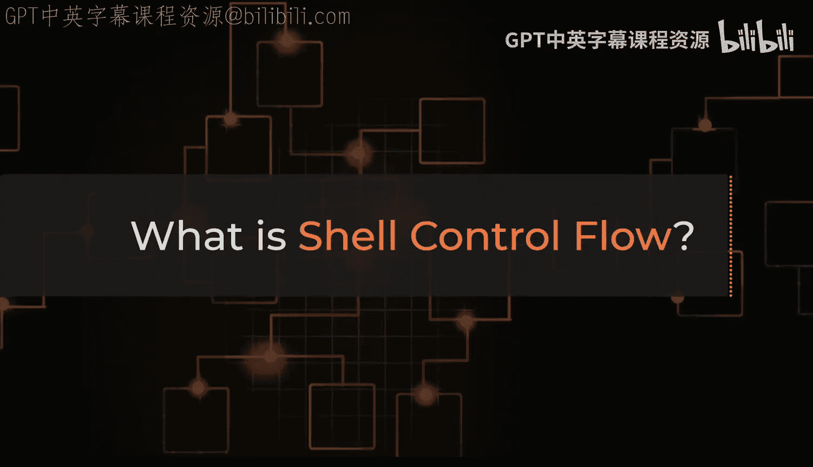
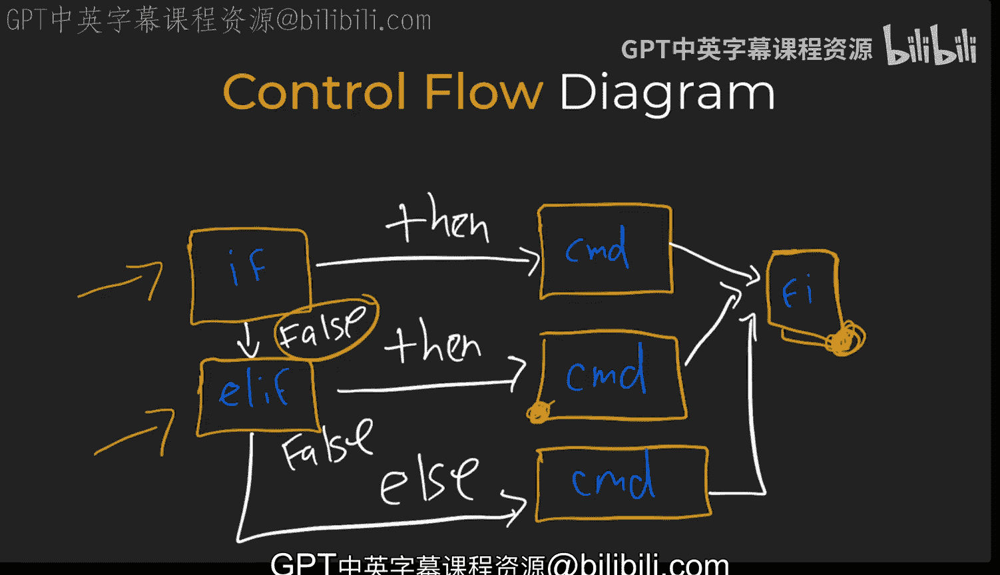

#  035：什么是Shell控制流 🧭




在本节课中，我们将要学习Shell脚本中的控制流。控制流本质上是一种逻辑形式，它允许脚本根据不同的条件执行不同的命令，从而实现自动化决策。

## 概述

在现实世界中，我们时刻都在运用逻辑。一个很好的例子是去杂货店购物。你可能想要某种特定的牛奶，比如有机牛奶。如果这种牛奶缺货，你的脑海中就会形成一个条件判断：如果这种牛奶没有，那么我就选另一种牛奶。如果第二种选择也没有，你或许还能接受第三种选项。Shell脚本中的控制流与此非常相似。你使用工具并编写这些条件语句来处理各种情况，从而完全自动化一个流程或工作流。

## 控制流详解

让我们更详细地了解一下。以下是一个控制流示意图，它展示了一个典型的`if-elif-else`结构。


图中展示了一个控制流程图。你可以看到有一个`if`语句和一个`elif`语句。在任何一种情况下，都会根据匹配到的条件运行相应的命令。

请注意，在第一个`if`语句中，如果你找不到某个文件（例如），那么就会注册一个`false`结果，程序将跳转到下一个代码块，即`elif`。

你可能会尝试寻找第二个文件。如果找到了那个文件，你就会运行一个命令，比如进行归档操作。最后，你会看到这里的`false`语句实际上是触发第二个循环的条件。

最终，当所有操作完成后，脚本会执行`fi`，这标志着脚本的结束。

因此，具体执行哪个命令，完全取决于你处于代码的哪个分支。在第一个`if`语句中，如果你能找到一个MP4文件并归档它，那么流程就直接通过。如果那个MP4文件不存在，那么就会进入第二个场景，即`false`语句。

所以，这本质上是一种基于条件匹配的流程。脚本会遍历并确定根据代码块的命中情况，接下来应该执行哪部分，然后继续传递到其他条件。

现在请注意，如果它不满足前两个条件（即`if`或`elif`），结果将再次为`false`，然后你会运行其他命令。这可能是类似这样的操作：如果这两个文件都不存在，也许向标准输出发送一条打印语句，让用户知道“我无法操作，我需要这些输入”。

因此，控制流与现实世界中的逻辑决策非常相似，它只是一系列允许你逻辑性地得出结论的步骤。



## 核心概念与结构

在Shell脚本中，控制流的基本结构通常如下所示：

```bash
if [ condition1 ]; then
    # 如果条件1为真，执行这里的命令
elif [ condition2 ]; then
    # 如果条件2为真，执行这里的命令
else
    # 如果以上条件都不为真，执行这里的命令
fi
```

以下是控制流中几个关键组成部分的说明：

*   **`if`**：用于检查第一个条件。
*   **`elif`**：是“else if”的缩写，用于检查额外的条件（可以有多个）。
*   **`else`**：当前面所有条件都不满足时，执行此分支。
*   **`fi`**：标志着整个`if`语句块的结束。
*   **条件判断**：通常使用方括号 `[ ]` 或 `[[ ]]` 来包裹测试表达式。

## 总结


本节课中，我们一起学习了Shell脚本中的控制流。我们了解到，控制流是一种逻辑结构，它通过`if`、`elif`和`else`等语句，让脚本能够根据不同的条件自动做出决策并执行相应的命令。这就像为脚本赋予了“思考”能力，使其能够处理各种可能的情况，从而构建出强大且灵活的自动化工作流。掌握控制流是编写有效Shell脚本的关键一步。