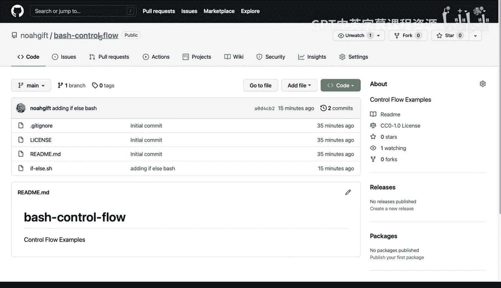

#  036：使用Shell控制流解决Bash问题 🐚


在本节课中，我们将学习如何在Bash脚本中使用`if-else`条件语句。这是一种根据不同的输入或条件执行不同操作的核心编程概念。我们将通过一个简单的食物选择示例，来演示其工作原理。

上一节我们介绍了Bash脚本的基础知识，本节中我们来看看如何使用控制流来让脚本做出决策。

## 代码解析与执行

首先，让我们逐步分析示例代码，然后运行它来观察效果。

脚本以一个`echo`命令开始，它会向用户打印问题：“what food do you choose”。接着，`read`命令会等待并读取用户的输入，并将其存储在一个名为`food`的变量中。

现在，条件判断部分开始了。方括号 `[ ]` 用于进行字符串匹配。其逻辑是：如果`food`变量的值等于字符串“apple”，则执行对应的条件语句。

以下是脚本中完整的条件判断结构：

```bash
if [ "$food" = "apple" ]; then
    echo "Eat yogurt with your apple."
elif [ "$food" = "milk" ]; then
    echo "Eat cereal with your milk."
else
    echo "Eat your $food by itself."
fi
```

*   **`if`**：开始一个条件判断块。
*   **`[ "$food" = "apple" ]`**：这是测试条件。它检查变量`$food`的值是否等于“apple”。注意，在Bash中，字符串比较使用单个等号`=`，并且变量和等号两边都需要有空格。
*   **`then`**：如果上述条件为真，则执行后面的语句。
*   **`elif`**：代表“else if”。如果第一个条件不满足，则检查这个条件（`$food`是否等于“milk”）。
*   **`else`**：如果以上所有条件都不满足，则执行这部分语句。
*   **`fi`**：非常重要，它用于关闭整个`if`条件语句块。

此外，脚本开头有 `#!/bin/bash`（shebang）行，它指定了用哪个解释器来执行脚本。我们还需要使用 `chmod +x` 命令赋予脚本可执行权限。

## 运行示例

现在，让我们运行这个脚本，看看不同输入下的结果。

首先，输入 **apple**。脚本必须精确匹配“apple”这个单词。
```
Eat yogurt with your apple.
```
这部分运行成功。

接下来，输入 **milk**。
```
Eat cereal with your milk.
```
运行良好。

最后，我们输入一个既不是“apple”也不是“milk”的食物，例如 **steak**。
```
Eat your steak by itself.
```
脚本正确地执行了`else`分支。

## 总结与练习

本节课中我们一起学习了Bash中`if-else`条件语句的基本用法。可以看到，Bash的条件判断结构相当直观。

这是一个供你练习的绝佳例子。本示例代码已托管在GitHub上，仓库名为 **“bash-control-flow”**。你可以访问该仓库链接，获取代码并在自己的环境中进行修改和实验，以加深理解。



通过这个简单的食物选择器，你已经掌握了使用Shell控制流来构建能够响应不同输入的Bash脚本的基础。