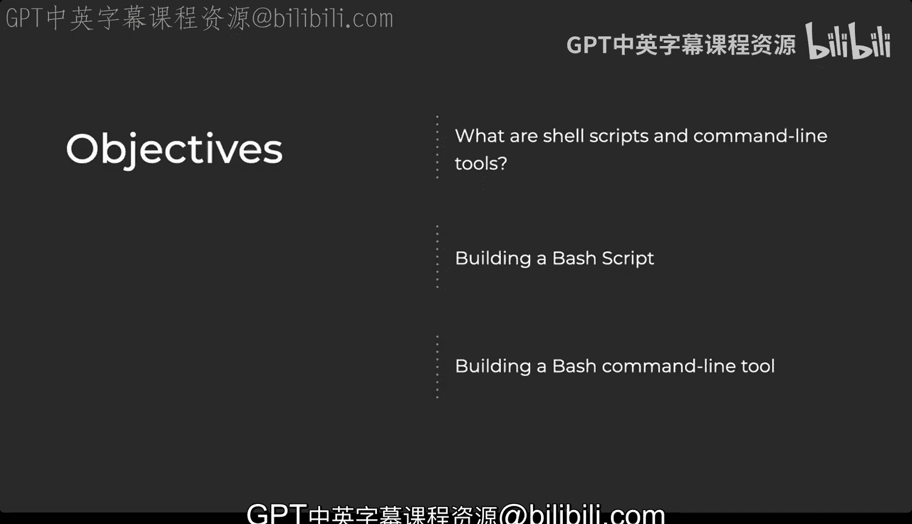

#  044：Bash脚本与命令行工具编写入门 🐚

在本节课中，我们将学习Bash脚本和命令行工具的基础知识，并深入探讨如何构建它们。我们将了解脚本和命令行工具的定义，学习如何构建一个Bash脚本，并最终创建一个实用的Bash命令行工具来解决实际问题。

---

## 什么是脚本与命令行工具？


上一节我们介绍了Bash的基本操作。本节中，我们来看看脚本和命令行工具的具体定义。

*   **脚本**：脚本是一个包含一系列命令的文本文件。当执行脚本时，系统会按顺序运行文件中的命令。脚本通常用于自动化重复性任务。
*   **命令行工具**：命令行工具是可以在终端中直接调用的程序或脚本。它们通常接受输入（参数），执行特定功能，并产生输出。一个编写良好的脚本可以被配置为方便的命令行工具。


---

## 如何构建一个Bash脚本

理解了基本概念后，我们现在开始学习如何构建一个Bash脚本。

构建Bash脚本有几个关键步骤，以下是详细说明：

1.  **创建脚本文件**：使用文本编辑器创建一个新文件，通常以 `.sh` 作为扩展名，例如 `myscript.sh`。
2.  **指定解释器（Shebang）**：在脚本文件的第一行，需要指定用于执行脚本的解释器。对于Bash脚本，使用：
    ```bash
    #!/bin/bash
    ```
    这行代码告诉系统使用 `/bin/bash` 来运行此脚本。
3.  **编写命令**：在Shebang行之后，可以按顺序写入需要执行的Bash命令。
4.  **赋予执行权限**：创建文件后，它默认没有执行权限。需要使用 `chmod` 命令添加权限：
    ```bash
    chmod +x myscript.sh
    ```
5.  **运行脚本**：现在可以通过以下方式运行脚本：
    ```bash
    ./myscript.sh
    ```

---

## 构建一个Bash命令行工具

我们已经学会了创建基础脚本。本节中，我们来看看如何将脚本升级为一个更实用、更像标准命令行的工具。

一个有用的命令行工具通常能处理用户输入。在Bash脚本中，可以使用特殊变量来获取传递给脚本的参数。

*   **`$1`， `$2`， ...**： 代表第一个、第二个参数。
*   **`$0`**： 代表脚本本身的名称。
*   **`$#`**： 代表传递给脚本的参数个数。
*   **`$@`**： 代表所有参数的一个列表。

例如，我们可以创建一个名为 `greet.sh` 的工具，它接受一个名字作为参数并打招呼。

```bash
#!/bin/bash
# 这是一个简单的命令行工具示例
echo "Hello, $1! Welcome to the command line."
```

保存并赋予权限后，可以这样使用：
```bash
./greet.sh Alice
```
输出结果为：
```
Hello, Alice! Welcome to the command line.
```

通过使用条件判断（如 `if` 语句）、循环和参数检查，可以让脚本变得更健壮和实用，从而解决更复杂的问题。



---

本节课中我们一起学习了Bash脚本与命令行工具的基础。我们明确了脚本与命令行工具的定义，逐步实践了从创建脚本文件、添加Shebang、编写命令到赋予权限和运行的完整流程。最后，我们通过使用特殊变量处理参数，将一个简单的脚本转化为一个可交互的命令行工具。掌握这些技能是自动化任务和构建高效数据工程流水线的重要一步。