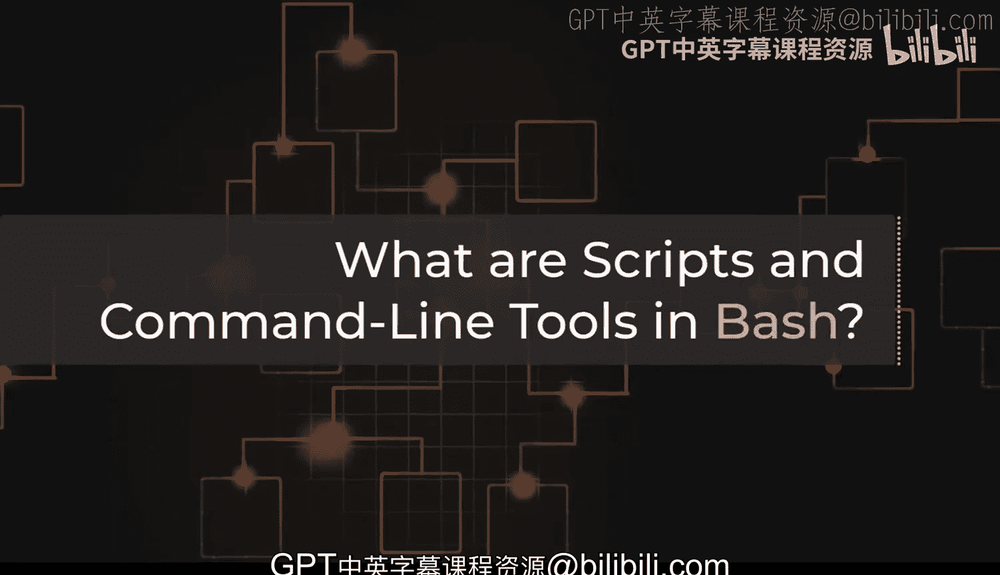
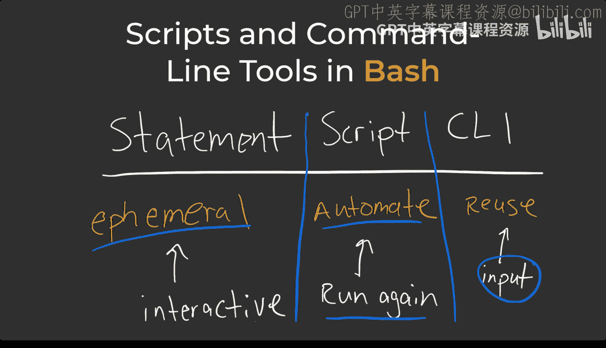

#  045：脚本与命令行工具解析 🐚




在本节课中，我们将学习Bash编程中的三种核心操作模式：语句、脚本和命令行工具。我们将探讨它们各自解决的问题、适用场景以及如何在实际工作中选择和使用它们。

---

## 什么是语句？

上一节我们介绍了课程概述，本节中我们来看看第一种操作模式：语句。

语句是你在Bash命令行中交互式执行的单条命令。它通常是临时性的，用于快速尝试或探索某些操作，执行后通常不会保存或复用。

一个典型的例子是使用 `grep` 命令搜索文件中的内容：
```bash
grep "error" logfile.txt
```
执行这条语句后，你看到了结果，任务就完成了。你可能会通过命令历史来重新运行它，但语句本身并非为长期复用而设计。它的核心价值在于**交互式探索**。

---

## 什么是脚本？

理解了临时性的语句后，我们来看看更持久的解决方案：脚本。

脚本是将一系列命令或函数组织在一个文件中的程序。它用于创建可重复执行的自动化工作流，比单条语句更正式和结构化。

以下是创建一个简单备份脚本的步骤：

1.  **创建脚本文件**：使用文本编辑器创建一个新文件，例如 `backup.sh`。
2.  **添加Shebang行**：在文件第一行指定解释器，例如 `#!/bin/bash`。
3.  **编写命令**：在文件中添加要执行的命令序列。
4.  **赋予执行权限**：使用 `chmod +x backup.sh` 命令使脚本可执行。
5.  **运行脚本**：通过 `./backup.sh` 执行脚本。

脚本的优势在于可以保存、版本控制，并定期运行（例如通过cron作业），非常适合自动化重复性任务。

---

## 什么是命令行工具？

在掌握了脚本的基础上，我们来看看功能更强大、更灵活的形式：命令行工具。

命令行工具是一种特殊的脚本或程序，它接受用户输入（如参数和标志）来定制其行为。几乎所有的Unix工具（如 `ls`, `cat`, `grep`）都是命令行工具。

命令行工具的关键特性是**可配置性**。例如：
```bash
ls -l /home  # `-l` 是一个标志（flag），用于改变`ls`命令的输出格式
grep -i "warning" system.log  # `-i` 标志使搜索不区分大小写
```

以下是命令行工具的核心组成部分：

*   **参数**：命令作用的对象，如文件名。
*   **标志（Flags/Options）**：以 `-` 或 `--` 开头的选项，用于修改命令行为，例如 `-h`（帮助）、`-l`（长格式列表）。
*   **输入/输出**：可以从标准输入读取数据，或将结果输出到标准输出或文件。

命令行工具结合了语句的交互性和脚本的自动化能力，通过参数化实现了高度的灵活性，是自动化的终极形式。在构建可复用的工具时，应优先考虑为其设计清晰的命令行接口。

---

## 总结

本节课中我们一起学习了Bash中三种重要的操作模式。

*   **语句**是用于即时探索的临时性交互命令。
*   **脚本**是保存在文件中的命令集合，用于实现可重复的自动化任务。
*   **命令行工具**是带参数和标志的脚本或程序，提供了最高级别的灵活性和可配置性，是构建强大自动化工作流的基石。



理解这三者的区别和联系，能帮助你在不同场景下选择最合适的工具，从而更高效地使用命令行完成数据工程任务。