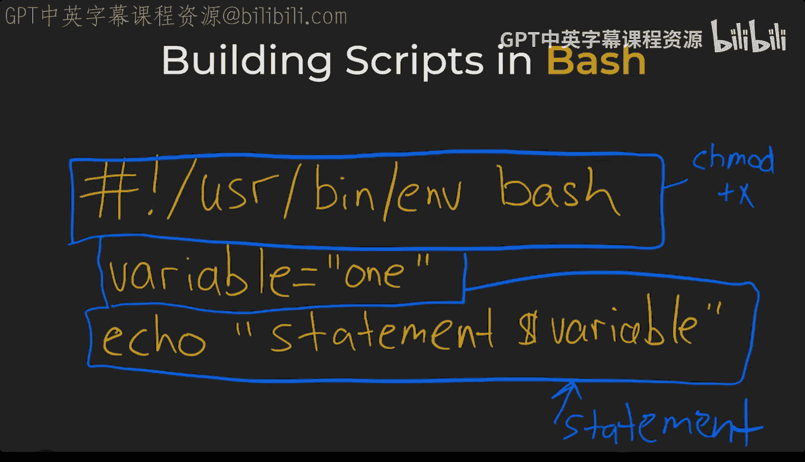
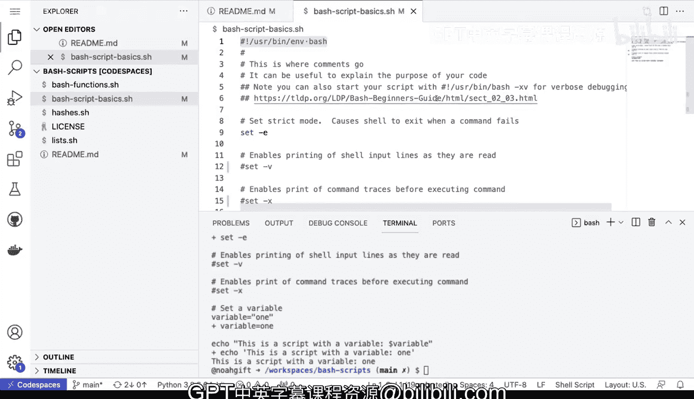

#  046：构建Bash脚本 🐚

在本节课中，我们将要学习如何构建一个基础的Bash脚本。我们将了解脚本的核心组成部分，包括Shebang行、变量、语句以及一些用于调试和增强脚本健壮性的设置。

---

## 脚本的核心组件

让我们深入了解Bash脚本的一些关键组成部分。

首先，脚本的最开头是Shebang行。Shebang行的作用是告诉系统应该使用哪个解释器来执行这个脚本。例如，`#!/bin/bash` 表示我们希望使用Bash来运行它。它也可以是Python、Z shell或其他任何shell。这一点很重要，因为有了它，我们就不必在运行脚本前手动输入 `bash` 命令。

另一个需要注意的点是，你需要使用 `chmod +x` 命令使脚本文件可执行。这样，任何人都可以执行这个脚本，你也能在自动化流程中重复使用它。

接下来要指出的是变量。如果你想创建一个变量，只需要通过等号语句进行赋值即可。例如，`variable="1"` 将一个字符串赋值给变量。之后，你可以在代码的其他部分使用这个变量。

最后是语句。在这一部分，你可以将语句串联起来。例如，我打印出“word”这个词加上我之前设置的变量。实际上，要构建你的第一个Bash脚本，只需要了解这几样东西。一旦你掌握了它，它就是一种自动化形式，你可以将一系列步骤或一个待办事项列表放入脚本中，然后让它们按顺序运行。

---

## 一个基础的Bash脚本示例

现在，我们来看一个基础的Bash脚本示例。脚本的核心组件包括Shebang行、调试模式、语句和变量。如果我们想最简略地理解如何编写Bash脚本，我建议关注以下三点。

以下是这个基础Bash脚本的内容。首先，请注意这里的Shebang行。其次，一个很好的做法是在脚本开头添加注释。在这里，你可以说明你的代码具体是做什么的，这样即使十年后其他人看到你的脚本，也能明白发生了什么。

接下来重要的是，通常建议设置严格模式。你可以通过 `set -e` 来实现。这会使shell在命令执行失败时立即退出。这非常有用，因为它能让你的代码对潜在错误更具鲁棒性。

你还可以启用打印shell输入行的功能，这对于调试很有帮助。另一个可以做的操作是启用在执行命令前打印命令追踪信息的功能。这很好，因为它会告诉你它将要做什么，然后再去执行。

最后，核心组件是变量和语句。在这里，我创建了一个变量，然后在语句中使用了它。让我们运行一下这个脚本。如果我输入 `bash script_basic`，它会执行并显示调试信息。现在，我可以注释掉这些调试设置，再次运行。你会发现输出变得简洁了，只显示“这是一个带有变量1的脚本”。通常，你可以来回切换这些设置，决定你希望在代码中看到多少详细信息。

Bash还有一个巧妙的小功能，你可以在执行时设置详细的调试模式。如果我将Shebang行改为 `#!/bin/bash -xv`，让我们看看会发生什么。运行后，它会向标准输出打印大量信息。实际上，它在这里展示了我代码执行的所有细节，包括运行的环境、执行前和执行过程中发生的情况，甚至在执行前打印出整个脚本本身。如果你在代码调试中遇到困难，想进行详细调试，这是一个值得了解的好选项。

---

## 总结

本节课中，我们一起学习了构建Bash脚本的基础知识。我们了解了脚本的三大核心组件：Shebang行、变量和语句。我们还探讨了如何通过 `chmod` 命令使脚本可执行，以及如何使用 `set -e` 等选项来设置严格模式和调试信息，从而使脚本更健壮、更易于调试。掌握这些基础后，你就可以开始创建自己的自动化脚本了。