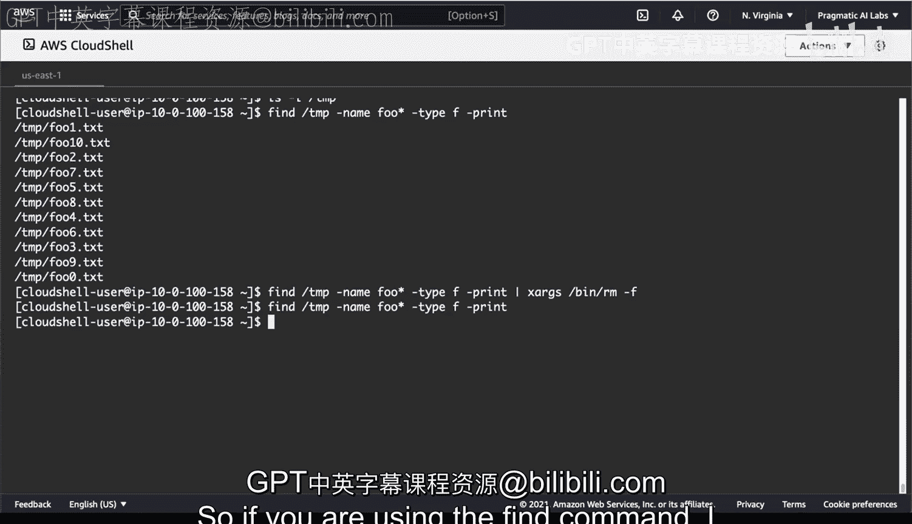

#  056：使用xargs扩展Linux搜索能力


在本节课中，我们将学习如何将`find`命令与`xargs`命令结合使用，以对搜索到的文件执行批量操作。我们将通过创建和删除一系列示例文件来演示这一强大功能。

上一节我们介绍了如何使用`find`命令在文件系统中定位文件。本节中我们来看看，找到文件后，如何高效地对它们执行操作。

## 创建示例文件

首先，我们需要一些用于演示的文件。我们将在`temp`目录下创建一系列文件。

以下是创建文件的命令：
```bash
for i in {0..10}; do touch temp/F$i; done
```
执行后，`temp`目录下会生成11个名为`F0`到`F10`的文件。

## 使用find命令定位文件

现在，假设这些文件分散在庞大的文件系统中，手动管理它们（如移动、清理）会非常麻烦。这正是`find`命令发挥作用的地方。

让我们使用`find`命令来定位这些文件：
```bash
find temp -name "F*" -type f
```
此命令会搜索`temp`目录下所有名称以“F”开头的文件（`-type f`确保只列出文件，而非目录），并将它们打印出来。

为了增加复杂性，我们可以在`temp`目录下再创建一个名为`Ffolder`的目录。此时再次运行上述`find`命令，你会发现该目录不会被列出，因为我们使用了`-type f`过滤器。

## 结合xargs执行批量操作

找到文件后，我们可能希望对它们执行操作，例如删除。这时就需要`xargs`命令。`xargs`可以从标准输入接收参数，并将其传递给指定的命令执行。

以下是删除所有找到的文件的命令：
```bash
find temp -name "F*" -type f | xargs /bin/rm -f
```
命令解析：
*   `find temp -name "F*" -type f`：查找所有目标文件。
*   `|`：管道符，将`find`命令的输出作为下一个命令的输入。
*   `xargs /bin/rm -f`：`xargs`接收文件列表，并为每个文件执行`/bin/rm -f`命令进行强制删除。

执行此命令后，再次运行`find`命令进行验证，你会发现所有`F*`文件都已被成功删除。`xargs`的强大之处在于，它不仅能用于删除，还可以与任何命令结合，例如查看元数据、打包归档等，从而基于搜索结果执行复杂的批处理任务。

## 总结



本节课中我们一起学习了如何利用`xargs`命令来扩展`find`命令的功能。核心流程是：首先使用`find`精确地定位文件，然后通过管道`|`将结果传递给`xargs`，最后由`xargs`驱动另一个命令（如`rm`、`cp`、`mv`等）对这批文件执行批量操作。这种方法极大地提升了在Linux文件系统中进行批量文件管理的效率和灵活性。