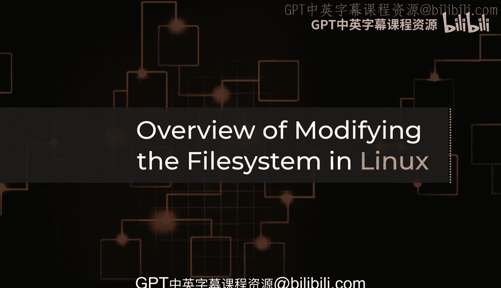
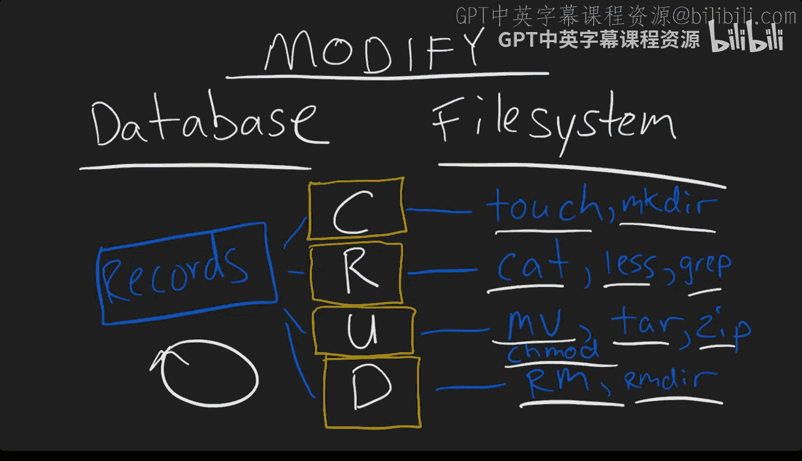

#  059：Linux文件系统操作概览 🗂️

在本节课中，我们将要学习数据工程中一个至关重要的基础技能：在Linux文件系统上进行数据操作。随着集中式文件系统在云平台和数据工程工作流中的回归，掌握如何高效地创建、读取、更新和删除文件与目录，变得尤为重要。

## 数据工程中的文件系统角色

我们正处在一个数据工程的新时代，集中式文件系统正在回归。许多云平台和数据工程工作流都涉及基于磁盘的层次化结构数据处理。这与我在电影行业的工作类似，我们会编写数据迁移脚本，查看数据树状结构并移动数据，因为我们能假定磁盘上存在某种约定。

虽然并非总能假定磁盘上存在某种结构，但可以确定的是，你总需要进行某种类型的数据操作，例如归档数据、将同类型文件集中处理，然后进行大数据处理。因此，特别是在集中式文件系统环境下，掌握操作文件系统上数据的能力，是数据工程师的一项重要技能。

接下来，我将介绍一些在磁盘上进行处理的重要技术。

## 从CRUD到文件系统操作

让我们看一个在软件工程中常见的缩写：CRUD。在开发Web或移动应用时，你常会听到这个缩写，它代表**C**reate（创建）、**R**ead（读取）、**U**pdate（更新）、**D**elete（删除）。当操作数据库系统时，你会创建、读取、更新和删除记录，这非常普遍。这里存在一个操作事物的反馈循环，你需要构建与数据库交互的服务。

在文件系统中，存在类似类型的操作，但它们有不同的名称和细微差别。

以下是文件系统中与CRUD对应的常见操作：

*   **创建 (Create)**：你可以使用 `touch` 命令创建一个空文件（如果文件已存在，则不会执行任何操作）。你可以使用 `mkdir` 命令创建目录。Linux文件系统的美妙之处在于，你可以创建多种不同的东西。
*   **读取 (Read)**：你可以运行 `cat` 命令将文件内容输出到标准输出。你也可以使用 `less` 命令来分页浏览文件内容。这些都是基于读取的操作。
*   **更新 (Update)**：你可以在文件系统上更新许多东西。例如，你可以使用 `mv` 命令将文件从一个位置移动到另一个位置，或重命名文件（移动和重命名实际上是同义词）。你可以使用 `tar` 或 `zip` 命令来压缩、归档文件，将其打包以便上传到邮件系统等。你还可以使用 `chmod` 命令更改文件的权限。
*   **删除 (Delete)**：类似地，你可以使用 `rm` 命令删除文件，或使用 `rmdir` 命令删除目录。

可以看到，数据库和文件系统在操作类型上非常相似，但使用的具体命令不同。

## 总结

本节课中，我们一起学习了Linux文件系统操作在数据工程中的重要性。我们了解了集中式文件系统的回归背景，并将熟悉的数据库**CRUD**概念（创建、读取、更新、删除）映射到了文件系统的具体命令上，例如 `touch`/`mkdir`、`cat`/`less`、`mv`/`tar`/`chmod` 以及 `rm`/`rmdir`。掌握这些基础操作是高效管理和处理数据文件的第一步。